# Keck/OSIRIS in PypeIt: final report on milestones M1-M5

## 1. Executive summary

We added the Keck I adaptive-optics lenslet integral-field spectrograph
OSIRIS to PypeIt, the community Python reduction pipeline, as the
spectrograph `keck_osiris`.  It covers the H2RG detector era (2016-01-01
onwards).  We kept the OSIRIS DRP's central step: the raw frame is
*rectified* with the Keck rectification matrices (recmats) by a numpy port
of `spatrectif_000.c`, or by an exact least-squares solver that is now the
default.  The rectified frame is turned into a *lenslet image* with one
spatial pixel per lenslet.  PypeIt's `Fiber` pypeline then reduces it with
one extracted spectrum per lenslet (spaxel).  The epoch-matched Keck
per-lenslet wavelength coefficients give the wavelengths, which are refined
per lenslet on the OH lines of every frame.  Sky subtraction is A-B followed
by the Davies (2007) OH-line scaling with a new guard.  A generic
`pypeit_fiber_cube` script builds the cubes and point-source spectra, and
PypeIt's IR sensitivity-function and telluric tools do the telluric
correction.

Headline validation numbers (details in sections 4-8):

| Test | Result |
|---|---|
| Rectification vs the DRP reference cube (Hn3/0.100", 3C 273, 2016; 3024 spaxels with S/N > 10) | median spaxel difference **0.74 %** (`drp` port) and **0.77 %** (`lstsq`); quasar spaxel within **0.1 %** (+0.04 % and +0.08 %) |
| DRP port with DRP-emulated input | reproduces the DRP cube to **2e-5** median, 6.6e-3 ADU/s worst voxel (peak 167 ADU/s) |
| Solver speed, full 2048 x 2048 frame | 2.0 s (`drp`, 40 iterations), 2.3 s (`lstsq`) on an Apple M5 Max laptop |
| 3C 273 position, collapsed spec1d vs DRP cube | centroid (30.140, 22.898) vs (30.146, 22.901) lenslets |
| OH-line tilt across a 64-lenslet block after the OH refinement | **0.023 px** (Hn3), **0.020 px** (Kbb); 0.073 / 0.106 px with the Keck coefficients alone |
| Davies OH scaling, 13 x 600-s NGC 3245 A-B frames | median integrated OH residual **0.053 -> 0.037**; no frame made worse |
| Telluric-corrected A0V star (HD101060, Kbb) | flat to **1.5 %** rms in 50-A bins |
| Very short standards (1.5 s, no sky lines) | wavelength offset vs the science frames **+0.54 px -> +0.001 px** |
| Dev suite (3 OSIRIS setups) | **7/7** reduce + afterburn tests and **21/21** OSIRIS vet tests pass; 908 PypeIt unit tests pass |

Status: `KeckOSIRISSpectrograph.supported = True`.  The user
documentation, the tutorial and the release notes are written; Sphinx builds
without warnings.  The two pull requests (PypeIt and dev suite) are drafted
in `pypeitdev/keck_osiris/pr_description.md` but have not been opened yet.
The main open items are in section 11: a tilt-model residual on 40 Kn3
lenslets with peculiar Keck coefficients, no cube co-addition, and no
second DRP comparison (we had no IDL).

## 2. Background and scope

### 2.1 OSIRIS data

OSIRIS (Larkin et al. 2006) puts up to ~3000 lenslet spectra on the
2048 x 2048 Teledyne H2RG detector, which has been in use since
2016-01-01.  The spectra lie only two detector rows apart, with a ~2 px
FWHM, and each is offset by ~29 px in dispersion from its vertical
neighbour.  The pattern repeats every 32 rows (Report 01).  Broadband
filters use 19 lenslet columns x 64 rows (1216 "slices").  Narrowband
filters pack three, and sometimes four, short spectra of different lenslets
head to tail in one slice, which gives up to 3072 spectra on the 66 x 51
lenslet grid.  The raw files hold `SCI` (ADU s^-1 coadd^-1), `VAR` and `DQ`
(9 = good).  Observers take no arcs or flats, only science frames, sky
frames (`ISSKY`), A0V standards and darks.

### 2.2 Why PypeIt keeps the DRP rectification

The spectra are too closely packed to trace slit by slit, so neighbouring
spectra cannot be separated without a PSF model.  The DRP solves this as a
linear inverse problem for each detector column, using the recmat (the
measured footprint of every slice on the detector).  We adopted that model
unchanged (design decision 1).  PypeIt's usual edge tracing, tilt tracing
and arc fitting are replaced by fixed calibrations built from the Keck
products.

### 2.3 What is new in PypeIt

PypeIt's `Fiber` pypeline was originally written for the MMT Binospec IFU,
where each fiber is one object.  OSIRIS reuses it with the lenslet as the
fiber, which needed new generic hooks: a `rectify` image-processing step,
fixed tilts and wavelengths, per-fiber wavelength solutions, per-fiber OH
refinement and OH scaling, a second cosmic-ray pass, and a generic cube
script.  All of them are gated so that other spectrographs are unaffected
(section 3.3).

### 2.4 Supported data and scope

| Item | Status |
|---|---|
| Era | H2RG only (MJD >= 57388).  Pre-2016 Hawaii-2 frames are flagged by `pypeit_setup` and refused by `run_pypeit` with a clear error |
| Modes tested end to end | Kbb/0.050" (KOA 2024-02-03, NGC 3245, the science-mode setup), Hn3/0.100" (2016, 3C 273, the DRP test pair), Kn3/0.035" (KOA 2024-08-13, nova V1405 Cas) |
| Other filters and scales | Same code paths (broadband identity layout, narrowband three-block split); each needs its recmat from tkserver |
| Header eras | 2015, truncated 2016 (no `ISSKY`, `PA_SPEC`, `DTMP7`, `INSTRUME` or weather cards) and complete 2024 headers |
| Out of scope | Hawaii-2 data; the imager; cube co-addition and registration of dithers; flux calibration beyond the A0V sensitivity function; automatic download of recmats |

## 3. Architecture

### 3.1 Processing flow

```
raw SCI/VAR/DQ (ADU/s/coadd)          Keck inputs: recmat (filter, scale, epoch),
   |                                   wave coeffs (epoch), OH list, hot/dead masks
   v
get_rawimage: ADU = SCI x exptime (TRUITIME x COADDS), BPM = DQ!=9 | hot | dead
   |
   v
RawImage.process -> orient -> [dark, unpaired frames only] -> rectify:
   un-orient; subtract per-column median of reference rows 2032-2044
   ("Adjust Channel Levels"); flag saturation and cosmic rays (L.A.Cosmic,
   per raw frame); select recmat by validity epoch; solve (lstsq | drp);
   sandwich variance; re-lay out as the lenslet image (1 px per lenslet)
   |
   v
A - B through PypeIt's bkg_id (each frame rectified separately; the solver is linear)
   |
   v
Fixed calibrations: block-slits (one per Keck lenslet column, 64 lenslets);
   Keck-derived tilts (2D Legendre per block); WaveCalib from the Keck
   coefficients; per-lenslet exact solutions as offsets
   |
   v
FiberFindObjects: one SpecObj per lenslet; per-lenslet OH zero points
   (fiber_sky_refine); Davies OH scaling of A-B frames (osiris_oh_scaling,
   subset guard); second cosmic-ray pass (fiber_cr_nsig)
   |
   v
FiberExtract: boxcar (1 lenslet) -> spec1d, vacuum, heliocentric
   |
   v
pypeit_fiber_cube: (lambda, row, col) cube with WCS; --point_source ->
   pypeit_sensfunc (IR, A0V) -> pypeit_tellfit
```

### 3.2 Key modules

| Module | Role | DRP counterpart |
|---|---|---|
| `pypeit/spectrographs/keck_osiris.py` | metadata for every header era, frame typing, detector, BPM, the `rectify` hook, lenslet layout, block-slits, fixed tilts and wavelengths, defaults | `calibrations.xml`, `assembcube_000.pro` (layout), keyword handling |
| `pypeit/core/lenslet_rectify.py` | recmat I/O and selection by epoch; `rectify_drp` and `rectify_lstsq`; reference rows; DRP 2016 cosmic-ray strip rule; Keck wavelength relation; lenslet layout; Keck-derived tilts | `spatrectif_000.c` ("Extract Spectra"), `adjchan` ("Adjust Channel Levels"), `assembcube_000.pro`, `corrtilt_000.pro` (emulated only) |
| `pypeit/core/skysub.py` (`oh_scaled_sky`, `oh_line_residuals`, `fiber_cosmic_rays`) | Davies OH scaling with guard; second CR pass | `scaledskysub_000.pro` |
| `pypeit/core/wavecal/wvutils.py` (`fiber_sky_refinement` and helpers) | per-lenslet OH zero points | the DRP has no per-lenslet equivalent |
| `pypeit/find_objects.py`, `pypeit/extraction.py` (`FiberFindObjects`, `FiberExtract`) | one object per lenslet, OH refinement, OH scaling, CR pass, fast boxcar | - |
| `pypeit/scripts/fiber_cube.py` (`pypeit_fiber_cube`), `pypeit/core/datacube.py` | cubes, WCS, point-source spectra | "Assemble Data Cube" |
| `pypeit/scripts/osiris_rectify.py` (`pypeit_osiris_rectify`) | stand-alone rectification for comparisons with the DRP | - |

### 3.3 Parameters

| Parameter | OSIRIS default | Purpose |
|---|---|---|
| `[calibrations] osiris_rectmat_dir` | None (falls back to `<raw dir>/calib`) | directory of recmats (`.fits` or `.fits.gz`) |
| `[calibrations] osiris_rect_method` | `lstsq` | solver (`lstsq`, `drp`) |
| `[calibrations] osiris_rect_niter`, `osiris_rect_relax` | 40, 1.0 | `drp` iterations and relaxation |
| `[calibrations] osiris_rect_crmask` | `lacosmic` | raw-frame CR flagging (`drp2016`, `none`) |
| `[calibrations] osiris_rect_use_var` | False | weight `lstsq` by the raw `VAR` |
| `[calibrations] osiris_grating_temp` | False | DRP `DTMP7` grating-expansion term |
| `[calibrations][wavelengths] method` | `fixed` | spectrograph-provided WaveCalib |
| `[calibrations][wavelengths] fiber_sky_refine` | `zeropoint` | per-lenslet OH refinement (`block`: linear per block) |
| `[reduce][skysub] osiris_oh_scaling` | `global` | Davies scaling pooling (`block`, `fiber`; None = off) |
| `[reduce][skysub] osiris_oh_min_exptime` | None | no OH scaling below this exposure time |
| `[reduce][skysub] fiber_cr_nsig` | 8 | second CR pass on A-B lenslet spectra |
| `[sensfunc] polyorder`, `[telluric] polyorder` | 7 | instrument response (Kbb filter ripples) |

The shared code that the PypeIt reviewers need to look at is: the
`runtime_par` mechanism (`Spectrograph.set_runtime_par`, called in
`PypeIt.__init__`); the `rectify` step of `RawImage.process`; the
fixed-calibration hooks (`get_fixed_tilts` with `raw_header`,
`get_fixed_wavecalib`, `get_fiber_wavelengths`, wavelength `method =
'fixed'`); the column-window boxcar speed-up in `FiberExtract`; the
un-subtracted frame passed to object finding (`bkg_redux_sciimg`);
`fiber_sky_refine`, `osiris_oh_scaling` (with its guard and
`osiris_oh_min_exptime`) and `fiber_cr_nsig`; `rectify=False` for bias and
dark frames; the arc-frame OH fallback; and the `fiber_cube_setup` hook with
`pypeit_fiber_cube` (`pypeit_binospec_ifu_cube` is now an alias).  All of
these are itemised in `pr_description.md`.

## 4. The rectification port

### 4.1 Solvers

**`drp`: a faithful port of `spatrectif_000.c`.**  All 2048 columns are
solved at once with array operations.  The forward model scatters `B * c`
(B = influence cube, c = slice spectra) through a sparse operator.  The DRP
schedule is reproduced exactly: the sharpened kernel `B^3 / sum B^3` with
+0.4 (iterations 0-9) and -0.2 (10-14) coupling to slices +/-64, plain
back-projection with `B / sum B` from iteration 15, 5-tap
`[0.1, 0.2, 0.4, 0.2, 0.1]` smoothing along the dispersion after iterations
12-17, and the final division by 1.28.  Output pixels are good when more
than half of the kernel weight falls on good pixels.

**`lstsq`: exact weighted least squares (the default).**  A slice overlaps
only slices of the same and the two adjacent 32-row bands.  The bands are
*not* independent, though: profiles chain through all 2048 rows, 242 slice
footprints straddle a band boundary, and solving the bands independently is
wrong by up to a factor of 5 at band edges.  The normal matrix of each
column is therefore block-tridiagonal (64 blocks of 19 x 19), and we solve
it exactly with a batched block-Thomas algorithm.  Weights do not depend on
the flux (read noise plus a per-column median background).  The variance is
propagated with the sandwich formula `(A^T W A)^-1 A^T W V W A (A^T W A)^-1`,
using the true pixel variance V and forward/backward Schur complements.  In
200 Monte Carlo realisations, measured variance / sandwich = 0.99; plain
`diag((A^T W A)^-1)` would be wrong by 5.5 %.  Flux-independent weights were
adopted because Poisson weights bias bright point sources: the recmat PSF
leaves residuals of up to ~40 sigma in the core of 3C 273, and
down-weighting that core put the quasar spaxel 2.1 % low (6 % at the red
end).  With the production weights the quasar agrees with `drp` to 0.03 %.
The rectified variance always comes from this least-squares machinery,
whichever solver produced the image.  The DRP noise rule, a linear sum of
`fblame * sigma`, is 0.53 times the least-squares sigma; it is kept inside
`rectify_drp` for fidelity only.

**Pre-processing per raw frame.**  Before the solve, the per-column median
of the unilluminated rows 2032-2044 is subtracted from each raw frame (the
H2RG branch of "Adjust Channel Levels").  Saturated pixels (>= 0.8 x 65535)
and cosmic rays (L.A.Cosmic, sigclip = objlim = 5) are flagged and excluded
from the solve.  A and B are processed separately and subtracted after
rectification.  Because the solver is linear, this equals rectifying A-B up
to the masks.  L.A.Cosmic on a single raw frame flags ~4000 pixels and
leaves the OH lines alone (58 of the brightest 0.5 % of pixels).  The 2016
DRP strip rule is available as `osiris_rect_crmask = drp2016`.

### 4.2 A bug found in the DRP C code

When building the output mask and noise, `spatrectif_000.c` tests
`Quality[jj][i]`, i.e. detector rows 0-15, instead of `Quality[j][i]`.
This indexing slip means the quality of the actual footprint rows is never
consulted.  PypeIt uses the intended rows.  The vet test reproduces the
slip (`drp_c_quality_bpm`) only to emulate the DRP.  The OSIRIS team may
want to fix this upstream.

### 4.3 Validation against the DRP reference cube

The test data are the OsirisDRP test pair `s160321_a002010` (3C 273) minus
`s160321_a002011`, in Hn3 at 0.100", with recmat
`s160318_c005___infl_Hn3_100.fits` and the DRP reference cube
`s160321_a002010_Hn3_100_ref.fits`.  We traced how that cube was made from
its DRF.  It was reduced in 2016 with "Clean Cosmic Rays" active, which has
been skipped for the H2RG since OsirisDRP commit 8d331a2, 2017-09-07.  It
used the 2016 wavelength solution, then stored as `osiris_wave_coeffs.fits`;
the M1 epoch selection picks the same 2016 file.  Because frame 010 has a
truncated header, the DRP read `DTMP7` as 0 K and extrapolated the CTE
table (`frac_expan = 0.99978`, ~1.5 px).  "Correct Dispersion" was also
applied.  We emulated all of these for the comparison, and the PypeIt cube
was resampled onto the DRP grid with `assembcube` rules.

| Comparison (spaxels with S/N > 10) | Median abs. spaxel difference | Quasar spaxel |
|---|---|---|
| `drp`, DRP-emulated input | 2.2e-5 (worst voxel 6.6e-3 ADU/s, peak 167) | +0.0001 % |
| `drp`, PypeIt input | 0.74 % (90th pct 6.4 %) | +0.04 % |
| `lstsq` (production weights), PypeIt input | 0.77 % (90th pct 6.6 %) | +0.08 % |
| `lstsq` vs `drp` | 0.09 % | +0.03 % |

With identical input the port reproduces the DRP to 1e-5.  The 0.7 %
difference with PypeIt's own input comes almost entirely from cosmic rays:
the 2016 DRP flagged 13 295 pixels that PypeIt's input does not mask, and a
single hit changes a faint spaxel by 5-20 %.  Above S/N ~ 100 both solvers
agree with the DRP to < 0.5 %.

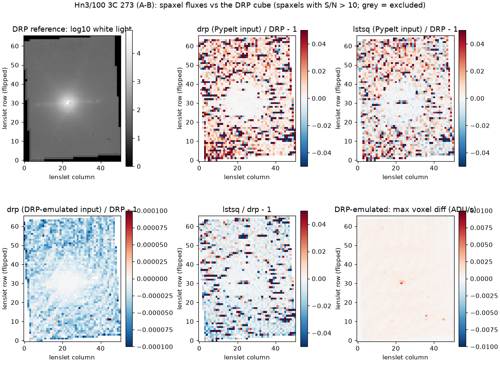

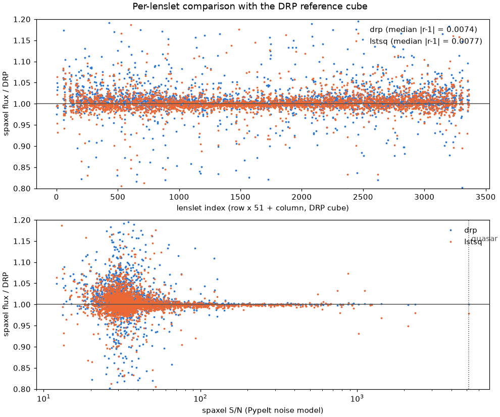

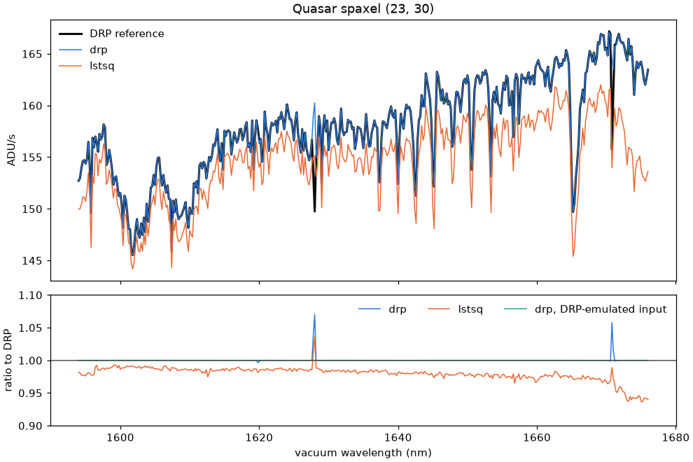


The pipeline order differs slightly from the DRP's: inside PypeIt the
reference rows are subtracted from each frame rather than from the A-B
difference.  This gives a different noise realisation of the 13-row median
and raises the median spaxel difference to the DRP cube from 0.74 % to
2.0 % for S/N 10-30 spaxels.  The two are statistically equivalent; the
per-column difference is 0.66 ADU rms.

### 4.4 Timings

| Step | Time |
|---|---|
| `drp`, 40 iterations with noise propagation | 2.0 s per full frame |
| `lstsq`, coupled bands | 2.3 s per full frame |
| Recmat read | 0.03 s (cached per configuration) |
| Full `rectify` step in the pipeline (L.A.Cosmic 3.4 s, solve and two variances ~7 s) | ~13 s per frame |
| Dev-suite reductions (`run_pypeit`) | Hn3 3 min 38 s, Kn3 5 min 33 s, Kbb (73 frames) 38 min 02 s |

### 4.5 Recmat selection and source

Keck builds one recmat per (filter, scale) and **validity epoch**, and
publishes them at http://tkserver.keck.hawaii.edu/osiris/.  That server is
plain HTTP; files are `.fits.gz` (25-90 MB) in `data/<epoch>/`.  The file
date is the date of the calibration scan and can be later than the
observations it serves: for example, `s240524_c006___infl_Kbb_050` serves
2024-02-03 in epoch 230701-250310.  PypeIt ships the 17 epochs as
`rectmat_epochs.ecsv`, copied from the tkserver table, and selects:

1. the epoch containing `MJD-OBS` (the nearest epoch, with a warning, if
   the date falls in a gap);
2. the latest matrix of that filter and scale dated inside that epoch;
3. otherwise the latest matrix dated before the observation, with a
   warning naming the epoch to download;
4. otherwise an error that lists the matrices and other files found, the
   applicable epoch and its tkserver sub-directory.

Users point PypeIt to their recmat directory with `osiris_rectmat_dir`.
PypeIt does not download recmats.  Because the tkserver listing is public
and stable, the matrix request drafted in Report 02 was not needed.

## 5. Wavelengths and tilts

### 5.1 Keck coefficients

The 11 epoch files `osiris_wave_coeffs*.fits` (66 x 51 x 4, giving pixel as
a function of wavelength) ship with PypeIt, together with their epoch table
from `calibrations.xml`.  Each lenslet's relation `x(lambda) = poly(lambda *
order / 3 / frac - 2200 nm)` is inverted on a 0.05-nm grid.  The block
solution (the reference lenslet, row 32) is fit with a 7th-order Legendre
polynomial (rms 1e-7 px).  Wavelengths are vacuum: the OH lines match the
vacuum `OH_NIRES` list to -0.01 A, whereas air would be off by 4.4 A.  The
DRP's `where(mjd ge begin and mjd le end)` leaves a one-day gap at each
epoch boundary; PypeIt picks the latest epoch starting on or before
`MJD-OBS`, which closes the gap.

### 5.2 The 1.92 px/row stagger and Keck-derived tilts

Within a block, the lenslets are staggered by 1.92 px per lenslet row
(~120 px over a block), and their dispersions differ, so a pure shift
leaves up to 0.6 px of error.  Every lenslet therefore carries its exact
Keck solution into the spec1d through the `get_fiber_wavelengths` hook.
PypeIt's tilts for each block are derived from the same coefficients.  For
each pixel, the tilt is the pixel of the block's reference lenslet at the
same wavelength, fitted with a 2D Legendre polynomial of orders (6, 4)
inside the filter band.  The spec2d wavelength image `wave_ref(tilts)`
reproduces the per-lenslet Keck solutions to 0.044 px rms for Kbb 2024 and
0.048 px for Hn3 2016 (robust 0.021-0.022 px).  The per-lenslet offsets in
the spec1d carry only this residual.

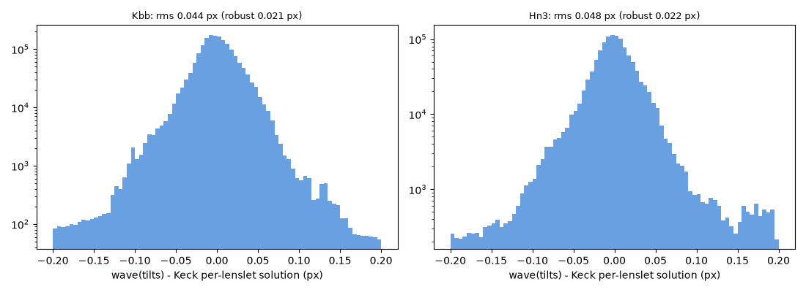

### 5.3 OH refinement (per-lenslet zero points)

With `fiber_sky_refine = zeropoint`, the isolated lines of the line list
(`OH_OSIRIS`, the DRP's `ohlines_kbb_all.dat`, in K; `OH_NIRES` otherwise)
are centroided in every lenslet of the un-subtracted frame.  The median
offset is applied as that lenslet's pixel zero point.  Fallbacks: lenslets
with fewer than 3 lines get the frame median; frames with fewer than 10
measured lenslets use the shift of their median-stacked spectrum.  Frames
with no measurable line at all adopt the per-lenslet shifts measured on the
`Arc` image of their calibration group (the long science/sky pair), with a
warning.

| Data | Result |
|---|---|
| NGC 3245, 600 s | 1012-1013 of 1207 lenslets measured, median 13 lines each, median shift +0.536 px, std 0.054 px |
| Hn3 2016 | 3039/3040 measured, median +0.003 px, std 0.060 px |
| Kn3 2024 | 2918/3040 measured, median 5 lines, 0.24 px |
| Repeatability science vs sky frame | r = 0.971 (Hn3), 0.898 (Kbb); std of the difference 0.014 / 0.024 px |
| HD89239, 1.5 s (no lines; arc fallback) | offset vs the refined 600-s frames +0.538 px -> **+0.001 px** (std 0.014 px) |

The shifts repeat from frame to frame, so the structure lives in the Keck
coefficients and is not noise.  The 2024 epoch solution is off by +1.5 A
(+0.54 px) in K, and the refinement absorbs that.  The OH-line tilt test
(design test 3: centroids of OH lines in the rectified sky frame, fitted
against lenslet row within a block) gives 0.073 px (Hn3) and 0.106 px (Kbb)
with the Keck coefficients alone, and **0.023 px** and **0.020 px** after
the refinement.  The per-lenslet centroid scatter is 0.03-0.04 px.  The
pre-refinement trend is smooth, signed, the same for both solvers and both
frames, and has no saw-tooth.  That rules out a slice-to-lenslet
mis-mapping or a `hilo` error, either of which would produce ~2 px jumps.

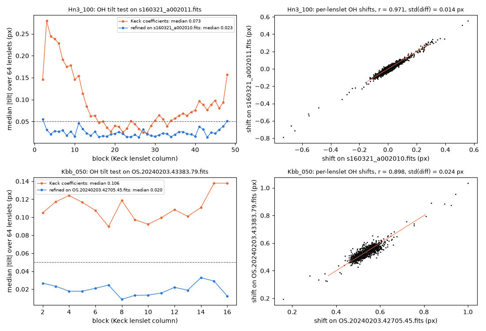

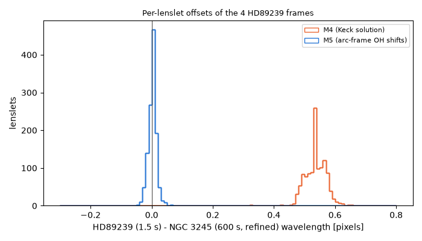

### 5.4 The DTMP7 grating-temperature term

The DRP rescales wavelengths by the aluminium expansion at the grating
temperature (`DTMP7`, CTE table from `assembcube_000.pro`).  We measured
the median OH-line offset from the vacuum list with and without the term:

| Frame | `DTMP7` | with term | without |
|---|---|---|---|
| Hn3 `s160321_a002011` (2016) | 55.34 K | +0.409 A | -0.000 A |
| Kbb `OS.20240203.42705.45` (2024) | 54.25 K | +1.917 A | +1.519 A |
| Kbb `OS.20240203.43383.79` (2024) | 54.25 K | +1.913 A | +1.514 A |

On both epochs the term moves the lines by +0.40 A *away* from the vacuum
list.  It is therefore off by default (`osiris_grating_temp = False`), and
the OH refinement absorbs the remaining epoch offset.  A missing `DTMP7`
gives no correction, with a warning.  The DRP's 0-K extrapolation is
reproduced only for the comparison with DRP cubes.  We would welcome the
Keck team's view on whether the term, or its sign, is still appropriate for
the current coefficient files.

### 5.5 The Kn3/0.035" tilt-residual issue (M5 Q&A 3)

**Summary.**  For Kn3 2024 (V1405 Cas, coefficient file
`osiris_wave_coeffs.fits`, epoch 201216-open) the Keck-derived tilts
reproduce the per-lenslet Keck solutions to 0.065 px rms (robust 0.025 px,
p99 0.23 px, maximum 1.83 px).  That is above the 0.05 px target of design
decision M4-13.  Forty lenslets (1.3 %) with a per-lenslet rms above 0.2 px
cause the excess.  Without them the rms is 0.035 px (maximum 0.25 px).  The
figures below come from `figures/make_final_figures.py`, using the shipped
coefficients, the production tilt model and the dev-suite Kn3 reduction.

| Coefficients (filter, epoch file) | Lenslets | rms (px) | robust | p99 | peculiar (> 0.2 px) | rms without them |
|---|---|---|---|---|---|---|
| Hn3, `osiris_wave_coeffs_160101_170508` | 3040 | 0.048 | 0.022 | 0.182 | 27 | 0.032 |
| Kn3, `osiris_wave_coeffs_160101_170508` | 3040 | 0.048 | 0.022 | 0.183 | 27 | 0.032 |
| Kbb, `osiris_wave_coeffs` (2024 data) | 1207 | 0.044 | 0.021 | 0.093 | 2 | 0.028 |
| **Kn3, `osiris_wave_coeffs` (2024 data)** | 3040 | **0.065** | 0.025 | 0.228 | **40** | **0.035** |

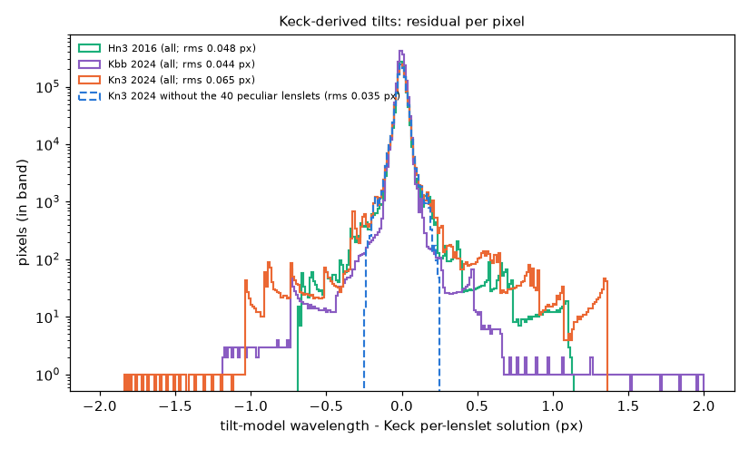

**Where they are.**  The peculiar lenslets are not at block edges: their
positions within the 64-lenslet blocks run from 1 to 61.  They are
scattered over Keck rows 3-63, with two concentrations: 15 in Keck columns
5-14 and 12 in columns 47-49, at the edge of the narrowband field.  The
other 13 are in columns 34-46.  Twenty of the 40 were already peculiar in
the 2016 coefficients.  The other 20 are new in the current epoch; for
example, L46_58 goes from 0.02 px to 1.25 px and L05_48 from 0.02 px to
0.69 px.  Seven lenslets that were peculiar in 2016 are normal now.  L34_15
is peculiar in both Kn3 epochs and in Kbb, where one of its pixels reaches
4.5 px.

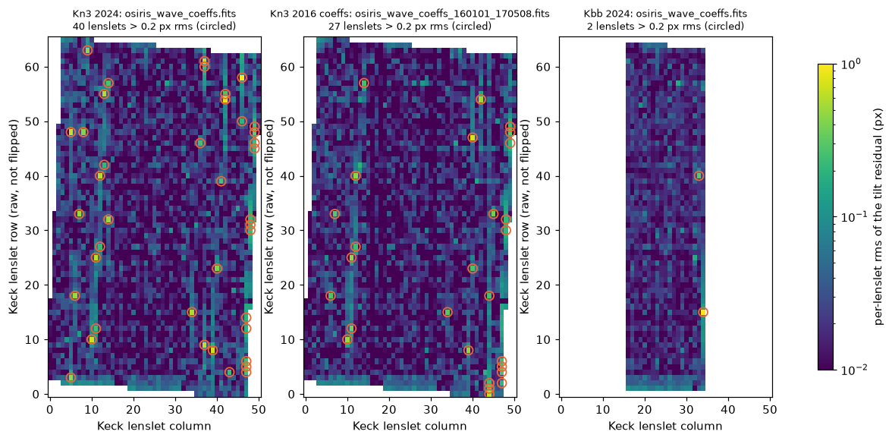

**What they are.**  The residual of each peculiar lenslet is a smooth
curve across the band: a constant offset plus curvature, up to ~1.8 px at
the band edge (left panel below).  It is exactly the deviation of that
lenslet's Keck solution from the mean of its two row neighbours (middle
panel; correlation -1.00 for the five worst).  The block tilt model is
smooth along the block, so it follows the neighbours, and the lenslet's own
solution is the outlier.  So the issue is not a failure of the tilt fit; it
is a property of the coefficient files.

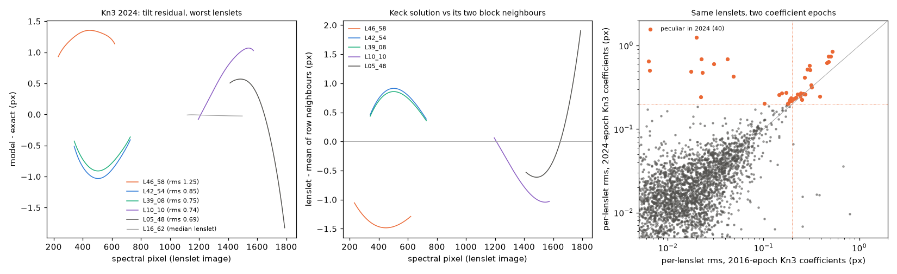

**What the sky says.**  The OH lines in the data can tell whether the
peculiar coefficients are right, meaning the lenslet really is displaced,
or wrong.  If a lenslet's coefficients are offset by delta from the truth,
the per-lenslet OH zero point pulls it back by -delta relative to its
neighbours; if the lenslet really is displaced, its zero point follows its
neighbours.  In the Kn3 reduction the zero points of the 40 lenslets have a
slope of **-0.71** (frame 45703) and **-0.68** (frame 46751) against the
Keck deviation.  The median |deviation| of 0.28 px drops to 0.08 px after
the refinement, compared with a 0.070 px scatter for normal lenslets (right
panel below).  **Most of the peculiarity is an error in the Keck
coefficients, mainly a constant shift, and PypeIt's OH refinement already
removes it from the spec1d wavelengths.**  The exception is the worst
lenslet, L46_58 (deviation -1.41 px).  It has no measurable OH line in
either frame, gets the frame median, and keeps its ~1.4 px error.  The
curvature part, about 0.1 px rms for the peculiar lenslets, cannot be
tested with a zero point.

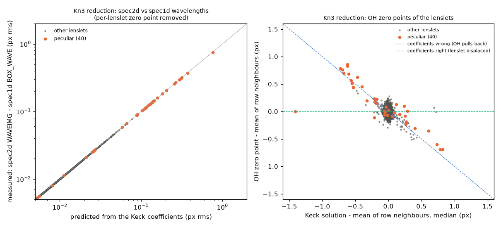

**Impact.**  The spec1d wavelengths, and therefore cubes, line maps and
point-source spectra, carry each lenslet's own Keck solution plus its OH
zero point.  For 39 of the 40 lenslets the dominant error is already
corrected.  The spec2d wavelength image (`WAVEIMG`) is off by up to 1.8 px
for these lenslets.  The reduction confirms that the spec2d-spec1d
difference equals the predicted residual to 0.010 px or better for all 3040
lenslets.  The Davies scaling uses the per-lenslet wavelengths, so it is
not affected.  The Kn3 reduction and its vet test pass.  **Recommendation
for WMKO:** check the current-epoch Kn3 coefficients of the 40 lenslets
listed in Appendix C, especially L46_58, L42_54, L39_08, L10_10, L05_48 and
L37_61.  A later PypeIt option could refit the block polynomials with those
lenslets rejected; that would not change the spec1d.

## 6. Sky subtraction

### 6.1 A-B with `bkg_id`

Pairing cannot be derived from the headers: `ISSKY` is missing or
unreliable, and the 2016 DRP test pair is `ISSKY = 0` for both frames.  The
user therefore gives every frame a `comb_id` and sets the `bkg_id` of each
science or standard frame to the `comb_id` of its sky frame.  Nodded
standard pairs use each other.  Sky frames that should not be reduced on
their own are typed `sky` only.  No dark is subtracted from A-B pairs.
Darks are never rectified, so they can be subtracted from unpaired raw
frames; they are grouped by ITIME in calibration groups (PypeIt does not
rescale darks).

### 6.2 Davies (2007) OH scaling with the subset guard

This follows `scaledskysub_000.pro`.  The OH lines of the sky (B) spectrum,
with the continuum removed by a 41-px running median, are grouped by
vibrational transition.  One factor `r - 1` per group is fit between A-B
and B by weighted least squares, with 3-sigma MAD clipping and the
exclusion of pixels whose residual exceeds half the sky line.  Only the
line spectrum is rescaled (the DRP's `scale_fitted_lines_only`), and the K
tail group takes the 9-7 factor.  `FiberFindObjects` fits the boxcar
spectra of all lenslets together (`global`, the default) and stamps the
model back onto the lenslet image, where it becomes the spec2d `SKYMODEL`.
Standards are never scaled, and the spec1d sky columns are zero for A-B
frames.

The M4 version accepted any factor that lowered the rms of the line pixels.
That made the two 44-s frames worse.  In M5 a factor must be 3-sigma
significant, and the subset of significant group factors that most lowers
the median, over isolated lines, of |integrated line residual| / sky-line
flux is kept.  If no subset lowers that median, no factor is applied.
`osiris_oh_min_exptime` (default None) can also skip short frames
altogether.

Metric: median over isolated `OH_OSIRIS` lines of |residual integrated over
+/-3 px and summed over lenslets| / sky-line flux.  "WAVEIMG" uses the
spec2d block wavelengths; "refined" uses the per-lenslet refined spec1d
wavelengths, which we now treat as the reference.

| Frame | t (s) | A-B | Davies M4 | Davies M5 | refined: A-B | M4 | M5 |
|---|---|---|---|---|---|---|---|
| 42266.81 | 44 | 0.0402 | 0.0675 | **0.0402** | 0.0309 | 0.0597 | 0.0309 |
| 42460.10 | 44 | 0.0735 | 0.0808 | **0.0735** | 0.0693 | 0.0689 | 0.0693 |
| 42705.45 | 599 | 0.0528 | 0.0347 | 0.0437 | 0.0491 | 0.0380 | 0.0424 |
| 44064.64 | 599 | 0.0387 | 0.0329 | 0.0387 (=) | 0.0322 | 0.0354 | 0.0322 |
| 44757.73 | 599 | 0.0475 | 0.0391 | 0.0391 | 0.0486 | 0.0440 | 0.0441 |
| 46116.63 | 599 | 0.0501 | 0.0358 | 0.0358 | 0.0507 | 0.0377 | 0.0377 |
| 46816.35 | 599 | 0.0634 | 0.0480 | 0.0511 | 0.0579 | 0.0369 | 0.0443 |
| 48172.98 | 599 | 0.0838 | 0.0464 | 0.0464 | 0.0882 | 0.0515 | 0.0514 |
| 48868.72 | 599 | 0.0821 | 0.0366 | 0.0366 | 0.0839 | 0.0455 | 0.0455 |
| 50226.88 | 599 | 0.0369 | 0.0373 | 0.0369 (=) | 0.0395 | 0.0396 | 0.0392 |
| 50920.99 | 599 | 0.1332 | 0.0542 | 0.0542 | 0.1324 | 0.0537 | 0.0538 |
| 52278.78 | 599 | 0.0313 | 0.0281 | 0.0304 | 0.0306 | 0.0274 | 0.0296 |
| 52965.80 | 599 | 0.0258 | 0.0236 | 0.0258 (=) | 0.0300 | 0.0302 | 0.0300 |
| 54326.00 | 599 | 0.0770 | 0.0362 | 0.0362 | 0.0854 | 0.0424 | 0.0423 |
| 55001.79 | 599 | 0.0638 | 0.0343 | 0.0342 | 0.0713 | 0.0408 | 0.0408 |

With M5, no frame is worse under either definition.  The 600-s median goes
from 0.0528 to 0.0369 (M4: 0.0362).  On the WAVEIMG metric 10 of 13 600-s
frames improve and 3 are unchanged; on the refined metric 11 of 13 improve.
For 44064 and 52965 the apparent M4 improvement was not real: on the
refined metric M4 made both slightly worse.  On 42705, 46816 and 52278 the
subset search drops one group factor and gains less than M4 did.  Other
data: a sky-sky pair improves 0.082 -> 0.030, the Hn3 2016 pair 0.29 ->
0.05 (factors +26 % and +27 %), and on Kn3 the one in-band group (9-7) is
rejected on one frame and gives 0.063 -> 0.056 on the other.

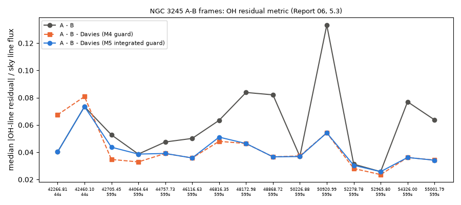

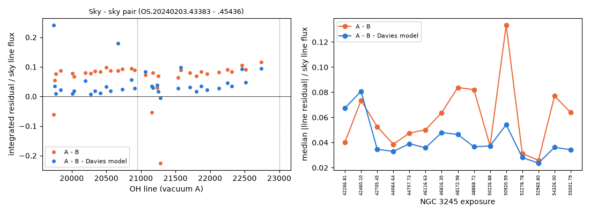

### 6.3 Trade-offs and how to turn it off

The scaling helps most on long exposures with bright, variable OH lines.
It does nothing, by design, when the lines barely changed or are too weak
to fit: the 44-s frames and three of the 600-s frames are left as plain
A-B.  With the old rule it could do harm on short exposures.  `global`
pooling cannot follow spatial sky variations; `block` and `fiber` can, but
they are noisier and more easily biased by strong object lines.  The user
page (`doc/spectrographs/keck_osiris.rst`, section "OH-line scaling
(Davies 2007)") documents this.  To turn the scaling off:

```ini
[reduce]
    [[skysub]]
        osiris_oh_scaling = None
```

`None` is case sensitive; `none` is rejected by the parameter validation.
To skip only short frames, keep the default and set, e.g.,
`osiris_oh_min_exptime = 100`.

## 7. Science-mode validation: NGC 3245 (Kbb/0.050", KOA 2024-02-03)

The night has 23 NGC 3245 frames (600 s and 45 s, 8 sky frames), the A0V
standards HD101060 (24 frames) and HD89239 (7 frames, 2 s), and 15 darks;
73 frames in total.  The full night reduces in 38 min.

**Cube.**  `pypeit_fiber_cube` builds a (1474, 66, 21) cube: 19 lenslet
columns x 64 rows plus padding, 0.05" spaxels, 2.82 A steps over
19651-23808 A.  CRPIX = (12, 32) is the layout origin, which is the DRP
reference spaxel, and the rotation comes from the position-angle keywords.
There is no DRP cube of this night to compare against.

**Maps.**  We stacked the 13 600-s spec1d files in lenslet coordinates.
The K continuum is smooth and peaks at lenslet (row 33, col 23).  The CO
2-0 bandhead depth is a nearly uniform 0.08 (an old bulge).  H2 1-0 S(1)
(at 21311 A) is detected on the nucleus (EW +0.39 A; 3x3 flux 5745 counts
vs map noise 970).  Br gamma is not detected.

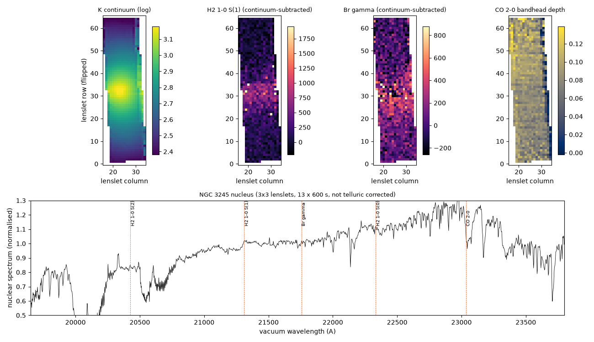

**The line-map step is astrophysical.**  The H2 and Br gamma maps show a
sharp horizontal edge at flipped lenslet row ~37.  We tested whether it
could be instrumental, for example a readout-channel boundary or column
1024 crossed because of the 1.92 px/row stagger:

1. In the central blocks the edge sits at the same lenslet row while the
   raw detector column of H2 at that row runs from 1011 to 1273.  A
   detector boundary would give a slanted pattern.
2. A sky-sky A-B pair measured with the same windows shows nothing (32 vs
   21 counts x A, scatter 86), whereas the galaxy pair jumps from 120 to
   587.  The sky continuum changes by less than 3 %, and darks and raw sky
   frames show no channel structure at the 1e-3 ADU/s level.
3. The H2 velocity runs from +230 km/s to -200 km/s across the nucleus
   (rotating nuclear gas), so the fixed +/-8 A window (+/-113 km/s) loses
   the line exactly at those rows.  With +/-25 A the contrast across the
   edge drops from 3.6 to 1.5.

The remaining edge has no counterpart in the continuum or in any sky-only
test, so it is intrinsic to the H2 emission (for example, nuclear dust).
This is documented as a user-page limitation.  We did no DRP comparison
because IDL was not available.

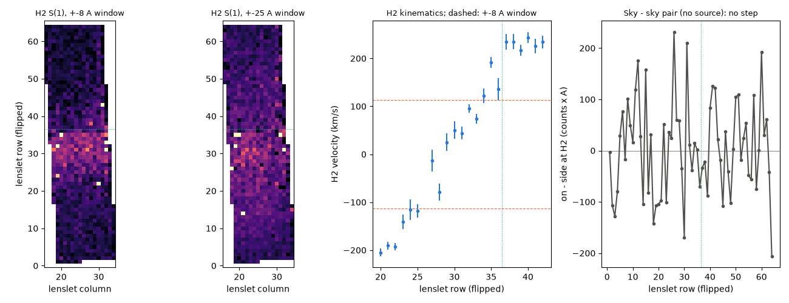

**Telluric and flux calibration.**  `pypeit_fiber_cube --point_source 0.4
--no_cube` sums the 184 lenslets within 0.4" of HD101060
(`OS.20240203.59407.32`, nodded with 59447) into a single-object spec1d.
`pypeit_sensfunc` (IR algorithm, A0, V = 8.78) and `pypeit_tellfit
--objmodel star` then run with `TellPCA_3000_26000_R10000` and an order-7
response polynomial.  The corrected star is flat to **1.5 %** rms in 50-A
bins (median 1.0 %, maximum 4.5 %); the 3-s frames give 2.5-2.7 %.  The
first 8.85-s frames we chose (56998, 57040) contain no star (brightest
lenslet 9-13 counts), hence the switch to 59407.

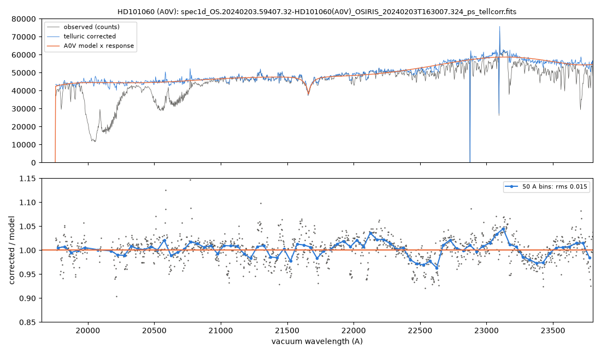

**Cosmic rays.**  L.A.Cosmic on single raw frames misses some hits, which
show up as isolated hot lenslets.  The second pass (`fiber_cr_nsig = 8`)
flags high-pass spikes in the A-B lenslet spectra that exceed three times
the residual of the neighbouring lenslets at the same wavelength, scaled by
the continuum ratio so that real absorption lines in bright lenslets
survive.  On frame 44064 the number of 8-sigma spikes drops from 260 to 3
(5 sigma: 558 -> 302).  About 70 of the 260 are a raw-column artefact
(spectral row 80, raw column ~1967) rather than cosmic rays, and masking
them is harmless.  Each frame gets 96-340 flagged pixels at 600 s and ~100
at 44 s.  Standards are skipped.

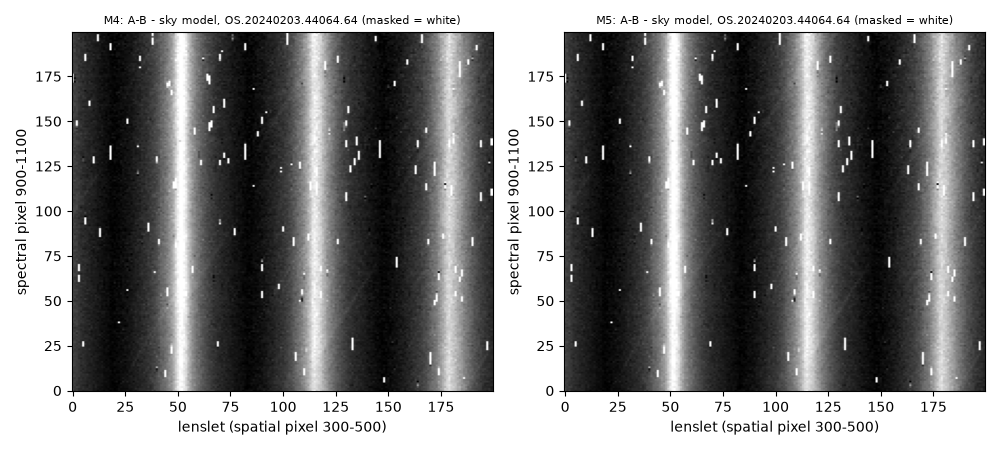

## 8. Other modes and eras

**Hn3/0.100" (2016, 3C 273; the DRP test pair).**  This narrowband filter
uses 51 blocks and 3040 lenslets with Keck coefficients, and every lenslet
has its own spectrum (`MASKDEF_ID = row * 51 + col`, names `L<col>_<row>`).
It is the rectification acceptance test (section 4.3) and the
quasar-position test.  OH scaling factors are +26 % and +27 %, with
line-pixel rms 225 -> 62 counts.

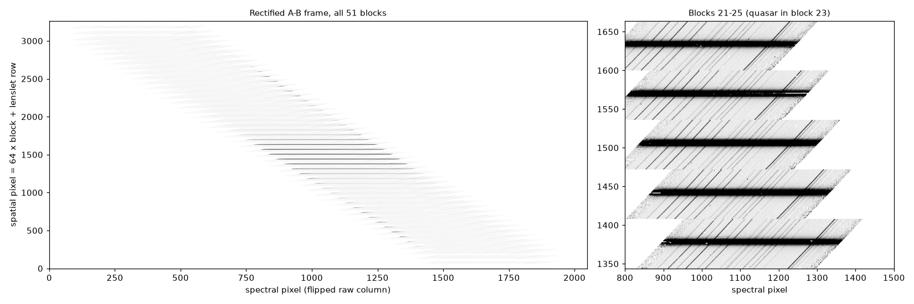

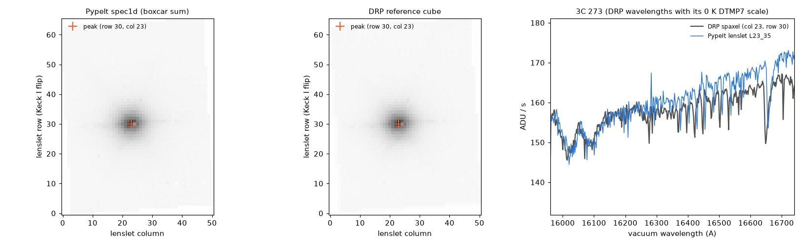

**Kn3/0.035" (KOA 2024-08-13, nova V1405 Cas).**  We used two 300-s A/B
pairs and the epoch recmat `s240523_c002___infl_Kn3_035.fits.gz`.  The data
reduce with no code change.  Every one of the 3040 lenslets keeps at least
394 of its ~462 window pixels, so no lenslet-mapping edge case appeared.
The nova peaks at lenslet (34, 28) and (46, 26) in the two dither
positions, with Br gamma EW 26.6 and 28.6 A.  Since the B frames are only
1" away, the nova also appears as a negative image (expected).  The tilt
residual is described in section 5.5.

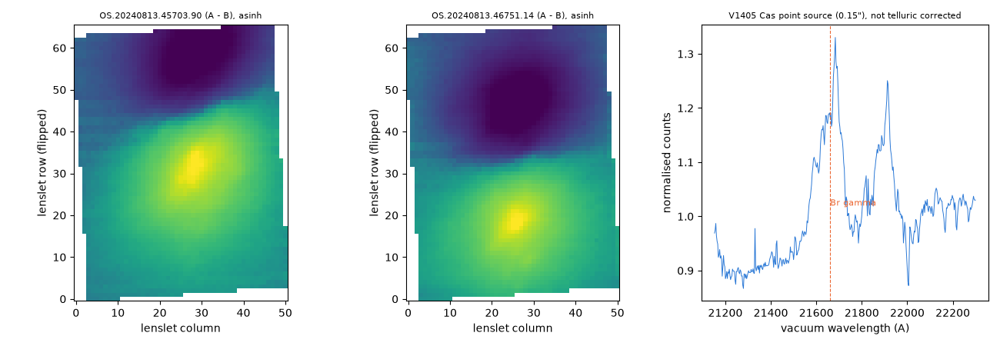

**Hawaii-2 era (2015).**  The Kn5/0.035" OsirisDRP test frames load, and
`pypeit_setup` warns that they predate the H2RG.  `run_pypeit` stops with
"Pre-2016 (Hawaii-2) OSIRIS data are not supported by PypeIt; use the Keck
OSIRIS DRP instead."  Their recmat is not obtainable in any case: the
Dropbox and tkserver links in the DRP repository return HTML pages.

## 9. Testing and reproducibility

**Unit tests (no large files).**  `test_keck_osiris.py` has 28 tests
(header eras, typing, exptime units, layouts, hooks, tilts, wavelengths,
robustness), `test_lenslet_rectify.py` 20 (solvers on synthetic bands,
sandwich variance, epoch selection, gzip), `test_fiber_sky.py` 6 (OH
refinement, Davies guard, CR pass) and `test_fiber_extract_window.py` 1
(parametrised): 61 collected tests in all.  The full suite
(`pytest pypeit/tests --ignore=pypeit/tests/test_pkgdata.py`) gives 908
passed.  `test_pkgdata.py` is excluded because it downloads from a GitHub
branch that does not exist yet and deletes a tracked file.

**Dev suite.**  `test_scripts/setups.py` registers `keck_osiris`:
`Hn3_100`, `Kbb_050`, `Kn3_035`.  `test_setups.py` adds the `Kbb_050`
afterburn tests: two `pypeit_fiber_cube` runs (NGC 3245 cube; HD101060
point source), `pypeit_sensfunc` and `pypeit_tellfit`.

```
PYPEIT_DEV=$PWD ./pypeit_test reduce afterburn vet -s keck_osiris/Hn3_100 \
    keck_osiris/Kbb_050 keck_osiris/Kn3_035 -t 2 -o <out>
  PASSED keck_osiris/Hn3_100 pypeit                      0:03:38
  PASSED keck_osiris/Kn3_035 pypeit                      0:05:33
  PASSED keck_osiris/Kbb_050 pypeit                      0:38:02
  PASSED keck_osiris/Kbb_050 pypeit_fiber_cube (NGC3245) 0:00:14
  PASSED keck_osiris/Kbb_050 pypeit_fiber_cube (HD101060) 0:00:04
  PASSED keck_osiris/Kbb_050 pypeit_sensfunc             0:00:27
  PASSED keck_osiris/Kbb_050 pypeit_tellfit              0:01:31
  --- PYPEIT DEVELOPMENT SUITE PASSED 7/7 TESTS ---
```

**Vet tests (21).**

| File | Tests |
|---|---|
| `test_keck_osiris_rectify.py` (5) | DRP emulation; both solvers vs the DRP cube; `lstsq` vs `drp`; timing |
| `test_keck_osiris_flow.py` (11) | OH-line tilt test on Hn3 and Kbb, refinement repeatability, vacuum, spec1d lenslets, quasar position |
| `test_keck_osiris_kbb.py` (3) | spec1d (1207 lenslets, Davies model in the spec2d), cube structure and WCS, telluric flatness |
| `test_keck_osiris_kn3.py` (2) | 3040 lenslets with usable windows; nova continuum and Br gamma |

The `vet` phase of `pypeit_test` runs the whole `vet_tests` directory, so
other instruments fail there when their reductions are absent; the OSIRIS
vet tests were therefore also run directly
(`pytest vet_tests/test_keck_osiris_*.py --redux_out <out>`).

**Data on the dev-suite Google Drive.**  Everything lives under
`RAW_DATA/keck_osiris/`, which JXP has uploaded:

| Directory | Content | Size |
|---|---|---|
| `Hn3_100/`, `calib/`, `ref/` | 2016 3C 273 pair; recmat `s160318_c005`; DRP reference cube | 236 MiB |
| `Kbb_050/`, `calib/` | 73 KOA frames of 2024-02-03 and file lists; recmat `s240524_c006` (unzipped, 159 MB) | 2.7 GiB |
| `Kn3_035/`, `calib/` | 4 KOA frames of 2024-08-13 and file list; recmat `s240523_c002` (`.fits.gz`) | 169 MiB |
| `Kn5_035/` | 2015 frames (header-era error test); a 254-byte matrix stub and a DRP cube, both unused | 86 MiB |

Nothing outside that directory is needed (M5 Q&A 4).  The pypeit, sensfunc
and tellfit files and the tests are in the dev-suite git repository.  The
Keck wavelength coefficients, both epoch tables, the OH list, the CTE table,
the lenslet maps and the hot/dead masks are committed in PypeIt
(`pypeit/data`).  The telluric grid is downloaded automatically by PypeIt's
cache from its S3 store.

**Figures.**  `Reports/figures/make_m{2,3,4,5}_figures.py` and
`make_final_figures.py` regenerate every figure in this report from the
reductions (see Appendix B).

## 10. Key decisions

Numbers refer to the decision table of `keck_osiris_design.md`: 1-25 from
the design Q&A, M1-x to M4-x from the milestone Q&A, and M5.

| Topic | # | Decision |
|---|---|---|
| Scope | 2, 22 | Test data: the DRP Hn3/0.100" pair first, then the KOA 2024-02-03 Kbb/0.050" night (NGC 3245, two A0V stars, darks) as the science-mode setup |
| | 3, 11 | H2RG era only (MJD >= 57388); 2015 Kn5 frames kept as a header-era error test (their recmat is unobtainable) |
| | 8 | Names: `keck_osiris.py`, `KeckOSIRISSpectrograph`, `keck_osiris` |
| | 18 | Narrowband split in phase 1; Kbb/0.050" is the first supported mode |
| | 25 | Keep all 73 KOA frames for now; trim the dev-suite copy later |
| | 9, 10, 17 | Design document first, then staged milestones with reports |
| Metadata and typing | 4, M1-2 | ADU = `SCI x exptime`, `exptime = TRUITIME x COADDS` when present (ITIME overstates 2-s frames by 36 %), else ITIME with era-dependent units |
| | 5, 14, M1-1 | Darks from `SFILTER = 'Drk'`; standards from the target name (`OBSTYPE` is `'a'` for every KOA frame); all other on-sky frames science (+ `sky` if `ISSKY = 1`); configuration = filter + scale |
| | 12 | Header tolerance: missing `ISSKY`, `PA_SPEC`, `DTMP7`, `INSTRUME`, weather cards use defaults; missing `SFILTER`/`MJD-OBS` is an error naming the card |
| | 13 | `VAR` only as an optional solver weight; PypeIt computes its own variance; BPM = `DQ != 9` or Keck hot/dead masks |
| | M1-3 | Dev-suite sky frames typed `sky` only (backgrounds, not reduced alone) |
| | M1-4 | `specflip = True`; the `rectify` step un-orients, solves in the raw orientation and flips back |
| Rectification | 1 | Port the DRP rectification and run the `Fiber` pypeline on the result |
| | 7, M4-1 | Recmats supplied by the user (`osiris_rectmat_dir`), selected by Keck validity epoch (file date inside the epoch; latest-before with a warning); `.fits.gz` accepted |
| | 16 | Acceptance test: agreement with the DRP reference cube |
| | 19 | Rectification as a generic `RawImage` step calling a spectrograph transform; solvers in `core/lenslet_rectify.py` |
| | M2-1, M3-5 | Production `lstsq`: flux-independent weights and sandwich variance; default solver from M3 |
| | M2-2, M3-6 | Reference rows and L.A.Cosmic on each raw frame before the solve; DRP 2016 strip rule as an option |
| | M2-3 | Rectified ivar always from the least-squares machinery; the DRP noise rule kept for fidelity only |
| | M2-4 | Missing `DTMP7`: no correction (never the DRP's 0-K extrapolation) |
| Layout and calibrations | 21, M3-3 | One block-slit per Keck lenslet column; narrowband re-laid out as a lenslet image (one pixel per lenslet); `MASKDEF_ID = row * 51 + col` |
| | 20, M3-1 | Fixed tilts through a hook, verified by an OH-line tilt test; the 0.073 px M3 trend accepted open and closed by the OH refinement in M4 |
| | M3-2, M4-2 | Every lenslet keeps its exact Keck solution in the spec1d; Keck-derived 2D Legendre (6, 4) tilts per block make the spec2d nearly exact |
| | M4-3 | Broadband lenslet windows limited to the filter band |
| | M4-13 | Tilt rms close to 0.05 px accepted (Kn3 2024: 0.065 px; section 5.5); telluric standard `OS.20240203.59407.32`; M4 shared code accepted |
| Wavelengths | 6 | Epoch-matched Keck coefficients, vacuum, refined on OH lines |
| | M3-4, M4-5 | `DTMP7` term re-tested (+0.40 A away from the vacuum list on both epochs) and off by default (`osiris_grating_temp = False`) |
| | M4-4 | Per-lenslet OH zero points on every frame (`fiber_sky_refine = zeropoint`) |
| | M4-12, M5 | Frames without sky lines adopt the per-lenslet shifts of the `Arc` frame of their calibration group (order: own lenslets, own stack, arc) |
| Sky | 15, 23 | A-B through `bkg_id`, no dark with A-B; Davies OH scaling in addition |
| | M4-6 | Davies scaling on the 1D lenslet spectra, `global` pooling, stamped as the spec2d sky model; not for standards |
| | M4-7 | Darks never rectified; grouped by ITIME for unpaired frames |
| | M4-10, M5 | Guard: subset of significant group factors that lowers the median integrated residual; optional `osiris_oh_min_exptime` (default None) |
| | M4-11, M5 | Line-map step diagnosed as astrophysical (H2 kinematics + an intrinsic edge); documented |
| Cubes and telluric | 24, M4-8 | Generic `pypeit_fiber_cube` (hook `fiber_cube_setup`, WCS at the layout origin, `--point_source`); Binospec script an alias |
| | M4-9 | Telluric with the IR algorithm on the point-source spectrum of the A0V star; response polynomial order 7 |
| Hardening (M5) | M5 | Tilt cache per configuration (168 fits -> 1); second CR pass `fiber_cr_nsig = 8` (science A-B only); Kn3/0.035" third setup; `supported = True` |
| Shared code | M3-7, M4-13 | Generic, gated additions accepted and itemised for the reviewers (section 3.3) |

## 11. Outstanding issues and future work

1. **Kn3 tilt residual (section 5.5).**  There are 40 lenslets with
   peculiar current-epoch Keck coefficients; most of their error is a
   constant offset that the OH refinement corrects in the spec1d.  L46_58
   (no OH lines) keeps ~1.4 px, and the spec2d `WAVEIMG` is off by up to
   1.8 px for these lenslets.  Options: refit the block polynomials with
   them rejected (cosmetic for the spec2d), and ask WMKO to review the
   coefficients (Appendix C).
2. **Davies scaling leaves three 600-s frames unchanged** (44064, 50226,
   52965) and gains less than M4 on 42705, 46816 and 52278, where the
   subset search drops a group factor.  That is the price of never making a
   frame worse.  `block`/`fiber` pooling and per-line weighting have not
   been explored on these data.
3. **Line maps** use a fixed wavelength window.  Velocity-aware maps, i.e.
   integrating over the fitted line profile, are future work.
4. **No cube co-addition or dither registration.**  `pypeit_fiber_cube`
   builds one cube per exposure, and the M4 maps stacked 13 frames dithered
   by up to 8 lenslet columns without registration.
5. **No DRP comparison for Kbb or Kn3.**  IDL was not available, so the
   only DRP reference is the 2016 Hn3 cube.  A DRP reduction of one
   NGC 3245 pair would give a second rectification reference in the
   most-used mode.
6. **Untested epochs and modes.**  The 2026 TRICK-dichroic epoch
   (`260604-open` on tkserver) has not been tested.  The other broadband
   filters (Zbb, Jbb, Hbb, Kcb), the remaining narrowband filters, and the
   0.020" scale use the same code but have not been reduced.  Narrowband
   filters with very few lines in band (for example Kn5) fall back to the
   stack shift or the frame median for the OH refinement.
7. **Short-frame OH fallback.**  Stack-only frames (the 3/8.85-s HD101060
   frames) keep a common zero point.  A later option could combine the
   arc's per-lenslet shifts with the frame's own stack zero point (M5 Q&A
   5).
8. **Flats.**  No lamp flats are used; lenslet throughput comes from the
   recmat normalisation, and we did not test a Keck white-light scan.
9. **Dev-suite volume.**  `Kbb_050` holds 73 frames (2.7 GiB) and should be
   trimmed (drop most HD89239 frames, the 45-s pairs and the unused
   darks).
10. **Pull requests.**  The shared-code changes of M3-M5 (section 3.3)
    await PypeIt review.  `test_pkgdata.py` will only pass once the branch
    exists on GitHub.
11. **DRP observations for the Keck team.**  The `Quality[jj]` indexing
    slip in `spatrectif_000.c` (section 4.2); the one-day epoch gaps in
    `calibrations.xml`; the `DTMP7` term's sign and size on current data
    (section 5.4); the 0-K extrapolation for a missing `DTMP7`; the
    unavailable Kn5/035 test matrix link.
12. **Raw-column artefact.**  A feature at spectral row 80 (raw column
    ~1967) in 600-s frames is masked by the second CR pass.  Its origin was
    not investigated.

## 12. Acknowledgements and references

This work rests on the Keck OSIRIS data reduction pipeline: its
rectification algorithm, lenslet geometry, wavelength coefficients, OH line
list and scaled sky subtraction.  We thank its authors and W. M. Keck
Observatory, which publishes the rectification matrices.  Raw data come
from the Keck Observatory Archive.  The PypeIt implementation was developed
by J. X. Prochaska with Claude (Anthropic's AI assistant).

- Larkin, J. et al. 2006, SPIE 6269, 62691A (OSIRIS)
- Lyke, J. et al. 2017, Astrophysics Source Code Library, ascl:1710.021
  (OSIRIS DRP)
- Lockhart, K. et al. 2019, AJ 157, 75 (OSIRIS DRP: characterisation and
  improvements)
- Davies, R. I. 2007, MNRAS 375, 1099 (OH-line scaling)
- Horne, K. 1986, PASP 98, 609 (optimal extraction; used by PypeIt's
  `FiberExtract` when a flat exists; OSIRIS uses boxcar)
- OsirisDRP: https://github.com/Keck-DataReductionPipelines/OsirisDRP
- Keck rectification matrices: http://tkserver.keck.hawaii.edu/osiris/
- PypeIt: https://pypeit.readthedocs.io; user page
  `doc/spectrographs/keck_osiris.rst`, tutorial
  `doc/tutorials/keck_osiris_howto.rst`

## Appendix A. File inventory

**PypeIt (`osiris_port`), OSIRIS-specific**

| File | Content |
|---|---|
| `pypeit/spectrographs/keck_osiris.py` | spectrograph class (new) |
| `pypeit/core/lenslet_rectify.py` | recmats, solvers, layout, Keck wavelengths and tilts (new) |
| `pypeit/scripts/osiris_rectify.py` | `pypeit_osiris_rectify` (new) |
| `pypeit/data/spectrographs/keck_osiris/` | 11 `osiris_wave_coeffs*.fits`, `wave_coeff_epochs.ecsv`, `rectmat_epochs.ecsv`, `al_cte.ecsv`, Kbb 2016 lenslet maps (new) |
| `pypeit/data/static_calibs/keck_osiris/` | Keck hot and dead pixel masks (new) |
| `pypeit/data/arc_lines/lists/OH_OSIRIS_lines.dat` | DRP K-band OH list, vacuum (new) |
| `pypeit/tests/test_keck_osiris.py`, `test_lenslet_rectify.py`, `test_fiber_sky.py`, `test_fiber_extract_window.py` | unit tests (new) |
| `doc/spectrographs/keck_osiris.rst`, `doc/tutorials/keck_osiris_howto.rst` | user page and tutorial (new) |

**PypeIt, shared code (modified, gated)**

`pypeit/spectrographs/spectrograph.py`, `__init__.py`; `pypeit/core/meta.py`
(keys `issky`, `numreads`, `sampmode`, `tmatemp`);
`pypeit/images/rawimage.py`, `combineimage.py`, `buildimage.py`;
`pypeit/pypeit.py`; `pypeit/calibrations.py`; `pypeit/find_objects.py`;
`pypeit/extraction.py`; `pypeit/specobj.py`; `pypeit/core/skysub.py`;
`pypeit/core/wavecal/wvutils.py`; `pypeit/core/datacube.py`;
`pypeit/scripts/fiber_cube.py` (new), `binospec_ifu_cube.py`;
`pypeit/pypeit_steps.py`, `exposure.py`, `scripts/reduce_by_step.py`;
`pypeit/qa.py`; `pypeit/par/pypeitpar.py` (the parameters of section 3.3);
`pyproject.toml`; `doc/pypeit_par.rst`, `doc/help/*`,
`doc/include/spectrographs_table.rst`, `doc/spectrographs/spectrographs.rst`,
`doc/tutorials/tutorials.rst`, `doc/releases/2.1.0dev.rst`.

**Dev suite (`dev_osiris`)**

| File | Content |
|---|---|
| `RAW_DATA/keck_osiris/{Hn3_100,Kbb_050,Kn3_035,Kn5_035}/` | raw frames, recmats, DRP cubes (Google Drive) |
| `pypeit_files/keck_osiris_{hn3_100,kbb_050,kn3_035}.pypeit` | reduction inputs |
| `sensfunc_files/keck_osiris_kbb_050.sens`, `tellfit_files/keck_osiris_kbb_050.tell` | afterburn inputs |
| `test_scripts/setups.py`, `test_setups.py`, `pypeit_tests.py` | registrations; `PypeItFiberCubeTest` |
| `unit_tests/test_load_images.py` | `keck_osiris` entry |
| `vet_tests/test_keck_osiris_{rectify,flow,kbb,kn3}.py` | vet tests |
| `pypeitdev/keck_osiris/` | design document, implementation plan, PR text, Reports 01-07, this report, figure scripts |
| `claude_prompts/keck_osiris/` | the design prompt and milestone prompts M1-M5 with their Q&A and logs |

## Appendix B. Figures

| Figure | Content | Script |
|---|---|---|
| `m2_difference_images.png`, `m2_per_lenslet.png`, `m2_quasar_spectrum.png`, `m2_rectified_frames.png` | rectification vs the DRP cube | `make_m2_figures.py` |
| `m3_lenslet_image.png`, `m3_oh_tilts.png`, `m3_quasar.png` | lenslet image, M3 OH tilts, 3C 273 position | `make_m3_figures.py` |
| `m4_oh_tilts.png`, `m4_tilt_model.png`, `m4_oh_scaling.png`, `m4_ngc3245.png`, `m4_telluric.png` | refined tilts, Keck-derived tilts, Davies scaling, NGC 3245 maps, telluric | `make_m4_figures.py` |
| `m5_oh_guard.png`, `m5_std_shift.png`, `m5_linemap.png`, `m5_crs.png`, `m5_kn3.png` | guard, short-frame fallback, line-map diagnosis, cosmic rays, Kn3 | `make_m5_figures.py` |
| `final_tilt_hist.png`, `final_tilt_map.png`, `final_tilt_lenslets.png`, `final_tilt_redux.png` | Kn3 tilt-residual issue | `make_final_figures.py` |

`make_final_figures.py` runs as `PYPEIT_DEV=<dev suite> python
make_final_figures.py <redux>/keck_osiris/Kn3_035`; the numbers quoted in
section 5.5 are printed by it.

## Appendix C. The 40 peculiar Kn3 lenslets (current coefficient epoch)

Names are `L<Keck column>_<Keck row>`; per-lenslet tilt-residual rms
> 0.2 px with `osiris_wave_coeffs.fits`:

L05_03, L05_48, L06_18, L07_33, L08_48, L09_63, L10_10, L11_12, L11_25,
L12_27, L12_40, L13_42, L13_55, L14_32, L14_57, L34_15, L36_46, L37_09,
L37_60, L37_61, L39_08, L40_23, L41_39, L42_54, L42_55, L43_04, L46_50,
L46_58, L47_04, L47_05, L47_06, L47_12, L47_14, L48_30, L48_31, L48_32,
L49_45, L49_46, L49_48, L49_49.

The 2016 coefficients (`osiris_wave_coeffs_160101_170508.fits`) flag 27;
20 are common to both.  Kbb 2024 flags L33_40 and L34_15.
