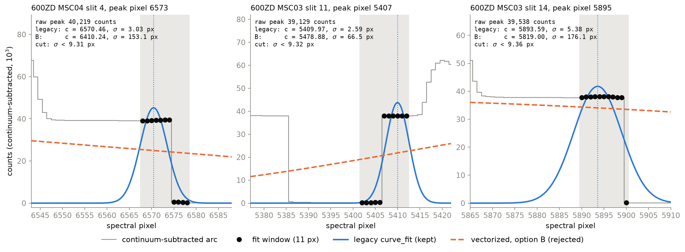
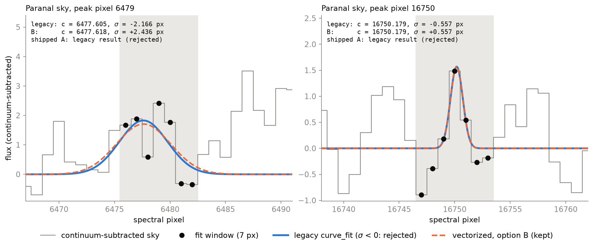
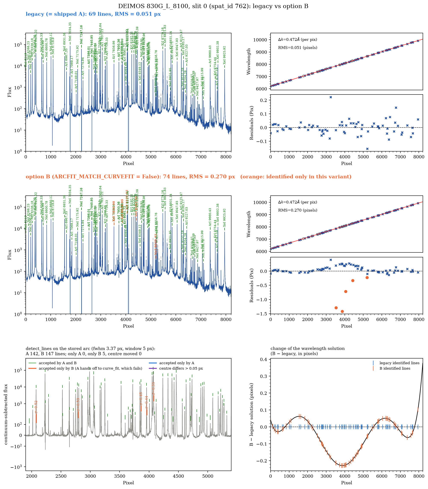
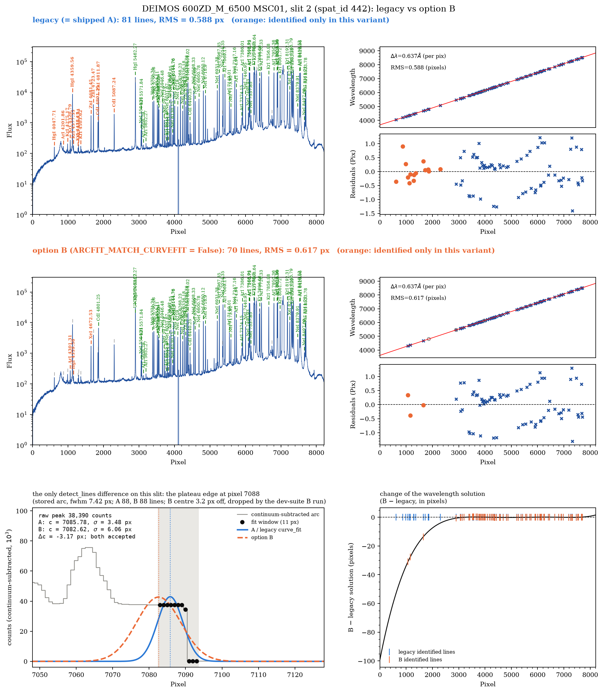
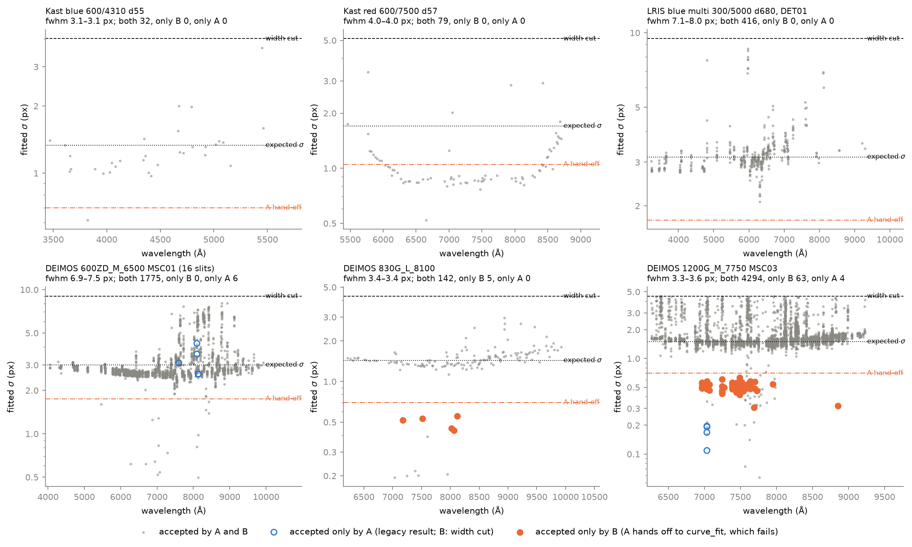
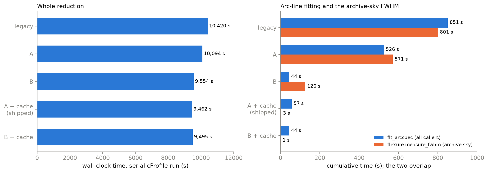
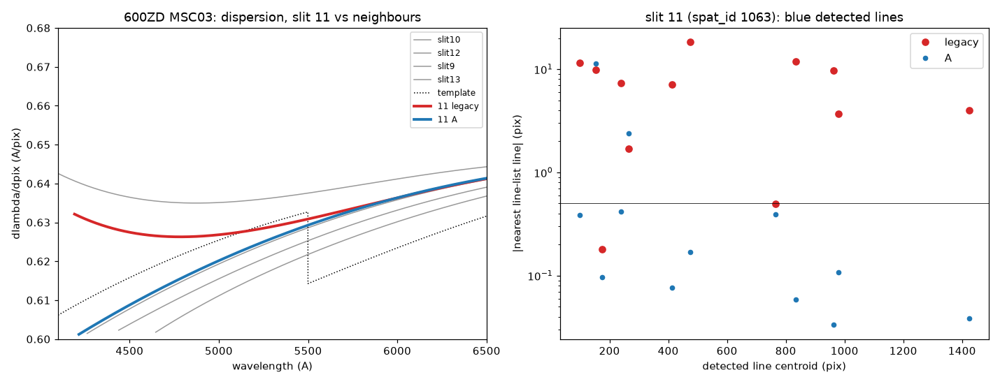

# Speed-up workstream C: arc-line fitting and the archive-sky FWHM cache

**Report of 2026-10-26, rewritten 2026-11-24 after the revert to
`curve_fit` (C.md, "Revert to CurveFit?", Q20).**  PypeIt branch
`speed_up_arcfit`; dev-suite branch `dev_speed_up_C`.  The working record,
with every intermediate number and decision, is `claude_prompts/speed_up/C.md`
(Q1–Q20 and the Logs).

> **How to read this report.**  §0–§8 describe PR C as it will be submitted
> ("R"): the per-line `scipy.optimize.curve_fit` Gaussian fit of develop, plus
> a median-width floor on the accepted lines and a cache of the archived-sky
> FWHM in spectral flexure.  The vectorized Gaussian fit that this workstream
> built and shipped as its default until 2026-11-24 was evaluated and **not
> adopted**; that study is kept in full as
> [Appendix D](#appendix-d-the-vectorized-fit-evaluated-not-adopted).
> Section numbers quoted inside Appendix D (§1–§15) refer to its own
> sections D.1–D.15.

## Contents

0. [Executive summary](#0-executive-summary)
1. [What PR C changes](#1-what-pr-c-changes)
2. [Speed](#2-speed)
3. [The median-width floor](#3-the-median-width-floor)
4. [Saturated plateau edges: kept, with a follow-up issue](#4-saturated-plateau-edges-kept-with-a-follow-up-issue)
5. [Dev-suite validation of R](#5-dev-suite-validation-of-r)
6. [Fixes from the develop comparison (Q18)](#6-fixes-from-the-develop-comparison-q18)
7. [Known limitation: fragile `full_template` identification](#7-known-limitation-fragile-full_template-identification)
8. [Why the vectorized fit was not adopted](#8-why-the-vectorized-fit-was-not-adopted)
- [Appendix A: files changed](#appendix-a-files-changed)
- [Appendix B: tests](#appendix-b-tests)
- [Appendix C: scripts](#appendix-c-scripts)
- [Appendix D: the vectorized fit (evaluated, not adopted)](#appendix-d-the-vectorized-fit-evaluated-not-adopted)

---

## 0. Executive summary

- **What PR C ships.**
  1. **Archive-sky FWHM cache.**  Spectral flexure measured the FWHM of the
     *same* archived sky spectrum once per slit and science frame: 170 times
     in a serial Keck/DEIMOS 600ZD run, 801 s.  It is now measured once per
     sky file (`flexure._archive_sky_fwhm`, `functools.lru_cache`), with
     bit-identical results.
  2. **Median-width floor.**  `arc.detect_lines` now rejects lines whose
     Gaussian σ is below **0.5 × the median σ** of the lines in the same
     spectrum (new `min_frac_med_width` argument; skipped below
     `min_nlines_med_width` = 5 lines).  Both are user parameters,
     `[calibrations][wavelengths] min_frac_med_width` and
     `min_nlines_med_width` (Q&A "Revert?", item 3), passed explicitly to the
     wavelength calibration and the tilts.
     Develop had no lower bound on σ, so single hot pixels, cosmic rays and
     noise spikes were kept whenever `curve_fit` converged on them.  The floor
     is off for peaks that are not arc or sky lines (slit edges, object
     profiles, cross-correlation peaks) and for the synthetic arc that
     `full_template`/`reidentify` cross-correlate.
  3. **Hardening of `fit_arcspec`.**  Windows with non-finite pixels are
     skipped instead of raising, and non-finite fits return −999 instead of
     NaN (which slipped past `flexure.py`'s `== -999` check).
  4. **Fixes found by the dev-suite comparison** (§6): one-copy MMIRS
     templates; GNIRS 32/mm order-8 tilts at `spec_order = 2`.
- **The line fit itself is develop's `curve_fit` loop.**  No module switch;
  the only new parameters are the two floor settings.
- **Speed** (§2).  Line fitting proper was never a large cost: in the legacy
  serial DEIMOS 600ZD run it was ~180 s of 10 420 s, plus the 801 s of
  repeated sky-FWHM measurement.  The cache removes the latter.  Estimated
  R: **≈ 9 625 s, −7.6%**.  The vectorized fit would have saved a further
  ~130 s (1.4%), comparable to run-to-run noise.
- **Line lists** (§3).  The floor removes 2.0% of develop's arc lines
  suite-wide (5 163 of 254 101), 681 of them in final fits; 143 of 249
  setups are affected, most strongly the echelles.  Against the vectorized default it
  replaces, R differs by 52 of ~33 000 lines on the 370 October arc spectra,
  none in a final fit.
- **Saturated plateau edges are kept** (§4), as in develop.  No 1D cut
  separates them from real wide-slit lines; a 2D saturation/bleed mask is
  proposed in a GitHub issue draft
  ([`Issue_arc_saturation_bleed.md`](Issue_arc_saturation_bleed.md)).
- **Validation** (§5).  PENDING.
- **Known limitation** (§7).  Multislit `full_template` has no RMS or
  monotonicity safeguard, so any change to a line list can flip a fragile
  slit's identification without the pipeline flagging it.  Left to a
  follow-up PR (Q18).
- **Deferred** (Q19 (b)).  The remaining time in a DEIMOS reduction is in
  B-spline fitting (flats, sky, extraction), tilt tracing (`robust_fit`) and
  `full_template`'s `differential_evolution`; a later workstream.

## 1. What PR C changes

| change | where | effect |
|---|---|---|
| Archive-sky FWHM cache | `pypeit/core/flexure.py`: `_archive_sky_fwhm` (`lru_cache`), used by `get_archive_spectrum` | one `measure_fwhm` per sky file and process instead of one per slit/object; bit-identical |
| Median-width floor | `pypeit/core/arc.py`: `detect_lines(..., min_frac_med_width=0.5, min_nlines_med_width=5)` | 0 disables; applied only if ≥ `min_nlines_med_width` lines pass the other cuts |
| Floor parameters | `pypeit/par/pypeitpar.py`: `WavelengthSolutionPar.min_frac_med_width` (0.5, ≥ 0) and `min_nlines_med_width` (5, ≥ 1); `wvutils.med_width_kwargs(par)` | passed through `wvutils.arc_lines_from_spec`, `autoid.reidentify`, `match_to_arxiv`, `map_fwhm`, `measure_fwhm`, `full_template`, `echelle_wvcalib`, `ArchiveReid`, `HolyGrail`, `BuildWaveCalib`, `tracewave.tilts_find_lines` (via `BuildWaveTilts`) and `pypeit_identify`; spectral flexure's FWHM measurements use the function defaults |
| Floor disabled for non-line peaks | `trace.peak_trace` (slit edges), `findobj_skymask.objs_in_slit` (objects), `flexure.spat_flexure_shift` and `wvutils.xcorr_shift` (cross-correlation peaks) | `min_frac_med_width=0`, as in develop |
| Floor disabled for the synthetic arc | `wvutils.get_xcorr_arc` | `min_frac_med_width=0`: the synthetic arcs cross-correlated by `full_template` and `reidentify` are identical to develop's |
| `fit_arcspec` hardening | `pypeit/core/arc.py` | non-finite windows skipped; non-finite fits → −999; undefined covariance → `inf` |
| MMIRS templates | `pypeit/data/arc_lines/reid_arxiv/mmt_mmirs_{J_zJ,HK_zJ,K3000_Kspec}.fits` | one copy instead of three (§6) |
| GNIRS 32/mm tilts | `pypeit/spectrographs/gemini_gnirs.py` | `spec_order = [2, 4, 4, 4, 4, 4]` (§6) |

Where the floor applies, by caller: wavelength calibration (`arc_lines_from_spec`,
`measure_fwhm`/`map_fwhm`), tilts (`tilts_find_lines`), and spectral flexure
(`spec_flex_shift`, the archive-sky `measure_fwhm`).  This is the same scope
as the vectorized default it replaces, so the floor's effects measured in
the full dev-suite comparison (§5, Appendix D.14) carry over.

## 2. Speed

Serial `--ncpu 1` cProfiles of Keck/DEIMOS 600ZD_M_6500 (Oct 26; the
artifacts are `keck_deimos_600zd_m_6500_C_*.prof`), attributed by caller with
`pstats` (C.md Q&A "Speed" and "Revert?"):

| | legacy (develop) | R (estimated) | vectorized B + cache (measured) |
|---|---:|---:|---:|
| wall | 10 420 s | ≈ 9 625 s | 9 495 s |
| vs legacy | — | **≈ −7.6%** | −8.9% |
| archive-sky `measure_fwhm` | 170 calls / 801 s | 1 call / ~5 s | 1 call / 1 s |
| other `detect_lines` (wavecalib, tilts, flexure, xcorr) | ~180 s | ~180 s | ~75 s |

- R is estimated as legacy − 801 s + one measurement.  It was not profiled
  end to end; the floor is a single vectorized comparison and costs nothing
  measurable.
- The ~130 s between R and B is comparable to run-to-run noise: the
  vectorized A + cache variant measured 9 462 s, faster than B + cache.
- In isolation, `detect_lines` over the 370 October arc spectra takes 36.9 s
  with `curve_fit` and 5.9 s with the vectorized fit, but that is 0.4–1.4% of
  a reduction.
- **The fit and the cache remove the same time.**  The 801 s of sky-FWHM
  measurement *is* Gaussian line fitting, so either a faster fit or the cache
  removes it.  Legacy → B alone: −866 s; the cache then adds −59 s.  Legacy
  → cache alone: ≈ −795 s.  Once the cache is in, the fit is ~2% of the run.
- **Where the time goes now** (B + cache profile, which R matches outside line
  fitting): flat field 2 395 s, extraction 1 782 s (`local_skysub_extract`
  1 536 s), tilts 1 727 s (88 642 `robust_fit` calls, 452 s), object finding
  and global sky 1 332 s, image processing 1 069 s, wavelength calibration
  694 s (`differential_evolution` in `full_template` 354 s).
  `iterative_bspline_fit` is 1 599 s.  These are left to a later workstream
  (Q19 (b)).

## 3. The median-width floor

**Why a relative floor** (Task 10, Q13; Appendix D.12.1).  On the 370 arc
spectra of the October dev-suite run (Kast blue/red, DEIMOS, LRIS blue):

| floor | develop lines removed | of those in final fits |
|---|---:|---:|
| σ > 0.85 px (FWHM > 2 px) | 341 | 84 (82 on Kast red, whose lines are 1.7–2.5 px FWHM) |
| σ > 0.35 × fit half-width | 473 | 73 |
| **σ > 0.5 × median σ of the spectrum** | **325** | **6, all DEIMOS** |

Arc lines share the instrumental profile, so a relative floor removes
sub-resolution features without touching instruments whose lines are
intrinsically narrow.  (The R survey below, with the pipeline's exact cuts,
counts 341 removed lines, 6 in final fits, all in 13 DEIMOS setups.)

**What it does to the line lists** (`arcfit_revert_survey.py`, same 370
spectra, pipeline fwhm per slit):

| variant | lines accepted |
|---|---:|
| develop (`curve_fit`, no floor) | 33 368 |
| **R (`curve_fit` + floor)** | **33 027** |
| vectorized B (+ floor; the default until Nov 24) | 32 987 |

- R and B share 32 981 lines, with centroids within 1.7e-4 px at the 99th
  percentile.  46 lines are in R only (the saturated plateau edges, §4) and 6
  in B only; none of the 52 is in a final fit.
- The negative-σ fits that `curve_fit` produces on some spikes are rejected
  by the existing `twid > 0` cut, as in develop.

**Suite-wide** (`arcfit_revert_floor_suite.py` on every WaveCalib file of
the full develop run, `REDUX_OUT_PR/develop`; pipeline fwhm and sigdetect per
setup):
- 321 files, 3 021 slits/orders, 254 101 lines;
- the floor removes **5 163 lines (2.0%), 681 of them (0.3% of all lines) in
  final fits**;
- 143 of 249 setups have a different line list, 76 with final-fit lines
  removed;
- the largest effects are on echelle data: Keck/HIRES (up to 497 lines in a
  setup), APF/Levy, VLT/UVES, Magellan/FIRE, VLT/SINFONI; then GMOS, KCWI,
  MOSFIRE, X-shooter, Binospec, LDSS3 and DEIMOS.

The other 106 setups should reproduce develop exactly under R.  The full
per-setup list is in `REDUX_OUT_PR/revert_floor_suite.txt`.

**Side effect on the measured FWHM.**  The narrow detections the floor
removes used to pull `measure_fwhm`/`map_fwhm` down.  In the full comparison
of the vectorized default, 213 slits got a measured FWHM more than 1% wider
(companion report §3, §5.2).  The same happens under R.  Through FWHM-scaled
tolerances this changes some fits, and on GNIRS 32_SB_SXD it pushed order 8
over a tilt-fit cliff (§6).

## 4. Saturated plateau edges: kept, with a follow-up issue

In bright DEIMOS 600ZD arcs, regions of ~60 spectral pixels sit at ~39 900
counts across the slit, with line cores at 79 503 counts (hard saturation)
inside them.  The edges and flat tops of these plateaus pass every cut of
`detect_lines` (Appendix D.5.1, Figure 1).
- 46 such features in the 370 arc spectra (45 in 600ZD_M_6500, 1 in
  1200G_M_5500);
- none is used in a final wavelength fit;
- their `curve_fit` centroids mark the plateau edge, not a line.

The vectorized fit dropped them only because it does not converge on a step;
`curve_fit` does.  Under R they are therefore kept, as in develop.  Losing
them is what flipped several 600ZD `full_template` identifications under the
vectorized default (Appendix D.4, D.6), so keeping them also keeps develop's
identifications there.

**No clean 1D cut exists** (C.md Q&A "Revert?", point 3):

| cut (applied to R's lines) | of the 46 removed | final-fit lines removed |
|---|---:|---:|
| flat top: 3rd-highest / max > 0.98 | 38 | 4 314 |
| vertical edge: adjacent-pixel jump > 2.5 × a Gaussian's | 46 | 954 |
| poor fit: RMS residual / amplitude > 0.15 | 46 | 157 |
| raw > 30 000, flat top > 0.995 and jump > 0.8 | 33 | 35 |

Wide-slit DEIMOS lines are flat-topped and bright blends fit poorly, so in
1D they look the same.  The plateaus are below `nonlinear_counts`, so that cut
misses them too.  The issue draft
[`Issue_arc_saturation_bleed.md`](Issue_arc_saturation_bleed.md) proposes
flagging saturated pixels in the 2D arc, growing the flag along the bleed
direction, and carrying it into `detect_lines`.

## 5. Dev-suite validation of R

PENDING.

## 6. Fixes from the develop comparison (Q18)

The full dev-suite comparison of the vectorized default against develop
(Appendix D.14 and the companion report
[`Speed_Up_Arcfit_DevSuite_Comparison.md`](Speed_Up_Arcfit_DevSuite_Comparison.md))
traced four regressions, each exposing a weakness already in develop.  Three
were fixed in this PR and stay in R:

| fix | where | result |
|---|---|---|
| One copy per MMIRS template (`J_zJ`, `HK_zJ`, `K3000_Kspec`) | `pypeit/data/arc_lines/reid_arxiv/` | the three copies gave an exact tie in the global cross-correlation; nep_as1_MOS slit 18: RMS 23 → 0.114 px |
| GNIRS 32/mm echelle tilts `spec_order = [2, 4, 4, 4, 4, 4]` | `gemini_gnirs.py` | order 8 monotonic; its 4th-order tilt fit could curl by tens of pixels |
| `test_add_missing_slits` finds edges by position | dev suite `unit_tests/test_maskdesign_matching.py` | robust to which spurious edges are detected |
| `test_gmos` R150_869 tolerance 0.25 → 0.30 px | dev suite `vet_tests/test_wavelengths.py` | RMS 0.272 px |

Under R, `test_add_missing_slits` should pass even unchanged, because slit-edge
peak finding is identical to develop (`curve_fit`, no floor): the Sobel spike
that the vectorized fit kept gets σ = −0.66 and is rejected.  This was not
re-run; the by-position version is kept because it is more robust.
The GNIRS change addresses a cliff that the floor's wider FWHM can still
reach.

Follow-ups, not in PR C: the multislit `full_template` RMS and monotonicity
safeguard; evaluating `map_fwhm` at each order's own spectral midpoint; a
guard against extrapolation in the tilt fit; LDSS3 VPH-RED_mos slit 21 (wrong
on develop too).

## 7. Known limitation: fragile `full_template` identification

`full_template` cross-correlates a synthetic arc built from the detected
lines and refines the match with `differential_evolution` in
`xcorr_shift_stretch`.  Appendix D.10 traces a 600ZD slit whose solution
moved by 38 px at its blue end when the cross-correlation changed by 1.6e-8,
because the optimiser landed in a different optimum (there, the new one was
the correct one).  Multislit `full_template` applies no RMS threshold and no
monotonicity check (companion report §5.5), so such flips pass unflagged.
Any change to a line list can trigger one, including the floor, and equally
future unrelated changes.  R limits the exposure by leaving the synthetic arc
identical to develop's and by keeping the plateau edges.

## 8. Why the vectorized fit was not adopted

- **Little speed.**  With the cache in, the vectorized fit saves ~130 s of
  ~9 500 s on serial DEIMOS (§2), within run-to-run noise.  Its large
  apparent saving came from the repeated sky-FWHM measurement, which the
  cache removes for both fits.
- **Its line-list benefits do not depend on it.**  Its main finding, the
  sub-resolution spikes, is handled by the floor, which works on `curve_fit`
  output (§3).  Its other difference, dropping saturated plateau edges, was a
  side effect of non-convergence; it destabilised 600ZD identifications and
  is better addressed in 2D (§4).
- **Cost.**  ~600 lines of numerical code in `core/arc.py` (log-parabola
  seed, batched Gauss–Newton, moment-seeded rescue, `curve_fit` fallback and
  hand-off rules, centroid variance), ~200 lines of tests, a user parameter
  (`fast_line_fit`), a context manager and module switches, and a special
  case for the synthetic arc.  Two fitting paths would need to be maintained
  and kept in agreement.

The study (method, fidelity, worked examples, profiles, the dev-suite
comparison) is kept as Appendix D for reference.  The code is in the
`speed_up_arcfit` history up to `fbbfa2c07`.

---

## Appendix A: files changed

**PypeIt (`speed_up_arcfit`, relative to develop):**

| file | change |
|---|---|
| `pypeit/core/arc.py` | `detect_lines(min_frac_med_width=0.5, min_nlines_med_width=5)` and the floor; `fit_arcspec` hardening |
| `pypeit/par/pypeitpar.py`, `doc/pypeit_par.rst` | `WavelengthSolutionPar.min_frac_med_width`, `min_nlines_med_width` (validated) |
| `pypeit/core/wavecal/autoid.py`, `pypeit/core/tracewave.py`, `pypeit/wavecalib.py`, `pypeit/wavetilts.py`, `pypeit/scripts/identify.py` | the two parameters threaded to every `detect_lines` call of the wavelength calibration and the tilts |
| `pypeit/core/flexure.py` | `_archive_sky_fwhm` (`lru_cache`), used by `get_archive_spectrum`; `min_frac_med_width=0` for the slitmask cross-correlation peak |
| `pypeit/core/trace.py`, `pypeit/core/findobj_skymask.py` | `min_frac_med_width=0` (slit-edge and object peaks) |
| `pypeit/core/wavecal/wvutils.py` | `med_width_kwargs`; `arc_lines_from_spec` takes the two parameters; `get_xcorr_arc` and the `xcorr_shift` peak with `min_frac_med_width=0` |
| `pypeit/spectrographs/gemini_gnirs.py` | 32/mm echelle tilts `spec_order = [2, 4, 4, 4, 4, 4]` |
| `pypeit/data/arc_lines/reid_arxiv/mmt_mmirs_{J_zJ,HK_zJ,K3000_Kspec}.fits` | one copy of the template instead of three |
| `pypeit/tests/test_arc.py`, `pypeit/tests/test_flexure.py` | tests (Appendix B) |
| `doc/releases/2.1.0dev.rst` | Functionality (floor; flexure speed-up), Instrument-specific (MMIRS, GNIRS), Testing, Under-the-hood (floor; `fit_arcspec` hardening; cache) |

`fast_line_fit` and the vectorized-fit switches are gone.  On a rebase onto
develop 90c41e1a9, develop's `test_map_fwhm_without_arc_lines_uses_configured_values`
needs its mock `detect_lines` to accept `**kwargs` (done in the `revert`
worktree).

**Dev suite (`dev_speed_up_C`):** `claude_prompts/speed_up/C.md`; this
report, the companion comparison and the issue draft;
`pypeitdev/speed_up/scripts/arcfit/*`; `vet_tests/test_arcfit.py`;
`unit_tests/test_maskdesign_matching.py`; `vet_tests/test_wavelengths.py`.

## Appendix B: tests

`pytest pypeit/tests` (`pypeit14b`): **926 passed**, none failed, on
`speed_up_arcfit` (revert `2a899824e` + the floor parameters, uncommitted);
959 passed in the `revert` worktree (develop 90c41e1a9 + PR C).

`pypeit/tests/test_arc.py` (10 tests):
- `test_detect_lines`: Paranal sky, 3 307 lines with the floor (3 250–3 350),
  every accepted σ above the floor, 3 748 without it (> 3 700);
- `test_fit_arcspec_recovers_truth`;
- `test_fit_arcspec_edge_cases` (truncated windows at both ends; all-negative
  and zero windows → −999; NaN window skipped without raising; empty input);
- `test_detect_lines_rejects_narrow_features` (σ = 0.4 px spikes: none
  survives the floor, every arc line does; without the floor most spikes are
  accepted);
- `test_detect_lines_floor_needs_enough_lines`;
- `test_detect_lines_floor_explicit_value`;
- `test_get_xcorr_arc_no_floor`;
- `test_med_width_pars` (defaults, config parsing, validation,
  `med_width_kwargs`);
- `test_tilts_find_lines_med_width` (the tilt line detection applies the
  floor it is given).

`pypeit/tests/test_flexure.py`: `test_archive_fwhm_cache`.

Dev suite: `vet_tests/test_arcfit.py` (no final-fit line far below the
floor, read from each reduction's `.par` file; DEIMOS 830G_L_8100 keeps RMS < 0.1 px and no duplicate
identification).

## Appendix C: scripts

In `pypeitdev/speed_up/scripts/arcfit/`, run with the `pypeit14b`
interpreter and `PYPEIT_DEV` set:
- `arcfit_revert_survey.py`, `arcfit_revert_summary.py`: develop vs R vs B
  line lists on the 370 October arc spectra (`REDUX_OUT_C/legacy`);
- `arcfit_revert_jump.py`, `arcfit_revert_resid.py`: the plateau cuts of §4;
- `arcfit_revert_floor_suite.py`: lines the floor removes per develop
  WaveCalib file of the full suite (`REDUX_OUT_PR/develop`);
- `arcfit_revert_run.sh`: the R dev-suite run (`REDUX_OUT_PR/revertR`) and
  its vet tests;
- the scripts of the vectorized-fit study are listed in Appendix D.18.

---

## Appendix D: the vectorized fit (evaluated, not adopted)

This appendix is the report as it stood on 2026-11-24, before the revert,
with headings renumbered (§N → D.N).  It describes the vectorized Gaussian
fit, options A (hand-offs to `curve_fit`) and B (no hand-off, with the
median-width floor), the "Bxa" exception, and the full dev-suite comparison
of B with develop.  "Shipped default" and "PR C" in it refer to the
vectorized fit, which is no longer in the PR.

### D.0 Executive summary (vectorized default, as of 2026-11-24)

- **What changed.**  `pypeit.core.arc.fit_arcspec` used to fit a Gaussian to
  every detected line with its own `scipy.optimize.curve_fit` call.  On a
  serial Keck/DEIMOS 600ZD reduction that was 1.11 M `curve_fit` calls and
  ~840 s.  It now fits all lines at once:
  1. a weighted analytic log-parabola;
  2. a batched Gauss–Newton/Levenberg polish on `curve_fit`'s own objective;
  3. a moment-seeded rescue for the lines the analytic step cannot seed;
  4. the old per-line `curve_fit` as the last resort, for the few lines the
     vectorized steps cannot fit at all.
- **The default is option B** (`ARCFIT_MATCH_CURVEFIT = False`,
  `[calibrations][wavelengths] fast_line_fit = True`): the vectorized result
  is used for every line it can fit, with **no hand-off to `curve_fit`**.
  `detect_lines` then rejects lines whose σ is below **0.5 × the median σ** of
  the lines in the same spectrum (single hot pixels, noise spikes; §12).
  Slit-edge, object, flexure and cross-correlation peak finding skip that
  floor.
- **Option A is used only on request**, with one internal exception.
  `fast_line_fit = False` restores A for the wavelength calibration and the
  tilts: lines on which the vectorized fit is not confident go back to
  `curve_fit`, there is no floor, and the line lists match legacy on all 370
  dev-suite arc spectra (centroids within 1e-3 px; §3).  The exception is the
  synthetic arc that `full_template` and `reidentify` cross-correlate, which
  is always built with A, because those cross-correlations are very sensitive
  to which lines enter it (§13).
- **Why B is the default after all.**  B was first held back because losing
  saturated plateau edges flipped the identification of a few DEIMOS
  `full_template` slits (§4, §6).  Q14 judged those features junk and the
  flips a symptom of an identification step that was already fragile (§10).
  With the floor, B removes the 83 sub-resolution spikes that B alone kept and
  that legacy kept by chance (§12.1).
- **The fit and a second change remove the same time.**  In spectral
  flexure the FWHM of the archived sky spectrum was re-measured 170 times per
  DEIMOS run, and that accounted for 801 of the 851 s of legacy line fitting.
  It is now cached, with bit-identical results.  B and the cache overlap, so
  the credit depends on which is counted first:

  | path | first step | then the other |
  |---|---|---|
  | B first | B alone: 10 420 → 9 554 s (−8.3%) | cache: −59 s |
  | A first | A alone: −326 s | cache: −632 s |

  Earlier versions of this report credited the cache with the largest saving;
  that reads the A path.  Line fitting proper (wavelength calibration and
  tilts) was only ~150 s, about 1.5% of the legacy run (C.md, Q&A "Speed").
- **Speed.**  Serial DEIMOS 600ZD on the same code: 10 420 s (legacy) →
  9 495 s (B + cache), −8.9%; A + cache is 9 462 s, the same within noise
  (§9).  Under B, line fitting costs 44 s, 0.5% of the run; legacy line
  fitting was 8.2% of the run, so no fit could save more than ~8%.  The
  remaining time is in B-spline fitting (flats, sky, extraction), tilt
  tracing and `full_template`'s `differential_evolution` search; speeding
  those up is deferred to a later PR (Q19 (b)).  Across A+B+C, serial
  DEIMOS went from 12 394 s (June baseline) to ~9 500 s.  These profiles
  predate §12–§13.  The floor is a single vectorized comparison; the A fit
  inside `get_xcorr_arc` (§13) was not re-profiled, but it is confined to the
  synthetic arcs of `full_template`/`reidentify`.
- **Full dev-suite comparison with `develop`** (§14,
  [companion report](Speed_Up_Arcfit_DevSuite_Comparison.md)).  Over 2 780
  slits and orders, 92% of the wavelength solutions agree with develop to
  < 0.1 px and 98% to < 0.5 px; 37 move by ≥ 1 px.  The lines in the final
  fits fall by 0.7%; the median RMS goes from 0.142 to 0.140 px.
- **Four regressions were traced, and each exposes a weakness already in
  develop** (Q17).  Three were fixed in this PR (§15): the tripled MMIRS
  templates, the GNIRS 32/mm order-8 tilt fit, and a dev-suite test that
  addressed edges by index.  After the fixes, the remaining reduction and
  vet-test failures are develop's own, and one dev-suite tolerance was raised
  from 0.25 to 0.30 px (GMOS R150_869).
- **Known limitation.**  Multislit `full_template` has no RMS or
  monotonicity check, so any change to a line list can flip a fragile slit's
  identification without the pipeline flagging it (§10, §14).  A safeguard
  would flag 54 develop slits too, so it is left to a follow-up PR.

### D.1 What was replaced, and why

`detect_lines` (`pypeit/core/arc.py`) is the peak finder behind:
- the wavelength calibration;
- tilt tracing;
- object finding;
- slit-edge peak finding;
- spatial and spectral flexure.

`detect_lines` subtracts a continuum, finds peaks, and calls
`fit_arcspec(xarray, yarray, pixt, fitp)` to measure each peak's amplitude,
centre and width.  It then keeps the lines that pass these cuts:
`twid > 0`, `twid < 3·fwhm/2.35`, `0 < tcent < nspec`,
`|tcent − pixt| < 0.75·fwhm` and `tampl_true < nonlinear_counts`.

The legacy `fit_arcspec` looped over the peaks.  For each one it called
`fitting.fit_gauss`, i.e. `curve_fit(gauss_3deg, …)` with no `sigma`: an
unweighted linear-space least-squares fit over a window of
`2·round(1.25·fwhm / 2) + 1` pixels (7 px for `fwhm = 4`).

The June 2026 DEIMOS 600ZD_M_6500 profile
(`keck_deimos_600zd_m_6500_profile_report.md`; 12 393.8 s serial wall) put
this loop among the top hotspots:

| function | calls | time |
|---|---:|---:|
| `fitting.fit_gauss` (cum) | 1.11 M | 840 s |
| `gauss_3deg` (self) | 93 M | 332 s |
| `curve_fit` (cum) | — | 648 s |
| `leastsq` (cum) | — | 586 s |

Re-profiled on the current code with the legacy path forced, the numbers are
1 114 679 `fit_gauss` calls and **846 s** (`keck_deimos_600zd_m_6500_C_legacy.pstats.txt`).
The baseline reproduces.  Each window holds only a few pixels and only three
parameters are fit, so the cost is almost all per-call overhead.  That makes
it a natural target for vectorization.

### D.2 The method

All of the code is in `pypeit/core/arc.py`.  `fit_arcspec` keeps its
signature `(ampl, cent, widt, centerr)` and its −999 sentinel for failed
fits.  It builds an `(nline, nwin)` array of window pixels, truncated at the
spectrum edges exactly as the old loop truncated them, and applies the
following cascade.

#### D.2.1 Weighted log-parabola (the analytic seed)

For a Gaussian `y = A exp(−(u−u0)²/2σ²)`, `ln y` is a parabola in the
window-centred coordinate `u = x − x[pixt]`:

    ln y = a0 + a1 u + a2 u²

Centring on the peak matters.  An absolute-pixel Vandermonde matrix for a
7-px window at x ≈ 3000 has a condition number of ~1e14.

`curve_fit` minimises Σ(y − g)² in linear space.  Write `y = g·e^δ`.  The
linear residual is then ≈ g·δ ≈ y·δ, so a log-space fit with weights
**w² = y²** reproduces `curve_fit`'s objective to first order.  This is the
Guo weighting.  An unweighted log fit would be dominated by the faint wings.

Only the positive pixels can enter the log fit (`gpm = in-bounds & finite &
y > 0`).  The normal equations are a 3×3 Hankel system for each line, built
from five weighted moments:

    S_k = Σ w² u^k        (k = 0..4)
    T_k = Σ w² u^k ln y   (k = 0..2)

    | S0 S1 S2 | |a0|   |T0|
    | S1 S2 S3 | |a1| = |T1|
    | S2 S3 S4 | |a2|   |T2|

All lines are solved in one stacked `np.linalg.solve`.  The right-hand side
is passed as `T[..., None]`, because NumPy ≥ 2 rejects a stacked
`(n, 3)` vector.  Back-substitution gives:

    σ  = sqrt(−1/(2 a2))        u0 = −a1/(2 a2)        A = exp(a0 − a1²/(4 a2))

A line is accepted as a seed only if all of the following hold:
- it has at least `ARCFIT_MIN_GOODPIX = 4` positive pixels;
- its normal matrix is non-singular, judged by `|det|` relative to the product
  of the diagonal;
- `a2 < 0`;
- all three parameters are finite;
- `|u0|` is no larger than the window half-width, so that the centre is not
  extrapolated.

#### D.2.2 Gauss–Newton / Levenberg polish

`_gauss_newton_refine` runs batched Levenberg–Marquardt iterations on the
exact `curve_fit` objective, Σ(y − A e^{−(u−u0)²/2σ²})².  It uses **all
in-bounds pixels, including the negative wings** of the continuum-subtracted
arc, which the log fit cannot use.  This step is what makes the result track
`curve_fit` rather than the log-space approximation.

- Each line has its own damping factor: ÷10 after an accepted step, ×10 after
  a rejected one.
- A line leaves the active set once one of these holds:
  - χ² changes by less than `tol = 1e-10` (relative);
  - its parameters change by less than `xtol = 1.5e-8` (relative to amplitude
    and width);
  - its damping factor exceeds 1e10.
- **`ARCFIT_GN_ITER = 10` is therefore a cap, not a fixed count.**  The
  routine returns a per-line `converged` flag, and σ is returned as |σ|.
- The locked plan was 3 iterations.  The cap was raised to 10 in Q7 (table in
  §3): it costs 0.06 s more over 92 DEIMOS arcs and halves the number of lost
  saturated features.
- After the polish the centroid is no longer confined to the window.
  `curve_fit` does not confine it either.

#### D.2.3 Moment-seeded rescue

Some lines cannot be seeded analytically:
- fewer than 4 positive pixels;
- an upward parabola;
- a centre outside the window;
- a singular matrix.

These lines, if they have more than 3 finite pixels, are seeded by
`_moment_seed`, a vectorized `fitting.guess_gauss` (the same starting point
`curve_fit` uses).  They then get up to `ARCFIT_RESCUE_ITER = 20` Gauss–Newton
iterations.

The rescue was added in Task 3 (Q4(b)).  Without it, 6.7% of DEIMOS lines
and 13.2% of sky lines fell back to `curve_fit`, which left the fit only
~2× faster.

#### D.2.4 `curve_fit` fallback and the three hand-off rules

The legacy loop is kept verbatim as `_fit_arcspec_curvefit`.  It serves both
as the last-resort fallback and as the reference implementation.  Every line
that the vectorized steps attempt but do not accept goes to it.

Under **option A** (`ARCFIT_MATCH_CURVEFIT = True`; the default when this
section was written, now selected by `fast_line_fit = False`, §12), three
further classes of line are handed to `curve_fit` as well:
1. lines whose polish has **not converged** within `ARCFIT_GN_ITER`;
2. lines whose rescue has **not converged** within `ARCFIT_RESCUE_ITER`;
3. fits with **σ < `ARCFIT_MIN_WIDTH` × window half-width**, where
   `ARCFIT_MIN_WIDTH = 0.35`.  These are features much narrower than an arc
   line, such as hot pixels; `curve_fit` often fails on them, and it then
   decides whether they survive.

Rules 1–2 capture the saturated, flat-topped features and the blends.  Rule 3
captures the sub-resolution spikes.  These are exactly the populations on
which the vectorized and the legacy fits disagree about *acceptance* (§4).
With `ARCFIT_MATCH_CURVEFIT = False` (**option B, now the default**) the
vectorized result is used wherever it exists, and `detect_lines` applies the
median-width floor instead (§12).

The fallback was also hardened:
- windows that contain non-finite pixels are no longer sent to `curve_fit`,
  which used to raise an uncaught `ValueError` on them;
- non-finite `curve_fit` parameters become −999.  Legacy leaked NaN, which
  slips past `flexure.py`'s `== -999.0` check;
- a non-finite `centerr` on a finite fit becomes `inf`, which is legacy's
  "covariance not estimated" value.

#### D.2.5 `centerr`

`centerr` is the **variance** of the centre (legacy returns `fitcov[1,1]`),
not an error.  No caller uses it numerically: every consumer discards it or
stores it in a variable that is never read (C.md, Key facts).  It must keep
its shape, its sign and the −999 sentinel.

As decided in Q5:
- **When the polish runs** (`GN_ITER > 0`), `_gauss_center_variance` returns
  `curve_fit`'s own definition, `s²·[(JᵀJ)⁻¹]₁₁` with `s² = Σr²/(n−3)` over
  the in-bounds pixels.  Its median ratio to legacy `fitcov[1,1]` is 1.000 on
  both the sky and the DEIMOS arcs.
- **When `GN_ITER = 0`**, `_center_variance` propagates the parabola
  covariance `Cov(a) = s²(XᵀW²X)⁻¹` through `∂c/∂a1 = −1/(2a2)` and
  `∂c/∂a2 = a1/(2a2²)`.

#### D.2.6 Controls (Q9; defaults as of Q15/Q16)

| control | where | default | effect |
|---|---|---|---|
| `USE_VECTORIZED_ARCFIT` | `pypeit.core.arc` | `True` | `False` restores the legacy per-line loop for every line (kill switch) |
| `ARCFIT_MATCH_CURVEFIT` | `pypeit.core.arc` | **`False` (B)** | `True` = option A, for **all** `detect_lines` callers |
| `ARCFIT_MIN_FRAC_MED_WIDTH`, `ARCFIT_MIN_NLINES_MED_WIDTH` | `pypeit.core.arc` | 0.5, 5 | the median-width floor under B (§12); `detect_lines(min_frac_med_width=...)` overrides it per call |
| `ARCFIT_GN_ITER`, `ARCFIT_RESCUE_ITER`, `ARCFIT_MIN_WIDTH`, `ARCFIT_MIN_GOODPIX` | `pypeit.core.arc` | 10, 20, 0.35, 4 | tuning constants (`ARCFIT_MIN_WIDTH` is used only under A) |
| `fast_line_fit` | `[calibrations][wavelengths]` (`WavelengthSolutionPar`) | **`True`** | `False` = option A inside the wavelength calibration **and** the tilts |

`fast_line_fit` is applied in `BuildWaveCalib.run` (`pypeit/wavecalib.py`)
and, since §12, in `BuildWaveTilts.run` (`pypeit/wavetilts.py`).  The whole
body of each `run` executes inside the context manager
`arc.arcfit_options(match_curvefit=not fast_line_fit)`, which sets
`ARCFIT_MATCH_CURVEFIT` and restores it in a `finally`.  `get_xcorr_arc`
opens its own `arcfit_options(match_curvefit=True)` inside that (§13).

A context manager was used because about 15 call sites in the wavelength
calibration reach `fit_arcspec`, several of them without `par` at hand.  It
also works unchanged in `--ncpu` workers, since each worker runs
`BuildWaveCalib.run` itself.  Object finding, slit edges and flexure keep the
module default (B), with the floor disabled (§12.2).

### D.3 Fidelity to the legacy `curve_fit` fit

All numbers in this section compare `fit_arcspec` outputs on identical inputs
(C.md Tasks 2–5, Q7, Q8).  "Accepted" means the line passes `detect_lines`'
cuts.

**Analytic seed alone (`GN_ITER = 0`, no rescue):**

| data | median \|Δc\| | p99 \|Δc\| | other |
|---|---:|---:|---|
| Paranal sky (`paranal_sky.fits`; 4 259 peaks, `fit_interval = 3`) | 0.040 px | 2.0 px | 13.2% fall back |
| DEIMOS 600ZD arcs (92 spectra, 10 170 lines) | 0.009 px | 0.25 px | median \|Δσ/σ\| 0.9%; 6.7% fall back |

That is not close enough.  For example, `gn0` fails the dev-suite RMS
tolerance on `shane_kast_red/600_7500_d57` (§8).

**With the polish and the rescue**, on the 92 DEIMOS 600ZD arcs:

| `GN_ITER` (rescue 20) | `fit_arcspec` | speed-up | lines lost vs legacy | median / p99 \|Δc\| | lines with \|Δc\| > 0.02 px |
|---|---:|---:|---:|---|---:|
| 3 | 0.29 s | 16.1× | 122 | 1.4e-6 / 0.14 px | 174 |
| **10** (shipped cap) | 0.35 s | 13.3× | 51 | 1.4e-7 / 4.4e-4 px | 17 |

On the sky, `GN = 10` brings the p99 down from 0.87 to 0.33 px.  The
residual disagreements on the blended sky lines are lines where the two
optimisers reach different local minima.

The table above describes the vectorized fit by itself, which is what
option B uses.  **Under the shipped default A**, the hand-off rules send
every disagreeing population back to `curve_fit`:
- over **all 370 arc spectra** of the dev-suite run (33 354 legacy lines),
  **0 lines are gained and 0 are lost**, and shared centroids agree within
  1e-3 px (Q8);
- the residual differences are the two optimisers' stopping tolerances,
  1e-5 to 1e-3 px apart.

Re-checked for this report with `report_fig_saturated.py --list` and
`report_fig_negsigma.py --list`:
- **DEIMOS 600ZD arcs** (stored `arc_spectra`, `fwhm = 4`, 92 spectra): legacy
  accepts 7 887 lines, A 7 887, B 7 838;
- **DEIMOS 600ZD, pipeline inputs** (the per-slit `wv_fits[i].spec` and
  measured fwhm ≈ 7.0–7.7 px, 86 spectra): legacy 10 132, A 10 132, B 10 093;
- **Paranal sky:** legacy 3 748, A 3 748, B 3 766.

The unit test `test_detect_lines_matches_curve_fit` pins the sky result.

### D.4 Line-count changes under the pure-vectorized option (B), and why A shipped first

Option B changes which lines are accepted for three reasons.  Centroids of
the shared lines are unaffected (~1e-6 px).

1. **Negative σ (Q3).**  `gauss_3deg` uses only σ², so the sign `curve_fit`
   lands on depends on its path.  On the Paranal sky, 56 of 4 259 legacy fits
   end with σ < 0, and `detect_lines` rejects them through `twid > 0`; 49 of
   them pass every other cut.  The vectorized fit returns |σ|, and **B keeps
   38 of the 49** (computed for this report).  Most of these are not real
   lines: 37 of the 38 have σ between 0.25 and 0.66 px, against an expected
   σ ≈ 1.7 px for `fwhm = 4`.  They are sub-resolution spikes.  The one with
   a line-like width is shown in §5.2.  Under A all 49 go back to `curve_fit`
   and are rejected as before.
2. **Saturated, flat-topped features (Q6).**  On the 92 DEIMOS 600ZD arcs
   the vectorized fit rejects 129 legacy-accepted features at `GN = 0`, and
   51 at `GN = 10`.  All of them fail the width cut, 98–99% have raw peaks
   above 30 000 counts, and their windows are flat (3rd-highest / max
   ≈ 0.999).  On a plateau the Gaussian objective is nearly flat in σ, so the
   polish wanders to very large σ.  Legacy `curve_fit` returns a σ of 1.7–3 px
   instead.  §5.1 shows what these features actually are.
3. **Sub-resolution spikes on which `curve_fit` fails.**  Over the 370 dev-suite
   spectra B gains 83 lines, all with σ < 0.5 of the expected width (median
   0.33).  Legacy `curve_fit` raised `RuntimeError` on them.

Over all 370 spectra B **gains 83 and loses 56** lines.  The dev-suite run of
B (`REDUX_OUT_C/gn10`) passed every vet test that legacy passed.  Underneath,
though, it **changed line identifications**:
- 10 of 38 WaveCalib files move by more than 0.05 px, all multi-slit DEIMOS
  plus LRIS `multi_300` at 0.096 px;
- `600ZD_M_6500` MSC01 slit 2 is misidentified at the blue end: 4359.56 Å is
  placed on the line legacy calls 4377.35 Å, about 30 px off, while the slit
  RMS moves only from 0.588 to 0.617 (§5.4, Figure 4).  Similar flips occur
  on MSC01 slit 11 and MSC03 slits 0, 14 and 15;
- `830G_L_8100` (single slit) goes from RMS 0.051 to 0.27 px (§5.3,
  Figure 3);
- one case improves: `1200G_M_7750` max RMS 0.42 → 0.13.

On the misidentified 600ZD slits, the only difference in the input to the
identification is the loss of one or two of the saturated features (Q8).

**Decision (Q8): ship A, keep B as an option.**  A wrong wavelength
identification is a worse outcome than a smaller speed-up, and a vet-test
tolerance does not catch a 30 px misidentification at a slit end.  A keeps
the whole vectorized cascade, the tests and the kill switch, and it still
removes most of the `curve_fit` calls (§7).  Once the cache of §7.2 is in,
the remaining cost difference between A and B on DEIMOS is ~13 s.

> *Superseded by Q14–Q15 (§12):* B, with a median-width floor, became the
> default.  The 600ZD and 830G flips above are discussed there and in §14.

### D.5 Worked examples

#### D.5.1 Saturated, flat-topped DEIMOS 600ZD features that B rejects and legacy keeps

`report_fig_saturated.py --list` re-runs `detect_lines` on the arc spectra
stored in the legacy dev-suite WaveCalib files.  It uses the per-slit
spectrum and measured fwhm, i.e. what the pipeline saw: 86 slits,
fwhm 7.0–7.7 px, an 11-pixel fit window and a width cut of σ < 9.3 px.  It
lists every line that legacy accepts and B rejects: **46**.

- 45 of the 46 have raw peaks above 30 000 counts.
- **39 of those 45 sit on a vertical edge**: within ±4 px of the peak pixel,
  the spectrum jumps between adjacent pixels by 88–98% of the peak value.
- The other 6 sit in the middle of a flat plateau.
- **None of the 46 is used in any final wavelength fit**: the nearest
  `pixel_fit` line is at least 7.2 px away (median 26 px).

The same checks on the fwhm = 4 inputs of Q6/Q7 (51 lost, 50 saturated) give
the same picture: all 50 have an adjacent-pixel jump above 50% of the peak
(median 96%), and none is in a final fit.

**Figure 1.**  Three DEIMOS 600ZD features that legacy `curve_fit` accepts
and option B rejects.

- **How to read it.**  The grey step line is the continuum-subtracted arc
  that `fit_arcspec` sees, and the shaded band with black points is the
  11-pixel fit window.  The solid blue curve is the legacy Gaussian (its
  centre is the dotted line); the dashed orange curve is the option-B
  Gaussian.  The text gives the raw peak counts and both fits' centre and σ.
- **Left and middle.**  The window straddles the vertical edge of a plateau
  at ~39 000 counts.  Legacy places a σ ≈ 2.6–3.0 px Gaussian whose centre is
  3.5–4 px inside the edge.  B's fit has not settled; its σ is 66–153 px and
  fails the width cut.
- **Right.**  The window lies on the flat top, next to the plateau's right
  edge.  Legacy returns σ = 5.4 px, centred 1.4 px from the peak pixel; B again drifts to σ = 176 px.
- Under the shipped default A, all three are handed to `curve_fit`, so A
  returns the blue curve exactly.

| example | raw peak (counts) | legacy c / σ (px) | option B c / σ (px) | A |
|---|---:|---|---|---|
| MSC04 slit 4, pixel 6573 (edge) | 40 219 | 6570.46 / 3.03 | 6410.24 / 153.1 | = legacy, kept |
| MSC03 slit 11, pixel 5407 (edge) | 39 129 | 5409.97 / 2.59 | 5478.88 / 66.5 | = legacy, kept |
| MSC03 slit 14, pixel 5895 (plateau) | 39 538 | 5893.59 / 5.38 | 5819.00 / 176.1 | = legacy, kept |

**What these features are.**  The plateaus are not single saturated lines.
In the 2D arc frame (`Arc_A_0_MSC04.fits`, slit 4), the region around
spectral pixel 6505–6574 reads ~39 900 counts right across the slit for about
60 spectral pixels.  Within it lie line cores that reach 79 503 counts, the
maximum value in the frame, i.e. hard saturation.  The region then drops to
~1 300 counts within one pixel.

This is consistent with charge bleeding from hard-saturated pixels along the
CCD columns, which on DEIMOS run along the spectral direction.  That reading
is not verified further here.  Either way, the 7- or 11-pixel window sees
either a step or a flat top, not a Gaussian:

- **The legacy σ is an artefact.**  A step or a flat top has no Gaussian
  width.  `curve_fit` minimises the squared residual by placing the steepest
  part of a Gaussian on the step (left and middle panels), or by matching the
  curvature of a slightly convex top (right panel).  The resulting σ values
  cluster at a few recurring values, which is the signature of the window
  geometry rather than of the light: with fwhm = 4, legacy returns σ ≈ 1.69 or
  2.16 px on almost every one of these features.
- **The legacy centroid is not a line position.**  It marks the plateau
  edge, offset inward by a few pixels (2–3 px with the 7-pixel `fwhm = 4`
  windows, 3.5–4 px with the 11-pixel pipeline windows).  The brief for this report
  assumed the centroid "is nevertheless usable".  The data show that it is
  usable only as a reproducible marker of where the saturated region ends; it
  is not the wavelength of an arc line.  This is presumably why none of these
  features survives into a final wavelength fit.
- **The vectorized fit is not "right" either.**  On these windows it simply
  does not converge: the objective is almost flat along σ.  Under A this
  non-convergence triggers hand-off rule 1, and `curve_fit` gives the legacy
  answer.

#### D.5.2 A negative-σ line on the Paranal sky

**Figure 2.**  Two Paranal sky lines on which legacy `curve_fit` converges
to σ < 0 and `detect_lines` then rejects the line through `twid > 0`.  The
layout is as in Figure 1, with a 7-pixel window (`fwhm = 4`).

- **Left (pixel 6479).**  The one negative-σ line with a line-like width.
  Legacy: c = 6477.605, σ = −2.166 px.  Option B: c = 6477.618, σ = +2.436 px,
  so it is kept.  The two curves nearly coincide.  The centres differ by
  0.012 px, and the widths by 12%, because this noisy, blended window has two
  close minima.
- **Right (pixel 16750).**  The more typical case.  Both fits land on the
  same optimum (c = 16750.179, |σ| = 0.557 px to 4 decimals) and differ only
  in the sign.  The feature is a sub-resolution spike (expected σ ≈ 1.7 px).
- **What the reader should see.**  The sign of σ is the only reason legacy
  rejects these lines; the shape fitted is the same.  Under the shipped
  default A, the 37 narrow ones fail the width hand-off.  The remaining one
  (pixel 6479, σ = 2.4 px) is above the width threshold, so it is presumably
  handed off by the convergence rules (not checked separately).  All of them go to `curve_fit`, receive its
  negative σ, and are rejected exactly as before.

#### D.5.3 `830G_L_8100` under B: five spikes, RMS 0.051 → 0.27 px

**Figure 3** (`report_fig_arc1dfit.py 830g`).  The single slit of
`830G_L_8100` (spat_id 762; fwhm 3.37 px, 5-pixel fit window) in the legacy
dev-suite reduction and in the option-B reduction (`REDUX_OUT_C/gn10`).

- **Rows 1–2** reproduce the three panels of PypeIt's `Arc_1dfit` QA from the
  stored WaveCalib products: the arc with every detected line ticked in grey
  and every identified line labelled in green, the wavelength fit, and the
  residuals of the lines kept by the fit.  Lines identified in one variant
  only are drawn in orange.
- **Row 3, left** re-runs `detect_lines` on the stored arc under A and B
  (pixels 1 900–5 400).  **Row 3, right** is the B − legacy wavelength
  solution in pixels, with the identified lines of each variant ticked.

What happens, step by step:

1. **Five sub-resolution spikes enter the detected-line list.**  Re-running
   `detect_lines` on the stored spectrum, B accepts five lines that A does
   not, with σ = 0.43–0.55 px against an expected σ of 1.43 px and raw peaks of
   140–1 300 counts (orange ticks in row 3; the three at pixels 3 866, 3 961
   and 4 079 coincide with entries of the dev-suite list, which has five extra
   entries at pixels 3 527, 3 848, 3 866, 3 961 and 4 079).  Under A, the width
   rule (σ < 0.35 × 2 px = 0.7 px) hands all five to `curve_fit`, which raises
   `RuntimeError` on each, so A's list equals legacy's.
2. **`full_template` assigns a wavelength to all five.**  The final
   sigma-clipped fit rejects three of them (8 008.36, 8 061.72 and 8 117.54 Å)
   but keeps two: Kr I 7 856.98 Å at pixel 3 526.65 (residual −1.29 px) and
   Ar I 8 016.99 Å at pixel 3 865.69 (residual −1.42 px).  The second is a
   duplicate: the real Ar I 8 016.99 line sits at pixel 3 864.02 and is kept
   by both variants; the spike 1.7 px away receives the same wavelength.
3. **The rejection threshold rises with the RMS, and three marginal lines come
   back.**  Legacy rejects 8 105.92, 8 282.39 and 8 649.42 Å (their pixels are
   in its line list, with `gpm = False`).  In B they survive, with residuals
   of −0.72, −0.33 and −0.23 px.  The kept-line count goes from 69 to 74 and
   the RMS from 0.051 to 0.270 px.  The five orange points in B's residual
   panel are exactly these five lines.

The solution itself moves by at most 0.23 px over the range covered by both
line lists (row 3, right): the main effect here is a five-fold RMS inflation
with two wrong line positions in the fit, not a misidentification of the
spectrum.  This setup is not one of the vetted slits, so no tolerance would
have caught it.

#### D.5.4 `600ZD_M_6500` MSC01 slit 2 under B: one plateau edge, and the blue end flips

**Figure 4** (`report_fig_arc1dfit.py msc01s2`).  Same layout as Figure 3
for MSC01 slit 2 (spat_id 442; fwhm 7.42 px, 11-pixel window).  Row 3, left,
shows the fit window of the one line on which A and B differ.

- **The blue end.**  Legacy identifies 14 lines blueward of pixel 2 400
  (4 047.71–5 087.24 Å), including the two strongest Hg lines: Hg I 4 047.71 Å
  on the peak at pixel 614.9 and Hg I 4 359.56 Å on the 8 700-count peak at
  pixel 1 127.4, the brightest line in the blue.  B identifies three lines
  there, and two of them are the wrong wavelength on the right pixel: pixel
  1 063.8 is Kr I 4 320.79 Å in legacy and Ar I 4 301.31 Å in B, and Hg I
  4 359.56 Å is placed on the 180-count line at pixel 1 156.2, 28.7 px to the
  red of the bright peak, which B leaves unidentified.  The B solution departs
  from legacy's blueward of pixel ~2 900: −7.5 px at pixel 2 000, −33.7 px at
  pixel 1 000, −99 px at pixel 0 (row 3, right).  Redward of pixel 2 900 the
  two share all 67 lines and agree to within 1.6 px (0.7 px at pixel 8 000),
  which is why the RMS moves only from 0.588 to 0.617 px.  Legacy is the
  correct branch.
- **The detected lines are the same in the blue.**  Both variants' stored
  `tcent` lists contain the same 15 entries below pixel 2 400.  Re-running
  `detect_lines` on the stored arc, A and B accept the same 88 lines, and
  exactly one centroid differs: the plateau edge at pixel 7 088 (raw peak
  38 390 counts), at the *red* end of the spectrum.  A / legacy fits
  c = 7 085.78, σ = 3.48 px; B fits c = 7 082.62, σ = 6.06 px, 3.2 px to the
  blue, with the Gaussian centred on the flat top rather than on the step.
  In the dev-suite B run this line is dropped altogether (B's centre is
  5.4 px from the peak pixel, at the 0.75 × fwhm = 5.6 px limit of
  `detect_lines`, and the pipeline's call differs slightly from the re-run);
  in legacy it is detected (tcent 7 085.78) but not used in the final fit.
- **So one saturated feature at the red end flips the identification at the
  blue end.**  The blue lines are weak (10²–10⁴ counts against 10⁵ in the
  red), and their wavelengths are set by `full_template`'s shift-and-stretch
  of a synthetic arc built from *all* detected peaks (§10).  Removing one
  bright peak changes that cross-correlation enough to land on the wrong
  branch at the blue end, with the characteristic signature of §10: a
  smoothly diverging solution where the lines run out.  This is the
  mechanism behind Q8's finding that the saturated features "anchor the
  pattern match", and it is why A defers these lines to `curve_fit`.

#### D.5.5 Fitted σ across instruments and configurations

**Figure 5** (`report_fig_sigma.py`).  Fitted Gaussian σ of every line
`detect_lines` accepts, against wavelength, for six dev-suite setups.
`detect_lines` is re-run on the arc spectra stored in the legacy WaveCalib
files with the fwhm the pipeline used (each slit's measured fwhm, or the
`fwhm` parameter where `fwhm_fromlines = False`), and every line is fit under
A and B.
Grey: accepted by both (σ from B).  **Orange: accepted by B but rejected by
A** (A hands the line to `curve_fit`, which fails).  Blue circles: accepted
by A but rejected by B (plotted at A's σ).  The dotted line is the expected
σ = fwhm/2.355, the dashed line the width cut 3 × fwhm/2.35, and the orange
dash-dot line A's narrow-width hand-off, 0.35 × the window half-width.

| setup | slits | lines accepted by both | only B | only A |
|---|---:|---:|---:|---:|
| Kast blue 600/4310 d55 | 1 | 32 | 0 | 0 |
| Kast red 600/7500 d57 | 1 | 79 | 0 | 0 |
| LRIS blue multi_300_5000_d680 DET01 | 9 | 416 | 0 | 0 |
| DEIMOS 600ZD_M_6500 MSC01 | 16 | 1 775 | 0 | 6 |
| DEIMOS 830G_L_8100 | 1 | 142 | 5 | 0 |
| DEIMOS 1200G_M_7750 MSC03 | 34 | 4 294 | 63 | 4 |

What to see:

- **On Kast and LRIS, A and B accept the same lines.**  On Kast blue and
  LRIS the σ distributions sit on the expected value and vary smoothly with
  wavelength.  Kast red 600/7500 is the exception that proves the mechanism:
  it runs with `fwhm_fromlines = False` and `fwhm = 4`, while its lines are
  really 2.15 px wide (measured), so almost all of them (σ ≈ 0.85–0.95 px,
  rising to 1.6 px at both ends of the range) fall *below* A's hand-off line
  at 1.05 px.  A hands them all to `curve_fit`, which accepts them, and the
  two variants end with the same 79 lines.  The hand-off threshold scales
  with the fwhm the caller passes in, not with the true line width.
- **Every difference is a DEIMOS feature, in one of the two populations of
  §4.**  The B-only lines (orange) form a tight band at σ ≈ 0.5 px, a third of
  the expected 1.5 px, well below A's hand-off line at 0.7 px.  The A-only
  lines (blue) on 600ZD are the plateau edges of §5.1: A / legacy returns
  σ ≈ expected on them, B's fit wanders to σ ≈ 8.6 px with a centre several
  pixels from the peak and fails the cuts.
- **The 1200G_M_7750 spikes recur at the same wavelengths across slits.**
  The 63 B-only lines cluster at 6 970–7 730 Å, and nine wavelengths account
  for 51 of them, each recurring in four to seven of the 34 slits (6 968,
  7 035, 7 248, 7 387, 7 441, 7 491, 7 517, 7 538 and 7 638 Å, with peaks of
  150–2 400 counts).  They are therefore features of the lamp spectrum seen
  through a 5-pixel window, not detector defects.  This is the setup on which B *improved* the maximum RMS
  (0.42 → 0.13 px, §4), so admitting them is not uniformly harmful; the point
  is that B changes which features reach the identification, and the sign of
  the effect depends on the setup (compare §5.3).  The four A-only lines at
  7 035 Å are cases where `curve_fit` itself converges to σ = 0.11–0.20 px and
  passes the cuts, while B's σ = 0.78 px fit fails them.
- **Grey points below the hand-off line** (830G and 1200G at σ ≈ 0.2 px,
  600ZD at 0.5–1 px) are lines that A hands off and on which `curve_fit`
  returns a narrow σ that passes the cuts.  Legacy, A and B all accept them.
  The hand-off does not remove narrow features; it only defers the decision
  to `curve_fit`, which is what makes A's line lists identical to legacy's.

### D.6 Saturated features and line identification

The user asked how including the saturated features can improve the fit by
giving more identifications.  The evidence is as follows.

1. **They anchor the pattern match, not the final fit.**  The 600ZD
   wavelength solution uses `full_template`.  Its first step builds synthetic
   arcs from *all* detected peaks and cross-correlates them with the
   template, then refines a shift and stretch per snippet (§10).  The
   saturated features are among the brightest and most distinctive peaks.
   They are reproducible from slit to slit because they follow the bright Ar
   lines, so they contribute heavily to that cross-correlation.  Q8 found
   that losing one or two of them was the only input difference on the 600ZD
   slits that option B misidentified.  None of them is used as an identified
   line in a final fit (§5.1).
2. **Keeping them therefore gives more, and more robust, identifications.**
   With them, the identification lands on the branch that the neighbouring
   slits and the template agree on.  Without them, it can land on a branch
   that is off by tens of pixels at a slit end, which forfeits the correct
   identification of the lines there.  Example: MSC01 slit 2 under B has its
   blue lines assigned to the wrong wavelengths, at an RMS that barely
   changes.
3. **What their centroids are good for.**  The legacy centroid of a plateau
   edge is not a line wavelength (§5.1).  It is, however, stable: it moves
   with the edge, and the edge moves with the saturated line.  It therefore
   carries positional information for a cross-correlation even though it
   would be wrong as an identified line.  The final fits do not use these
   features, so this is the right division of labour.
4. **The alternative, rejecting them (option B or Q6(b)), was tried and
   measured.**  It gains ~13 s per serial DEIMOS reduction after the cache
   and costs identification flips on 600ZD, 830G_L_8100 and other multi-slit
   DEIMOS setups (§4).  Q6(b) assumed these lines were "not useful"; Q8
   showed that premise was wrong for identification.  A shipped first for
   that reason.  *Q14 later reversed this:* the flips were attributed to the
   fragility of `full_template` (§10), not to the loss of useful anchors, and
   B became the default (§12).  §13 keeps A where it matters most, in the
   synthetic arc used for the cross-correlation.
5. **A possible future improvement.**  Treat plateaus explicitly instead of
   letting `curve_fit` fit a Gaussian to them:
   - detect a flat-topped or stepped window (e.g. 3rd-highest/max > 0.95, or
     an adjacent-pixel jump > 50% of the peak);
   - give it a dedicated model, such as an edge position or the plateau
     midpoint from the half-maximum crossings over a wider window;
   - flag it as "saturated" so that the identification can use it as an
     anchor while the final fit excludes it explicitly.

   That would remove the slowest `curve_fit` calls (§7) without changing the
   anchors.  It is outside PR C.

### D.7 Fallback rate, where the time goes, and the archive-sky FWHM cache

#### D.7.1 Fallback rate

On clean arcs the vectorized path handles almost everything.  With the
rescue, on the DEIMOS arcs only 5 of 10 170 lines (0.05%) reach `curve_fit`
under B, and 36 of 4 259 sky lines (0.8%).

Under A the hand-offs add about 500 DEIMOS lines (~5%), and **432 of the 517
deferred lines end in `curve_fit` `RuntimeError`** after its full 800
evaluations (1.75 of 1.83 s for the 92 arcs, Q8).  So most of A's remaining
`curve_fit` time is spent on lines that legacy also fails to fit.  That time
is needed to reproduce legacy exactly, because some lines that legacy
accepts need more than 700 evaluations.  `maxfev` cannot be capped safely:
over 7 505 fallback fits, successful ones reach 799 evaluations, and 22
plausible lines need more than 400.

Fit-level micro-benchmarks (pure vectorized path):

| input | lines | legacy | vectorized | speed-up |
|---|---:|---:|---:|---:|
| synthetic (`_synthetic_arc`) | 2 046 | 437 ms | 16.6 ms | 26× |
| Paranal sky | 4 259 | 2 279 ms | 111 ms | 21× |
| DEIMOS 600ZD arcs, B (`GN = 10`) | 10 170 | 4.68 s | 0.35 s | 13.3× |
| DEIMOS 600ZD arcs, A | 10 170 | — | — | 2.0× |
| Paranal sky, A | 4 259 | — | — | 1.4× |

In the full serial DEIMOS profile **before the cache** (§9), A made
**319 275 `fit_gauss` calls (494 s)** against legacy's 1.11 M (846 s).  Of
`detect_lines`' 655 s, **571 s came from one caller**:
`autoid.measure_fwhm`, called 170 times by
`flexure.get_archive_spectrum`.  Blended sky lines often fail to converge and
are handed off.

#### D.7.2 The archive-sky FWHM cache (Q10)

`flexure.get_archive_spectrum` measured the spectral FWHM of the **same
archived sky spectrum** (`paranal_sky.fits` for DEIMOS) on every call: once
per slit and science frame, 170 times per run at ~3.4 s each.  The code's own
comment said it meant to avoid this.

The fix is a module-level helper, `@functools.lru_cache(maxsize=None)
_archive_sky_fwhm(sky_file)` in `pypeit/core/flexure.py`:
- it loads the sky file and runs `measure_fwhm` once per file;
- `get_archive_spectrum` still loads its own spectrum object on every call,
  so callers never share a mutable object;
- failures raise as before and are not cached;
- each `--ncpu` worker has its own cache, so no plumbing is needed.

The output is **bit-identical**, because it is the same deterministic
computation on the same file.  `test_archive_fwhm_cache` checks that a
second call does not re-measure.

Effect on serial DEIMOS (A):

| | before cache | after cache |
|---|---:|---:|
| `measure_fwhm` calls / cum | 170 / 571 s | **1 / 3 s** |
| `fit_gauss` calls / cum | 319 k / 494 s | **14 k / 42 s** |
| `fit_arcspec` cum | 526 s | **57 s** (0.6% of the run) |

### D.8 Dev-suite vetting

Method:
- `pypeit_test reduce -i shane_kast_blue shane_kast_red keck_deimos
  keck_lris_blue` (35 setups);
- then `vet_tests/test_{wavelengths,wavetilts,extraction,skysub}.py`;
- each variant reduced into its own `REDUX_OUT_C/<variant>`;
- variants selected through `scripts/arcfit/variant_hook/sitecustomize.py`.

Variants:
- `legacy` (kill switch off);
- **A** (shipped);
- `gn10` (= B, `GN_ITER = 10`);
- `gn0` (pure analytic seed plus rescue, no hand-offs).

All four reduced **35/35** setups.  Vet outcomes are identical for legacy, A
and `gn10`.  The 13 failures common to all are missing products for
instruments outside the four reduced.  `gn0` additionally fails
`test_shane_kast_red`.

**Vetted RMS** (the slit or quantity each test asserts on; values from the
Task 5 log and `REDUX_OUT_C/arcfit_metrics*.md`):

| vet test / setup | tolerance | legacy | **A** | gn10 (B) | gn0 |
|---|---:|---:|---:|---:|---:|
| shane_kast_red 300_7500_Ne (slit 1) | 0.05 | 0.0308 | 0.0308 | 0.0308 | 0.0413 |
| shane_kast_red 600_7500_d57 | 0.05 | 0.0369 | 0.0369 | 0.0369 | 0.0633 **fail** |
| shane_kast_red 1200_5000_d57 | 0.055 | 0.0512 | 0.0512 | 0.0512 | 0.0496 |
| keck_deimos 1200B_LVM_5200 (slit 3) | 0.15 | 0.1234 | = legacy | 0.1234 | 0.1242 |
| keck_deimos 600ZD_M_6500 (slit 1) | 0.35 | 0.3356 | = legacy | 0.3350 | 0.3100 |
| keck_deimos 900ZD_LVM_5500 (slit 1) | 0.1 | 0.0687 | = legacy | 0.0687 | 0.0685 |
| keck_lris_blue multi_300_5000_d680 (max) | 0.32 | 0.2970 | 0.2970 | 0.2969 | 0.2877 |
| keck_lris_blue long_400_3400_d560 (max) | 0.21 | 0.1947 | 0.1947 | 0.1947 | 0.1853 |
| keck_lris_blue long_600_4000_d560 (max) | 0.08 | 0.0621 | 0.0621 | 0.0621 | 0.0772 |

"= legacy": A's WaveCalib files match legacy to a median max |Δλ| of 1.4e-6
px, with the same line counts and RMS, for every DEIMOS file except
600ZD MSC03, which is not a vetted slit.

**All 38 WaveCalib files, summarised by setup family** (median/max slit RMS
in px; "max |Δλ|" is over the pixel range covered by both variants' lines):

| setup family | files | A vs legacy | gn10 (B) vs legacy | gn0 vs legacy |
|---|---:|---|---|---|
| Kast blue / red | 8 | identical RMS; max \|Δλ\| ≤ 7e-6 px | identical RMS (≤ 2e-4 change) | RMS changes up to 0.055 (600_4310_d55 0.074 → 0.019; 600_7500_d57 0.037 → 0.063, fails); \|Δλ\| up to 10 px (600_5000_d46) |
| LRIS blue | 13 | identical RMS; max \|Δλ\| ≤ 7e-6 px | identical RMS; `multi_300` DET01 \|Δλ\| 0.096 px | long_600 DET01 0.062 → 0.077; \|Δλ\| up to 4 px (multi_600 slitmask DET02) |
| other DEIMOS (830G_*, 900ZD_*, 1200B_LVM, 600ZD_tilted) | 10 | identical (\|Δλ\| ≤ 1.1e-3 px) | 830G_L_8100 **0.051 → 0.27**; 830G_LVM max 0.161 → 0.172; others ≤ 0.05 px | 830G_L_8100 0.051 → 0.34; \|Δλ\| up to 20 px (900ZD_M_6000) |
| DEIMOS 1200B_M / 1200G_M | 3 | identical (\|Δλ\| ≤ 2e-5 px) | moves up to 28.5 px (1200G_M_7750; max RMS 0.42 → 0.13) | up to 104 px (1200G_M_5500) |
| DEIMOS 600ZD_M_6500 MSC01–04 | 4 | MSC01/02/04 identical; **MSC03 slit 11 moves 30.7 px** (median RMS 0.2656 → 0.2579, lines 1 804 → 1 812; §10) | moves 31–52 px on all four mosaics (identification flips) | moves 17–49 px |
| **total lines in final fits** | 38 | legacy 21 702, **A 21 710** | 21 681 | 21 700 |

**Tilts.**
- A matches legacy on every Tilts file: identical tilt-line counts, median
  |Δtilt| ≤ 1.3e-7 px, max ≤ 0.005 px (one file differs by one 2D-fit point).
- `gn10` reaches 0.54 px (600ZD MSC02) and 0.88 px (1200G_M_5500).
- `gn0` reaches up to 1.4 px on 600ZD MSC04 and, per the Task 5 log, up to
  62 px on 1200G_M_5500.

**spec1d `WAVE_RMS`, legacy vs A:**
- identical on 40 Kast objects (max difference 1.1e-6);
- identical on 83 of 84 DEIMOS 600ZD objects.  The 84th is MSC03 slit 11
  (0.2757 → 0.2513).

**QA PNGs.**  Arc-fit QA PNGs are byte-identical or differ only at the
anti-aliasing level, except for that slit.

### D.9 Re-profiling and the A+B+C totals

All five serial profiles below are cProfile at `--ncpu 1` on the **same
HEAD**.  Legacy is the kill switch set through the variant hook.  The numbers
are copied from `speed_up_results.md`; the artifacts are
`keck_deimos_600zd_m_6500_C_{legacy,A,B,A_cache,B_cache}.*`.

**Figure 6.**  Serial DEIMOS 600ZD_M_6500 profiles of the five variants.
- **Left:** whole-run wall.
- **Right:** cumulative time in `fit_arcspec` (all callers) and in flexure's
  `measure_fwhm` of the archive sky.  The two overlap, because
  `measure_fwhm` calls `detect_lines` → `fit_arcspec`.
- **What to see.**  The archive-sky cache (A → A + cache) removes more time
  than the change to the fit itself (legacy → A).  With the cache, A and B
  are within ~33 s of each other in wall time (9 462 vs 9 495 s), and A's
  line-fitting cost is 57 s.

| | legacy | A | B | **A + cache (shipped)** | B + cache |
|---|---:|---:|---:|---:|---:|
| wall | 10 420 s | 10 094 s | 9 554 s | **9 462 s** | 9 495 s |
| vs legacy | — | −3.1% | −8.3% | **−9.2%** | −8.9% |
| `fit_gauss` calls / cum | 1.11 M / 846 s | 319 k / 494 s | 10 k / 20 s | 14 k / 42 s | 7.5 k / 29 s |
| `curve_fit` cum | 666 s | 441 s | 18 s | 40 s | 28 s |
| `gauss_3deg` calls | 93.0 M | 71.4 M | 3.1 M | 7.0 M | 4.8 M |
| `fit_arcspec` cum | 851 s | 526 s | 44 s | 57 s | 44 s |
| `_gauss_newton_refine` cum | — | 24 s | 19 s | 12 s | 11 s |
| `measure_fwhm` (flexure) calls / cum | 170 / 801 s | 170 / 571 s | 170 / 126 s | 1 / 3 s | 1 / 1 s |
| `detect_lines` calls / cum | 2 944 / 981 s | 2 944 / 655 s | 2 944 / 170 s | 2 775 / 87 s | 2 775 / 75 s |
| `spec_flex_shift` cum | 842 s | 591 s | 138 s | 23 s | 12 s |

Caveats (from `speed_up_results.md`):
- **Machine noise.**  Wall differences include noise of a few percent; for
  example, `extraction.run` ranges over 1 589–2 038 s for reasons unrelated
  to C.  The per-function arc-fit and flexure numbers are the robust ones.
- **Overlap with other work.**  The A + cache profile overlapped the unit
  tests and the doc build for ~15 min.
- **Against the plan.**  §C.7 expected ~700–800 s off DEIMOS from the fit
  alone.  The legacy-faithful A delivers 326 s from the fit, and the
  cache a further 568 s.  B, the default since §12, delivers 866 s from the
  fit alone, after which the cache adds only 59 s: the two remove the same
  repeated sky-FWHM measurement (§0).

**Kast blue 600_4310_d55, serial:**

| | legacy | A | B |
|---|---:|---:|---:|
| wall | 88.5 s | 88.4 s | 100.7 s |
| `fit_arcspec` cum | 0.75 s | 0.47 s | 0.22 s |
| `curve_fit` calls | 1 297 | 109 | 5 |

The wall differences are noise: B is slowest despite having the fastest fit.
The fit was never a Kast cost (0.3–0.5 s, not the 1–3 s §C.7 expected).

**DEIMOS `--ncpu 4`, uninstrumented** (B's `run_with_rss` recipe;
`REDUX_OUT_C/_ncpu4/`):

| | legacy | A | A + cache |
|---|---:|---:|---:|
| wall | 3 400.2 s | 3 368.6 s | **3 254.8 s** |
| calibrations / image proc / extraction | 1 480.1 / 76.7 / 660.7 s | 1 487.9 / 78.2 / 624.7 s | 1 475.3 / 78.3 / 501.2 s |
| peak PSS | 36.7 GB | 36.6 GB | 36.7 GB |

The fit change alone is within the ~3% run-to-run scatter at `--ncpu 4`; C
is mainly a serial-time gain.  The cache's serial saving shows up as −124 s
in the parallel extraction stage.

**A + B + C totals:**

| run | before | after | change |
|---|---:|---:|---:|
| serial DEIMOS 600ZD | 12 393.8 s (June baseline) | 9 462 s | −23.7% |
| serial Kast blue | 121.2 s | 88.4 s | −27% (essentially all from A) |
| DEIMOS `--ncpu 4` | 3 391.2 s (B) | 3 254.8 s | −4.0% |

- The DEIMOS `--ncpu 4` result is 3.8× faster than the June serial baseline.
- The two ends of the serial comparisons were measured on different code and
  days: the baseline on the old `pypeit` env with the `qtagg` backend.  These
  totals are therefore indicative.
- The like-for-like gain of C is −958 s serial (§9 table).

### D.10 Known limitation: the `full_template` shift-and-stretch step

The single WaveCalib file where A differs from legacy, `600ZD_M_6500` MSC03,
was traced to one slit, slit 11 (spat_id 1063).  The difference is not in the
line fitting:

- all 15 `detect_lines` calls inside `autoid.full_template` accept the same
  lines, with centres within 2e-6 to 8.5e-4 px;
- re-running `full_template` on the stored spectrum reproduces both results
  exactly.

The amplification chain:
1. `get_xcorr_arc` builds synthetic arcs from all peaks, so the
   cross-correlation changes by **1.6e-8**.
2. `detect_lines(corr, nfind=1)`'s continuum fit then moves the correlation
   peak from 4131.8517 to 4131.8583 px.
3. That changes the seed of `differential_evolution` in
   `wvutils.xcorr_shift_stretch` for snippet 0 (pixels 0–4106).
4. The optimiser lands in a different optimum:
   - legacy: shift 75.86, stretch 0.98896;
   - A: shift 98.59, stretch 0.97535;
   - `stretch2` is pinned at its bound in both runs.
5. The solutions differ by 38 px at pixel 0, 8.9 px at pixel 1000 and
   0.85 px at pixel 2000.

**Figure 7** (from `arcfit_msc03_judge.py`).
- **Left:** dispersion dλ/dpix against wavelength for slit 11 (legacy red, A
  blue), its neighbours (grey) and the template (dotted).  A's dispersion
  rises smoothly, like the neighbours'; legacy's turns over in the blue.
- **Right:** for the 12 blue lines detected identically in both runs, the
  distance from each line to the nearest line-list wavelength when mapped
  through each solution.  10 of 12 fall within 0.5 px for A (median 0.14 px),
  against 2 of 12 for legacy (median 7.2 px).
- **What to see.**  A is the correct branch.  It also has the lower RMS
  (0.251 vs 0.276) with more lines (81 vs 73 kept).

Caution: legacy's optimum has the *higher* zero-lag correlation (0.778 vs
0.767), so the objective itself cannot choose the right branch here.
Slit 9 (spat_id 902) of the same mosaic shows the same dispersion turnover in
*both* runs, so it may be misidentified today.  That is not verified.

**Decision (Q11):**
- no pipeline change in PR C;
- no GitHub issue;
- the fragility is documented as a known limitation, here and in the release
  notes.

Any change in a `full_template` setup's line list, at any level, can flip
such a slit.  This applies to PR C's tolerance-level differences, to
`fast_line_fit`, and equally to future, unrelated changes.

### D.11 Switches, options and remaining risks

**Switches (current defaults):**
- **Kill switch:** `pypeit.core.arc.USE_VECTORIZED_ARCFIT = False` restores
  the previous per-line implementation for every line.  The unit test
  `test_fit_arcspec_kill_switch` checks that it is bit-identical to
  `_fit_arcspec_curvefit`.
- **Options:** B with the floor is the default everywhere.
  `[calibrations][wavelengths] fast_line_fit = False` gives option A (legacy
  line lists, no floor) in the wavelength calibration and the tilts;
  `ARCFIT_MATCH_CURVEFIT = True` gives A for all callers.  After the cache, B
  buys ~13 s on serial DEIMOS 600ZD.  It matters most on spectra with many
  lines that `curve_fit` fails on.

**Remaining risks:**
1. **Consumers of `fit_arcspec` beyond wavelengths.**  `detect_lines` also
   feeds tilt tracing, object finding (`findobj_skymask`), slit-edge peaks
   (`trace.py`), spatial and spectral flexure, and `wavemodel`.  Under A
   these see legacy-equivalent results to ≤1e-3 px, but only the four
   instruments above were reduced.  A full `./pypeit_test all` at the tip of
   `speed_up_arcfit` is still required before merging.  Echelle (order-ID
   cross-correlations) and IFU setups are the ones most worth watching.
   *Done since (§14):* the full suite was run on develop and on PR C (B is
   the default, so these consumers now see B), and the regressions it found
   were traced (§15).
2. **Identification fragility (§10).**  The shift-and-stretch step amplifies
   sub-0.001 px changes.  Multi-slit DEIMOS products are also not
   reproducible run to run (#2208, `EDGE_CEN` off by 1 ULP), so no
   identical-output check is possible for them.
3. **Fallback cost on sky-line-heavy spectra.**  Under A, blended sky lines
   are handed to `curve_fit`, which often runs its full 800 evaluations
   before failing.  The cache removed the DEIMOS instance, but other paths
   that fit many sky lines (e.g. long sky spectra in flexure with
   `spec_method` variants not profiled here) keep that cost.
4. **Sentinels.**  The −999 convention is preserved.  Fits that legacy
   returned as NaN now return −999.  `flexure.py:90` checks `== -999.0`, so
   this is a behaviour fix, but a caller that tested for NaN would see a
   difference.  None was found.
5. **`centerr` is unused numerically.**  Its new values match legacy's
   definition (median ratio 1.000), but no test of downstream behaviour can
   catch a regression in it.  Should a future caller start weighting by it,
   it should be revalidated.
6. **Saturated features are a fragile anchor.**  They steer identification
   (§6) while their legacy fit parameters are artefacts (§5.1).  A dedicated
   plateau model would be more principled.

### D.12 Update: option B with a median-width floor is the default

**Decision (C.md, Q13–Q15, 2026-11-03).**
- Reject lines narrower than **0.5 × the median σ of the lines in the same
  spectrum** (Q13).
- Ship **option B without any `curve_fit` hand-off**.  The plateau edges B
  loses are judged junk: they only helped 600ZD because that setup's
  `full_template` identification is fragile already (Q14).
- Do it **in this PR**, keep legacy behaviour selectable, and make B the
  default (Q15).

#### D.12.1 Why a relative floor

Task 10 measured candidate floors on all 370 dev-suite arc spectra (C.md,
"Reject on sigma"; `arcfit_sigma_floor.py`).  PypeIt had **no lower bound on
σ** other than σ > 0, and legacy kept 456 sub-resolution features simply
because `curve_fit` happened to converge on them.

| floor | legacy lines removed | of those in final fits |
|---|---:|---:|
| σ > 0.85 px (FWHM > 2 px) | 341 | 84 (82 on Kast red, whose lines are 1.7–2.5 px FWHM) |
| σ > 0.35 × window half-width (A's hand-off rule used as a cut) | 473 | 73 (two Kast red setups pass `fwhm = 4` for 2.2-px lines) |
| **σ > 0.5 × median σ of the spectrum** | **325** | **6, all DEIMOS** |

All three remove every one of the 83 spikes that B adds.  Only the relative
floor leaves Kast and LRIS untouched.

#### D.12.2 Implementation

| item | change |
|---|---|
| `ARCFIT_MATCH_CURVEFIT` | default **False** (B): no hand-off to `curve_fit` for any line the vectorized fit handles |
| `ARCFIT_MIN_FRAC_MED_WIDTH = 0.5`, `ARCFIT_MIN_NLINES_MED_WIDTH = 5` | new module constants |
| `detect_lines(..., min_frac_med_width=None)` | new argument.  `None`: the floor (0.5) under B, no floor under A or the kill switch.  A number sets the floor; 0 disables it.  Skipped when fewer than 5 lines pass the other cuts |
| non-arc callers | pass `min_frac_med_width=0`: slit-edge peaks (`trace.py`), object peaks (`findobj_skymask.py`), the slitmask cross-correlation peak (`flexure.py`) and the arc cross-correlation peak (`wvutils.xcorr_shift`) |
| `[calibrations][wavelengths] fast_line_fit` | default **True**; now applied to **both** `BuildWaveCalib.run` and `BuildWaveTilts.run` (the latter split into `run` / `_run`).  `False` gives A (legacy line lists) for both |
| `ARCFIT_MIN_WIDTH` (0.35) | kept; used only under A |

Spectral flexure's cross-correlation uses the amplitudes of *all* peaks, so
the floor does not affect it.  The archived-sky FWHM measurement
(`measure_fwhm`) does use the accepted lines.  On `paranal_sky.fits` and
`sky_kastb_600.fits` it is unchanged.  On `sky_LRISb_600.fits`, which has
only 18 lines at 4–7σ, removing one 4σ line moves it from 6.23 to 6.87 px.
That measurement is fragile either way.

On the 140 000-pixel, 0.05 Å/pixel `paranal_sky.fits` used by
`test_detect_lines`, the floor removes 437 of 3 766 lines (11.6%), many of
them significant.  That spectrum has a broad, continuous σ distribution
rather than a narrow arc-line peak, so a relative floor is a much stronger
cut there than on arc spectra.  No pipeline step fits lines in that spectrum
other than the FWHM measurement above.

#### D.12.3 Tests

**Unit tests** (`pypeit/tests/test_arc.py`, 17 tests, all pass; full suite
934 passed):
- `test_detect_lines`: default count on the Paranal sky (3 300–3 360) and the
  legacy count (> 3 700); every accepted σ above the floor;
- `test_detect_lines_rejects_narrow_features`: on a synthetic arc with
  single-pixel spikes, every arc line is kept and no spike survives; without
  the floor the spikes are accepted; under A the line list equals legacy's;
  an explicit floor works under A;
- `test_detect_lines_floor_needs_enough_lines`: no floor below 5 lines;
- `test_detect_lines_floor_explicit_value`: the cut equals
  `σ > frac × median` for several fractions;
- `test_wavetilts_applies_fast_line_fit`: `BuildWaveTilts.run` applies the
  parameter (and B when `wavepar` is None);
- updated: the defaults in `test_arcfit_options`, `test_fast_line_fit_par`
  and `test_wavecalib_applies_fast_line_fit`; the narrow-feature and
  match-legacy tests now set A explicitly.

**Vet tests** (new `vet_tests/test_arcfit.py` in the dev suite):
- `test_arcfit_width_floor`: re-measures every line of every final
  wavelength fit (Kast, DEIMOS, LRIS blue; > 1 000 lines) on the stored arc
  spectrum, with the pipeline's `sigdetect`, `fwhm` and `max_frac_fwhm = 2`,
  and requires σ ≥ 0.8 × the floor;
- `test_arcfit_deimos_830g_l_8100`: RMS < 0.1 px, ≥ 65 lines, and no
  wavelength assigned twice.

The vet tests discriminate as intended:

| reduction | `test_arcfit_width_floor` | `test_arcfit_deimos_830g_l_8100` |
|---|---|---|
| legacy (`REDUX_OUT_C/legacy`) | **fails**: 2 lines (1200G_M_5500 slit 9, σ 0.36 px; 600ZD MSC01 slit 12, σ 0.54 px) | passes (0.051 px) |
| B without floor (`REDUX_OUT_C/gn10`) | **fails**: the same 2 + the 830G spike (σ 0.45 px) | **fails** (0.270 px) |
| **new default (`REDUX_OUT_C/Bfloor`)** | **passes** | **passes** (0.034 px) |

A general "no duplicate identification" test was tried and dropped: legacy
600ZD MSC01 already assigns one wavelength to two detections 1.5–2 px apart
on several slits.

#### D.12.4 Dev-suite vetting of the new default

`scripts/arcfit/arcfit_floor_vet.sh`, user service `pypeit-arcfit-floor`
(`MemoryMax=120G`), 2026-11-03 08:37–11:16, PypeIt `a49e8678f` plus the
uncommitted Task 11 changes, no variant hook.  The comparison is
`REDUX_OUT_C/arcfit_metrics_Bfloor.md` (`arcfit_metrics.py ... legacy Bfloor gn10`).

- **Reduce: 35/35 setups.**  **Vet: 10 passed, 13 failed**; the 13 are the
  same missing-product failures as legacy (instruments not reduced).  Every
  vetted RMS passes.
- **Lines in the final fits:** legacy 21 702, **new default 21 644**
  (−0.27%), B without floor 21 681.
- **Kast and LRIS blue are unchanged:** every RMS within 2e-4 px of legacy and
  |Δλ| ≤ 5e-4 px, except LRIS `multi_300` DET01 (1.8e-4 px; it was 0.096 px
  under B without the floor).

Where the new default differs from legacy (DEIMOS only):

| setup | legacy RMS med / max | new default | B without floor | comment |
|---|---|---|---|---|
| 830G_L_8100 | 0.051 | **0.034** | 0.270 | spikes removed; 66 lines (69) |
| 830G_LVM_8400 | 0.141 / 0.161 | **0.078 / 0.161** | 0.141 / 0.172 | 311 lines (328) |
| 1200G_M_7750 | 0.043 / 0.422 | **0.041 / 0.111** | 0.041 / 0.128 | the improvement of §4, kept |
| 1200G_M_5500 | 0.283 / 0.436 | 0.302 / 0.409 | 0.283 / 0.436 | slits 2 and 11 move ~19 px; see below |
| 1200B_M_5200 | 0.101 / 0.287 | 0.101 / 0.287 | same | 625 lines (629); 2 slits' RMS +10% |
| 600ZD_M_6500 MSC01–04 | — | as B without floor | — | the identification flips of §4 and §5.4, accepted per Q14 |
| 900ZD_LVM_5500 | 0.071 / 0.109 | 0.071 / 0.099 | 0.071 / 0.099 | |

**1200G_M_5500, slits 2 and 11** (spat_id 493 and 1825) change
identification at one end (2 and 3 lines swapped; |Δλ| ≈ 19 px), with lower
RMS (0.210 → 0.171, 0.240 → 0.188).  Comparing each solution's dispersion
curve with those of the eight unchanged slits does not settle which is
right: the unchanged slits themselves spread by up to 0.1 Å/pixel, and both
variants stay within that.  These are `full_template` slits, i.e. the
fragility of §10.

**Tilts.**  Median |Δtilt| ≤ 0.013 px on every file.  The maxima of note:
- **1200G_M_5500 slit 0, 61.7 px at spectral pixel 0.**  The floor removes
  one of the 22 tilt lines (legacy could use only 21 of them).  The new 2D
  fit has a slightly lower RMS (0.216 vs 0.221 px), and its tilt-image
  inversion rejects no pixels, against 12 417 in legacy.  The difference is
  confined to the extrapolated ends of the slit (median 0.34 px in the
  central 3 100 pixels, 9 px in the first 100).  The new tilts equal those of
  the pure analytic fit (`gn0`) to 0.01 px.
- 1200B_M_5200 slit 8: 3.3 px max (p99 1.7 px); LRIS
  `long_600_4000_d560_slitless` DET01: 1.4 px max, one tilt line fewer
  (12 vs 13).  Both are edge effects of a changed tilt-line list; they were
  not investigated further.

#### D.12.5 What this means for the earlier sections

- The original §0 (2026-10-26) said that products were unchanged except for
  one slit; that applies to option A only.  The §12 default changed DEIMOS
  identifications on the slits listed in §4 and above, by design (Q14).  §13
  later restored develop's identification on most of the 600ZD slits by
  keeping A in the synthetic cross-correlation arc.
- The speed numbers for B in §3, §7 and §9 apply to the new default: the
  floor is a single vectorized comparison.
- The variant hook (`variant_hook/sitecustomize.py`) now also neutralises
  `arcfit_options`, so `PYPEIT_ARCFIT_VARIANT=A` / `B` still apply to every
  caller despite the `fast_line_fit` parameter.

### D.13 Update: the synthetic cross-correlation arc keeps option A (Q16, "Bxa")

**Problem.**  The first full dev-suite run of the §12 default against
`develop` (C.md, "PR" task 1) moved 60 of 2 547 slits in 29 setups by more
than 1 px, with the RMS improving on 26 and worsening on 25.  Examples were
KOSMOS C_2 slit 1 (325 px), FOCAS 300B slit 1 (210 px), GMOS GS_HAM_MULTI
slits 18 and 37, and five 600ZD slits.

**Cause.**  `wvutils.get_xcorr_arc` builds the synthetic arc that
`full_template` (and `reidentify`) cross-correlates with the template, from
every peak `detect_lines` fits.
- Under A, a line whose `curve_fit` fails returns −999 and is left out of the
  synthetic arc.
- B returns a centroid for almost every peak, so 5–11 more blended or weak
  lines per call enter the synthetic arc.
- That is enough to change `full_template`'s shift and stretch (the
  amplification of §10).  Forcing A inside `get_xcorr_arc` alone restores
  develop exactly on KOSMOS.  The σ floor is not involved.

**Decision (Q16 = (c), "Bxa").**  B everywhere, except that `get_xcorr_arc`
runs `detect_lines` inside `arc.arcfit_options(match_curvefit=True)`.  The
cross-correlation then sees the same synthetic arc as develop, whatever
`fast_line_fit` is.  This confines PR C's changes to the line measurements.

Tested with the `full_template` re-run harness on the 13 affected setups
(slits moved = > 1 px from develop):

| setup | B (§12 default) | Bxa |
|---|---|---|
| KOSMOS slit 1 | 325 px | identical to develop |
| FOCAS slit 1 | 210 px | identical |
| GMOS GS_HAM_MULTI slits 18 / 37 | 1 682 / 220 px | 0.0 / 0.0 px |
| DEIMOS 600ZD MSC01 4/6/7/10, MSC02 2 | 32–98 px | ≤ 0.6 px |
| DEIMOS 830G_L_8100 / 830G_LVM (RMS) | 0.034 / 0.053 | kept: 0.034 / 0.053 |
| DEIMOS 1200G slit 3, 900ZD slit 9 | fixed | back to develop |

Bxa keeps the gains that come from better line measurements (830G) and gives
back those that were cross-correlation luck, together with the regressions,
which were luck too.

**Code.**  `pypeit/core/wavecal/wvutils.py` (`get_xcorr_arc` and its
docstring); the `ARCFIT_MATCH_CURVEFIT` docstring; new unit test
`test_get_xcorr_arc_uses_legacy_fit` (on the Paranal sky, A and B disagree on
which fits fail, but the synthetic arc is identical under both, and the
option is restored afterwards).

This is the only place where PR C uses A without the user asking for it.

### D.14 Full dev-suite comparison with `develop`

The full comparison, with figures, is
[`Speed_Up_Arcfit_DevSuite_Comparison.md`](Speed_Up_Arcfit_DevSuite_Comparison.md)
(C.md "PR" tasks 1–3).  `./pypeit_test all` was run on `develop` (90c41e1a9)
and on `develop` + PR C (Bxa), each at `-t 1` in a memory-capped scope; the
method is in its
[How the comparison was made](Speed_Up_Arcfit_DevSuite_Comparison.md#how-the-comparison-was-made).

**Headline numbers** (before the §15 fixes; see the companion's
[Summary](Speed_Up_Arcfit_DevSuite_Comparison.md#summary) and
[§1 Metrics](Speed_Up_Arcfit_DevSuite_Comparison.md#1-metrics)):

| | develop | PR C |
|---|---|---|
| Reduction / afterburner tests | 332 / 334 | 332 / 334 (the same two GNIRS failures) |
| Slits/orders with a solution on both | 2 780 | 2 780 |
| Lines in the final fits (sum) | 149 525 | 148 460 (−0.7%) |
| Median RMS | 0.142 px | 0.140 px |
| Median IDs_Wave_cov | 94.1% | 94.0% |
| Median measured FWHM | 3.990 px | 4.004 px |

- **Solutions**
  ([§2](Speed_Up_Arcfit_DevSuite_Comparison.md#2-wavelength-solutions)):
  77% of slits move < 0.01 px, 92% < 0.1 px, 98% < 0.5 px; 37 slits in 24
  setups move ≥ 1 px, with the RMS improving on 20 and worsening on 17.
  Control re-runs of develop moved 0 of 75 slits, so every difference comes
  from the code.
- **Line measurements**
  ([§3](Speed_Up_Arcfit_DevSuite_Comparison.md#3-arc-line-measurements)):
  223 636 → 218 838 detected lines (5 848 lost, mostly the floor and plateau
  edges; 1 050 gained, mostly lines on which `curve_fit` gave up).  For the
  217 788 matched lines the per-slit median centroid change is 1e-7–1e-6 px.
  Because the removed narrow detections used to pull `measure_fwhm`/`map_fwhm`
  down, 213 slits get a measured FWHM > 1% wider, which matters downstream
  (§5.2 of the companion).
- **Line fits**
  ([§4](Speed_Up_Arcfit_DevSuite_Comparison.md#4-arc-line-fits)): Nlin is
  unchanged on 2 136 of 2 780 slits and usually falls by 1–5 lines
  elsewhere.  The fits differ through those 1–5 lines (a few per cent in
  RMS, < 0.1 px in the solution), through FWHM-scaled tolerances, and through
  discontinuous flips in `full_template`/`reidentify`.  `test_keck_hires`
  fails on both branches, on different setups.
- **Regressions traced (Q17,
  [§5](Speed_Up_Arcfit_DevSuite_Comparison.md#5-the-traced-regressions))**.
  Each exposes a weakness already present in develop:

  | regression | cause | section |
  |---|---|---|
  | `test_add_missing_slits` | `curve_fit` returned σ = −0.66 on a Sobel spike, so develop rejected it by luck; B keeps it and the test's hard-coded edge indices shift.  Final slits identical. | [§5.1](Speed_Up_Arcfit_DevSuite_Comparison.md#51-test_maskdesign_matchingtest_add_missing_slits-deimos-1200g_cooper) |
  | GNIRS 32_SB_SXD order 8 non-monotonic (`test_load_spec1d`) | The FWHM, evaluated off the order, goes 3.73 → 4.16 px; tilt tracing has a cliff at 4.03 px, past which the 4th-order tilt fit curls by 62 px.  Develop sits 0.3 px from the cliff. | [§5.2](Speed_Up_Arcfit_DevSuite_Comparison.md#52-gnirs-32_sb_sxd-order-8-test_specutilstest_load_spec1d) |
  | MMIRS nep_as1_MOS slit 18, RMS 0.13 → 23 px | `mmt_mmirs_J_zJ.fits` (and `HK_zJ`, `K3000_Kspec`) held three identical copies, so the global cross-correlation had an exact tie broken by 1e-5 noise. | [§5.3](Speed_Up_Arcfit_DevSuite_Comparison.md#53-mmirs-nep_as1_mos-slit-18-rms-013--23-px) |
  | LDSS3 VPH-RED_mos slit 21, coverage 102% → 1.7% | A 27-px box slit; develop's solution is also wrong (non-monotonic, ~1 100 Å too red). | [§5.4](Speed_Up_Arcfit_DevSuite_Comparison.md#54-ldss3-vph-red_mos-a_1-slit-21-ids_wave_cov-102--17) |

- **Missing safeguard**
  ([§5.5](Speed_Up_Arcfit_DevSuite_Comparison.md#55-the-missing-safeguard-in-multislit-full_template)):
  multislit `full_template` applies no RMS threshold and no monotonicity
  check, so a 23-px solution passes unflagged.  Adding them would flag 54
  develop and 47 PR C slits of ~1 390; that is a behaviour change of its own,
  left to a follow-up PR (Q18).

### D.15 Fixes from the comparison (Q18)

Q18 = (a): fix the three cheap, verified items in this PR and leave the
safeguard and LDSS3 to follow-ups.  Details and verification are in the
companion's
[§7](Speed_Up_Arcfit_DevSuite_Comparison.md#7-fixes-applied-q18--a-2026-11-18).

| fix | where | result |
|---|---|---|
| One copy per MMIRS template (`J_zJ`, `HK_zJ`, `K3000_Kspec`) | PypeIt `pypeit/data/arc_lines/reid_arxiv/` | slit 18: RMS 0.114 px, 110 lines, within 0.08 Å of develop; the other MMIRS slits unchanged |
| GNIRS 32/mm echelle tilts `spec_order = [2, 4, 4, 4, 4, 4]` | PypeIt `gemini_gnirs.py` | order 8 monotonic, 8 233–9 466 Å (develop 8 238–9 463 Å); `test_load_spec1d` passes |
| `test_add_missing_slits` finds edges by position | dev suite `unit_tests/test_maskdesign_matching.py` | passes |
| `test_gmos` R150_869 tolerance 0.25 → 0.30 px | dev suite `vet_tests/test_wavelengths.py` | passes (RMS 0.272 px) |

After the re-run (6 MMIRS setups and GNIRS 32_SB_SXD), the remaining
reduction and vet failures are develop's own (GNIRS `coadd_2dspec`/`tellfit`,
four `test_specutils` tests, `test_keck_hires`), plus two artefacts of
re-running the vet tests on an already-vetted tree (Kast red spec2d
overwritten by the `redoslit` vet test; a ginga start-up timeout).

**Follow-ups, not in PR C:**
- the multislit `full_template` RMS and monotonicity safeguard;
- evaluating `map_fwhm` at each order's own spectral midpoint (the GNIRS
  order-8 FWHM was measured off the order);
- a guard against extrapolation in the tilt fit;
- LDSS3 VPH-RED_mos slit 21, which is wrong on develop too.

### D.16 Files changed (vectorized version, through `fbbfa2c07`)

**PypeIt (`speed_up_arcfit`, relative to `speed_up_B`; committed through
`fbbfa2c07`):**

| file | change |
|---|---|
| `pypeit/core/arc.py` | module constants (incl. `ARCFIT_MIN_FRAC_MED_WIDTH`, `ARCFIT_MIN_NLINES_MED_WIDTH`); `arcfit_options`; vectorized `fit_arcspec`; `_moment_seed`, `_gauss_model`, `_solve3`, `_gauss_newton_refine`, `_gauss_center_variance`, `_center_variance`; legacy loop kept as `_fit_arcspec_curvefit`; `detect_lines(min_frac_med_width=...)` and the floor (§12) |
| `pypeit/core/flexure.py` | `_archive_sky_fwhm` (`lru_cache`), used by `get_archive_spectrum`; `min_frac_med_width=0` for the slitmask cross-correlation peak |
| `pypeit/core/trace.py`, `pypeit/core/findobj_skymask.py` | `min_frac_med_width=0` (slit-edge and object peaks) |
| `pypeit/core/wavecal/wvutils.py` | `get_xcorr_arc` under `arcfit_options(match_curvefit=True)` (§13); `xcorr_shift` peak with `min_frac_med_width=0` |
| `pypeit/par/pypeitpar.py` | `WavelengthSolutionPar.fast_line_fit` (default `True`) |
| `pypeit/wavecalib.py` | `BuildWaveCalib.run` wrapped in `arc.arcfit_options(...)` |
| `pypeit/wavetilts.py` | `BuildWaveTilts.run` / `_run`, wrapped in `arc.arcfit_options(...)` |
| `pypeit/spectrographs/gemini_gnirs.py` | 32/mm echelle tilts `spec_order = [2, 4, 4, 4, 4, 4]` (§15) |
| `pypeit/data/arc_lines/reid_arxiv/mmt_mmirs_{J_zJ,HK_zJ,K3000_Kspec}.fits` | one copy of the template instead of three (§15) |
| `pypeit/tests/test_arc.py`, `pypeit/tests/test_flexure.py` | new tests (Appendix B) |
| `doc/pypeit_par.rst` | regenerated, one new row |
| `doc/releases/2.1.0dev.rst` | Functionality, Instrument-specific (MMIRS templates, GNIRS tilts), Under-the-hood (vectorized fit; floor; Bxa; known limitation; cache) and Testing bullets |

**Dev suite (`dev_speed_up_C`):**
- `claude_prompts/speed_up/C.md`;
- `pypeitdev/speed_up/Reports/speed_up_results.md` ("After workstream C");
- this report and `Speed_Up_Arcfit_DevSuite_Comparison.md`;
- `pypeitdev/speed_up/scripts/arcfit/*` (including `q17/`);
- `vet_tests/test_arcfit.py` (new, §12.3);
- `unit_tests/test_maskdesign_matching.py` (`test_add_missing_slits` by
  position, §15);
- `vet_tests/test_wavelengths.py` (`test_gmos` tolerance, §15).

### D.17 Tests (vectorized version)

`pytest pypeit/tests` (`pypeit14b`): **935 passed** on `speed_up_arcfit` at
`fbbfa2c07` (2026-11-18).  `pypeit/tests/test_arc.py` has 18 tests.

New in `pypeit/tests/test_arc.py`:
- `test_fit_arcspec_recovers_truth`;
- `test_fit_arcspec_matches_curve_fit` (centroid < 0.02 px; width, amplitude
  and `centerr` within 2%);
- `test_fit_arcspec_analytic_only`;
- `test_fit_arcspec_kill_switch`;
- `test_fit_arcspec_edge_cases` (lines at index 0, 1, N−2, N−1; all-negative
  and zero windows → −999; NaN pixel; empty input);
- `test_fit_arcspec_negative_wings`;
- `test_fit_arcspec_narrow_features` (A hands a hot pixel to `curve_fit`; B
  does not);
- `test_detect_lines_matches_curve_fit` (Paranal sky: same accepted lines,
  centroids < 0.02 px);
- `test_fit_arcspec_no_curve_fit_on_clean_data`;
- `test_arcfit_options`;
- `test_fast_line_fit_par`;
- `test_wavecalib_applies_fast_line_fit`;
- `test_wavetilts_applies_fast_line_fit`,
  `test_detect_lines_rejects_narrow_features`,
  `test_detect_lines_floor_needs_enough_lines`,
  `test_detect_lines_floor_explicit_value` (§12.3);
- `test_get_xcorr_arc_uses_legacy_fit` (§13).

`test_detect_lines` now checks the default count on the Paranal sky
(3 300–3 360) and the legacy count under A (> 3 700; 3 748, as with legacy).

Dev suite: `vet_tests/test_arcfit.py` (§12.3); `test_add_missing_slits`
rewritten to locate edges by position (§15).

New in `pypeit/tests/test_flexure.py`: `test_archive_fwhm_cache`.

### D.18 Scripts and how to regenerate the figures

All scripts are in `pypeitdev/speed_up/scripts/arcfit/`.  Run them with the
`pypeit14b` interpreter
(`/home/xavier/miniconda3/envs/pypeit14b/bin/python`) and with `PYPEIT_DEV`
set.  They need the dev-suite reductions in `$PYPEIT_DEV/REDUX_OUT_C/legacy`.

**PNG figures are git-ignored in this repository.**  The scripts below
regenerate them into `pypeitdev/speed_up/Reports/figures/arcfit/`.

| figure | script | notes |
|---|---|---|
| `sat_examples.png` (Fig. 1) | `report_fig_saturated.py` | `--list` prints all 46 legacy-kept / B-rejected 600ZD lines and the accepted-line totals per variant |
| `negsigma_example.png` (Fig. 2) | `report_fig_negsigma.py` | `--list` prints the negative-σ statistics and every such line |
| `arc1dfit_830g.png` (Fig. 3) | `report_fig_arc1dfit.py 830g` | legacy vs `REDUX_OUT_C/gn10`; prints the lines unique to each final fit and their residuals |
| `arc1dfit_msc01s2.png` (Fig. 4) | `report_fig_arc1dfit.py msc01s2` | same, plus the fit window of the one line whose centre differs |
| `sigma_vs_wave.png` (Fig. 5) | `report_fig_sigma.py` | `--list` prints every line accepted by only one of A and B, for the six setups |
| `profile_deimos.png` (Fig. 6) | `report_fig_profile.py` | numbers hard-coded from `speed_up_results.md` |
| `msc03_slit11_judge.png` (Fig. 7) | `arcfit_msc03_judge.py` | Task 6 trace |

Other analysis scripts used for the numbers in this report:
- `arcfit_sweep.py` (GN / rescue sweep);
- `arcfit_microbench.py`;
- `arcfit_lost_lines.py`;
- `arcfit_gained_lost.py` (the 83 / 56 over 370 spectra);
- `arcfit_slitdiff.py`;
- `arcfit_metrics.py` (`REDUX_OUT_C/arcfit_metrics*.md`);
- `arcfit_edge_cases.py`;
- `arcfit_msc03_slit11.py`, `arcfit_msc03_trace.py`;
- `arcfit_wave_rms.py`, `arcfit_png_cmp.py`;
- `arcfit_sigma_floor.py`, `arcfit_sigma_floor_summary.py` (Task 10: what a lower bound on σ would remove, suite-wide);
- `arcfit_pipeline_fwhm.py` (the fwhm the pipeline used per slit: measured, or the parameter when `fwhm_fromlines = False`);
- `arcfit_floor_vet.sh` (Task 11: dev-suite reduction and vet tests of the new default into `REDUX_OUT_C/Bfloor`);
- the batch drivers `arcfit_vet.sh`, `arcfit_task6.sh`, `arcfit_q10.sh`,
  `arcfit_q10_ncpu4.sh`;
- the variant switch `variant_hook/sitecustomize.py` (`PYPEIT_ARCFIT_VARIANT`
  = `legacy` / `A` / `B` / `gn10` / `gn0`).

For §13–§15 and the companion report (outputs in
`$PYPEIT_DEV/REDUX_OUT_PR/`):
- `arcfit_pr_bxa.sh` (full-suite run of PR C and the control runs);
- `arcfit_pr_metrics.py` (per-slit metrics, `REDUX_OUT_PR/cmp_*/pr_metrics.*`);
- `arcfit_pr_figs.py` → `figures/pr_compare_bxa/`;
- `arcfit_q17_figs.py` → `figures/q17/`;
- `q17/` (the trace harnesses: `ft.py`/`ftall.py` re-run `full_template` on
  stored arcs, `gn6.py`/`gn7.py` the GNIRS tilts and FWHM, `mdm*.py`/`mos.py`/
  `tmm_pos.py` the edge tracing, `guard.py` the safeguard count);
- `arcfit_q18_fix.sh` (re-run of the setups touched by the §15 fixes, and the
  vet tests on the merged tree).

Some of these scripts read `REDUX_OUT/keck_deimos/600ZD_M_6500`.  That
directory now holds the products of the last profile run, so point them at
`REDUX_OUT_C/legacy` instead.
