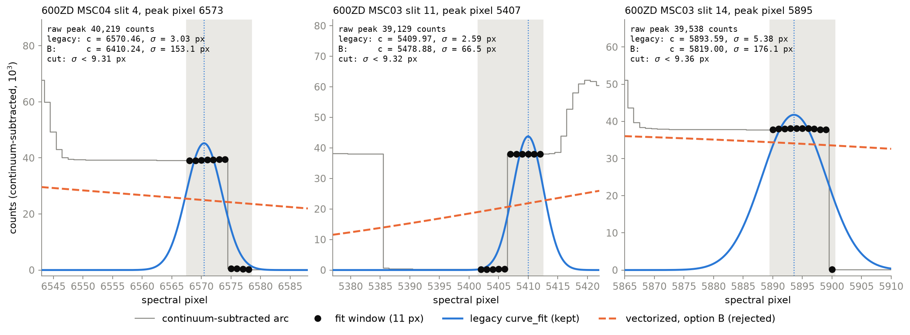
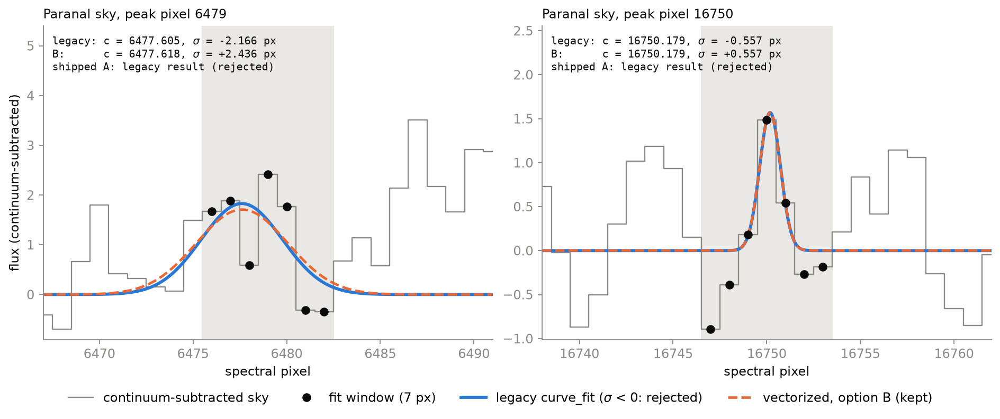
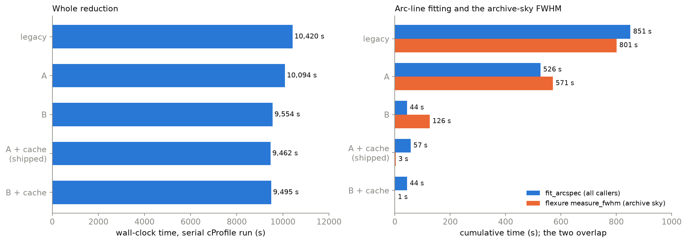
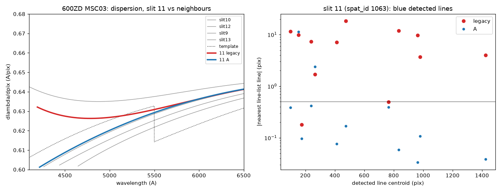

# Speed-up workstream C: vectorized arc-line Gaussian fitting

**Final report, 2026-10-26.**  PypeIt branch `speed_up_arcfit` (on top of
`speed_up_B`, PR #2209); dev-suite branch `dev_speed_up`.  The working record,
with every intermediate number and decision, is
`claude_prompts/speed_up/C.md` (Q1–Q11 and the Logs).  The measured tables
are also in `speed_up_results.md`, section "After workstream C".  This report
stands alone.

## Contents

0. [Executive summary](#0-executive-summary)
1. [What was replaced, and why](#1-what-was-replaced-and-why)
2. [The method](#2-the-method)
3. [Fidelity to the legacy `curve_fit` fit](#3-fidelity-to-the-legacy-curve_fit-fit)
4. [Line-count changes under the pure-vectorized option (B), and why A ships](#4-line-count-changes-under-the-pure-vectorized-option-b-and-why-a-ships)
5. [Worked examples](#5-worked-examples)
6. [Saturated features and line identification](#6-saturated-features-and-line-identification)
7. [Fallback rate, where the time goes, and the archive-sky FWHM cache](#7-fallback-rate-where-the-time-goes-and-the-archive-sky-fwhm-cache)
8. [Dev-suite vetting](#8-dev-suite-vetting)
9. [Re-profiling and the A+B+C totals](#9-re-profiling-and-the-abc-totals)
10. [Known limitation: the `full_template` shift-and-stretch step](#10-known-limitation-the-full_template-shift-and-stretch-step)
11. [Switches, options and remaining risks](#11-switches-options-and-remaining-risks)
- [Appendix A: files changed](#appendix-a-files-changed)
- [Appendix B: tests](#appendix-b-tests)
- [Appendix C: scripts and how to regenerate the figures](#appendix-c-scripts-and-how-to-regenerate-the-figures)

---

## 0. Executive summary

- **What changed.**  `pypeit.core.arc.fit_arcspec` used to fit a Gaussian to
  every detected line with its own `scipy.optimize.curve_fit` call.  On a
  serial Keck/DEIMOS 600ZD reduction that was 1.11 M `curve_fit` calls and
  ~840 s.  It now fits all lines at once:
  1. a weighted analytic log-parabola;
  2. a batched Gauss–Newton/Levenberg polish on `curve_fit`'s own objective;
  3. a moment-seeded rescue for the lines the analytic step cannot seed;
  4. the old per-line `curve_fit` as the last resort.
- **The shipped default is option A** (`ARCFIT_MATCH_CURVEFIT = True`).  A
  line on which the vectorized fit is not confident goes back to `curve_fit`:
  a polish or rescue that has not converged, or a fit narrower than 0.35 × the
  window half-width.  With these hand-offs `detect_lines` accepts **exactly the
  same lines as legacy on all 370 dev-suite arc spectra**, and their centroids
  agree to better than 1e-3 px.
- **Option B never calls `curve_fit` for a line it can fit.**  It is set by
  `[calibrations][wavelengths] fast_line_fit = True` (wavelength calibration
  only) or by `ARCFIT_MATCH_CURVEFIT = False` (all callers).  Its fit is 19×
  faster than legacy on DEIMOS.  Over the 370 spectra it loses 56 lines
  (saturated, flat-topped features) and gains 83 (sub-resolution spikes on
  which `curve_fit` fails).  Those changes flip the line identification on a
  handful of DEIMOS slits.
- **The largest single saving came from a second change.**  The FWHM of the
  archived sky spectrum in spectral flexure was re-measured 170 times per
  DEIMOS run.  It is now cached, with bit-identical results, and that removes
  568 s.
- **Serial DEIMOS 600ZD on the same code: 10 420 s (legacy) → 9 462 s
  (A + cache), −9.2%.**  Line fitting now costs 57 s, 0.6% of the run.  At
  `--ncpu 4` the wall goes from 3 400 s to 3 255 s.  Across A+B+C, serial
  DEIMOS went from 12 394 s (June baseline) to 9 462 s.
- **Products are unchanged except for one slit.**  Every dev-suite vet test
  has the same outcome as legacy.  37 of 38 WaveCalib files and every Tilts
  file match legacy.  The one exception is a single DEIMOS slit, which moves
  from a misidentified solution to the correct one through a known-fragile
  step (§10).
- **The "saturated lines" are not what the logs assumed.**  The features
  option B rejects on DEIMOS 600ZD are mostly the vertical edges of extended,
  flat-topped regions of saturated arc light, not saturated Gaussian lines
  (§5.1).  Legacy fits them with an arbitrary narrow Gaussian.  None of them
  enters a final wavelength fit, but they do steer the pattern-matching step,
  which is why keeping them (option A) keeps the identifications stable (§6).

## 1. What was replaced, and why

`detect_lines` (`pypeit/core/arc.py`) is the peak finder behind:
- the wavelength calibration;
- tilt tracing;
- object finding;
- slit-edge peak finding;
- spatial and spectral flexure.

`detect_lines` subtracts a continuum, finds peaks, and calls
`fit_arcspec(xarray, yarray, pixt, fitp)` to measure each peak's amplitude,
centre and width.  It then keeps the lines that pass these cuts:
`twid > 0`, `twid < 3·fwhm/2.35`, `0 < tcent < nspec`,
`|tcent − pixt| < 0.75·fwhm` and `tampl_true < nonlinear_counts`.

The legacy `fit_arcspec` looped over the peaks.  For each one it called
`fitting.fit_gauss`, i.e. `curve_fit(gauss_3deg, …)` with no `sigma`: an
unweighted linear-space least-squares fit over a window of
`2·round(1.25·fwhm / 2) + 1` pixels (7 px for `fwhm = 4`).

The June 2026 DEIMOS 600ZD_M_6500 profile
(`keck_deimos_600zd_m_6500_profile_report.md`; 12 393.8 s serial wall) put
this loop among the top hotspots:

| function | calls | time |
|---|---:|---:|
| `fitting.fit_gauss` (cum) | 1.11 M | 840 s |
| `gauss_3deg` (self) | 93 M | 332 s |
| `curve_fit` (cum) | — | 648 s |
| `leastsq` (cum) | — | 586 s |

Re-profiled on the current code with the legacy path forced, the numbers are
1 114 679 `fit_gauss` calls and **846 s** (`keck_deimos_600zd_m_6500_C_legacy.pstats.txt`).
The baseline reproduces.  Each window holds only a few pixels and only three
parameters are fit, so the cost is almost all per-call overhead.  That makes
it a natural target for vectorization.

## 2. The method

All of the code is in `pypeit/core/arc.py`.  `fit_arcspec` keeps its
signature `(ampl, cent, widt, centerr)` and its −999 sentinel for failed
fits.  It builds an `(nline, nwin)` array of window pixels, truncated at the
spectrum edges exactly as the old loop truncated them, and applies the
following cascade.

### 2.1 Weighted log-parabola (the analytic seed)

For a Gaussian `y = A exp(−(u−u0)²/2σ²)`, `ln y` is a parabola in the
window-centred coordinate `u = x − x[pixt]`:

    ln y = a0 + a1 u + a2 u²

Centring on the peak matters.  An absolute-pixel Vandermonde matrix for a
7-px window at x ≈ 3000 has a condition number of ~1e14.

`curve_fit` minimises Σ(y − g)² in linear space.  Write `y = g·e^δ`.  The
linear residual is then ≈ g·δ ≈ y·δ, so a log-space fit with weights
**w² = y²** reproduces `curve_fit`'s objective to first order.  This is the
Guo weighting.  An unweighted log fit would be dominated by the faint wings.

Only the positive pixels can enter the log fit (`gpm = in-bounds & finite &
y > 0`).  The normal equations are a 3×3 Hankel system for each line, built
from five weighted moments:

    S_k = Σ w² u^k        (k = 0..4)
    T_k = Σ w² u^k ln y   (k = 0..2)

    | S0 S1 S2 | |a0|   |T0|
    | S1 S2 S3 | |a1| = |T1|
    | S2 S3 S4 | |a2|   |T2|

All lines are solved in one stacked `np.linalg.solve`.  The right-hand side
is passed as `T[..., None]`, because NumPy ≥ 2 rejects a stacked
`(n, 3)` vector.  Back-substitution gives:

    σ  = sqrt(−1/(2 a2))        u0 = −a1/(2 a2)        A = exp(a0 − a1²/(4 a2))

A line is accepted as a seed only if all of the following hold:
- it has at least `ARCFIT_MIN_GOODPIX = 4` positive pixels;
- its normal matrix is non-singular, judged by `|det|` relative to the product
  of the diagonal;
- `a2 < 0`;
- all three parameters are finite;
- `|u0|` is no larger than the window half-width, so that the centre is not
  extrapolated.

### 2.2 Gauss–Newton / Levenberg polish

`_gauss_newton_refine` runs batched Levenberg–Marquardt iterations on the
exact `curve_fit` objective, Σ(y − A e^{−(u−u0)²/2σ²})².  It uses **all
in-bounds pixels, including the negative wings** of the continuum-subtracted
arc, which the log fit cannot use.  This step is what makes the result track
`curve_fit` rather than the log-space approximation.

- Each line has its own damping factor: ÷10 after an accepted step, ×10 after
  a rejected one.
- A line leaves the active set once one of these holds:
  - χ² changes by less than `tol = 1e-10` (relative);
  - its parameters change by less than `xtol = 1.5e-8` (relative to amplitude
    and width);
  - its damping factor exceeds 1e10.
- **`ARCFIT_GN_ITER = 10` is therefore a cap, not a fixed count.**  The
  routine returns a per-line `converged` flag, and σ is returned as |σ|.
- The locked plan was 3 iterations.  The cap was raised to 10 in Q7 (table in
  §3): it costs 0.06 s more over 92 DEIMOS arcs and halves the number of lost
  saturated features.
- After the polish the centroid is no longer confined to the window.
  `curve_fit` does not confine it either.

### 2.3 Moment-seeded rescue

Some lines cannot be seeded analytically:
- fewer than 4 positive pixels;
- an upward parabola;
- a centre outside the window;
- a singular matrix.

These lines, if they have more than 3 finite pixels, are seeded by
`_moment_seed`, a vectorized `fitting.guess_gauss` (the same starting point
`curve_fit` uses).  They then get up to `ARCFIT_RESCUE_ITER = 20` Gauss–Newton
iterations.

The rescue was added in Task 3 (Q4(b)).  Without it, 6.7% of DEIMOS lines
and 13.2% of sky lines fell back to `curve_fit`, which left the fit only
~2× faster.

### 2.4 `curve_fit` fallback and the three hand-off rules

The legacy loop is kept verbatim as `_fit_arcspec_curvefit`.  It serves both
as the last-resort fallback and as the reference implementation.  Every line
that the vectorized steps attempt but do not accept goes to it.

Under the **shipped default, `ARCFIT_MATCH_CURVEFIT = True` (option A)**,
three further classes of line are handed to `curve_fit` as well:
1. lines whose polish has **not converged** within `ARCFIT_GN_ITER`;
2. lines whose rescue has **not converged** within `ARCFIT_RESCUE_ITER`;
3. fits with **σ < `ARCFIT_MIN_WIDTH` × window half-width**, where
   `ARCFIT_MIN_WIDTH = 0.35`.  These are features much narrower than an arc
   line, such as hot pixels; `curve_fit` often fails on them, and it then
   decides whether they survive.

Rules 1–2 capture the saturated, flat-topped features and the blends.  Rule 3
captures the sub-resolution spikes.  These are exactly the populations on
which the vectorized and the legacy fits disagree about *acceptance* (§4).
With `ARCFIT_MATCH_CURVEFIT = False` (**option B**) the vectorized result is
used wherever it exists.

The fallback was also hardened:
- windows that contain non-finite pixels are no longer sent to `curve_fit`,
  which used to raise an uncaught `ValueError` on them;
- non-finite `curve_fit` parameters become −999.  Legacy leaked NaN, which
  slips past `flexure.py`'s `== -999.0` check;
- a non-finite `centerr` on a finite fit becomes `inf`, which is legacy's
  "covariance not estimated" value.

### 2.5 `centerr`

`centerr` is the **variance** of the centre (legacy returns `fitcov[1,1]`),
not an error.  No caller uses it numerically: every consumer discards it or
stores it in a variable that is never read (C.md, Key facts).  It must keep
its shape, its sign and the −999 sentinel.

As decided in Q5:
- **When the polish runs** (`GN_ITER > 0`), `_gauss_center_variance` returns
  `curve_fit`'s own definition, `s²·[(JᵀJ)⁻¹]₁₁` with `s² = Σr²/(n−3)` over
  the in-bounds pixels.  Its median ratio to legacy `fitcov[1,1]` is 1.000 on
  both the sky and the DEIMOS arcs.
- **When `GN_ITER = 0`**, `_center_variance` propagates the parabola
  covariance `Cov(a) = s²(XᵀW²X)⁻¹` through `∂c/∂a1 = −1/(2a2)` and
  `∂c/∂a2 = a1/(2a2²)`.

### 2.6 Controls (Q9)

| control | where | default | effect |
|---|---|---|---|
| `USE_VECTORIZED_ARCFIT` | `pypeit.core.arc` | `True` | `False` restores the legacy per-line loop for every line (kill switch) |
| `ARCFIT_MATCH_CURVEFIT` | `pypeit.core.arc` | `True` (A) | `False` = option B, for **all** `detect_lines` callers |
| `ARCFIT_GN_ITER`, `ARCFIT_RESCUE_ITER`, `ARCFIT_MIN_WIDTH`, `ARCFIT_MIN_GOODPIX` | `pypeit.core.arc` | 10, 20, 0.35, 4 | tuning constants |
| `fast_line_fit` | `[calibrations][wavelengths]` (`WavelengthSolutionPar`) | `False` | `True` = option B inside the wavelength calibration only |

`fast_line_fit` is applied in `BuildWaveCalib.run` (`pypeit/wavecalib.py`).
The whole body of `run` executes inside the context manager
`arc.arcfit_options(match_curvefit=not fast_line_fit)`, which sets
`ARCFIT_MATCH_CURVEFIT` and restores it in a `finally`.

A context manager was used because about 15 call sites in the wavelength
calibration reach `fit_arcspec`, several of them without `par` at hand.  It
also works unchanged in `--ncpu` workers, since each worker runs
`BuildWaveCalib.run` itself.  Tilts, object finding and flexure keep the
default.

## 3. Fidelity to the legacy `curve_fit` fit

All numbers in this section compare `fit_arcspec` outputs on identical inputs
(C.md Tasks 2–5, Q7, Q8).  "Accepted" means the line passes `detect_lines`'
cuts.

**Analytic seed alone (`GN_ITER = 0`, no rescue):**

| data | median \|Δc\| | p99 \|Δc\| | other |
|---|---:|---:|---|
| Paranal sky (`paranal_sky.fits`; 4 259 peaks, `fit_interval = 3`) | 0.040 px | 2.0 px | 13.2% fall back |
| DEIMOS 600ZD arcs (92 spectra, 10 170 lines) | 0.009 px | 0.25 px | median \|Δσ/σ\| 0.9%; 6.7% fall back |

That is not close enough.  For example, `gn0` fails the dev-suite RMS
tolerance on `shane_kast_red/600_7500_d57` (§8).

**With the polish and the rescue**, on the 92 DEIMOS 600ZD arcs:

| `GN_ITER` (rescue 20) | `fit_arcspec` | speed-up | lines lost vs legacy | median / p99 \|Δc\| | lines with \|Δc\| > 0.02 px |
|---|---:|---:|---:|---|---:|
| 3 | 0.29 s | 16.1× | 122 | 1.4e-6 / 0.14 px | 174 |
| **10** (shipped cap) | 0.35 s | 13.3× | 51 | 1.4e-7 / 4.4e-4 px | 17 |

On the sky, `GN = 10` brings the p99 down from 0.87 to 0.33 px.  The
residual disagreements on the blended sky lines are lines where the two
optimisers reach different local minima.

The table above describes the vectorized fit by itself, which is what
option B uses.  **Under the shipped default A**, the hand-off rules send
every disagreeing population back to `curve_fit`:
- over **all 370 arc spectra** of the dev-suite run (33 354 legacy lines),
  **0 lines are gained and 0 are lost**, and shared centroids agree within
  1e-3 px (Q8);
- the residual differences are the two optimisers' stopping tolerances,
  1e-5 to 1e-3 px apart.

Re-checked for this report with `report_fig_saturated.py --list` and
`report_fig_negsigma.py --list`:
- **DEIMOS 600ZD arcs** (stored `arc_spectra`, `fwhm = 4`, 92 spectra): legacy
  accepts 7 887 lines, A 7 887, B 7 838;
- **DEIMOS 600ZD, pipeline inputs** (the per-slit `wv_fits[i].spec` and
  measured fwhm ≈ 7.0–7.7 px, 86 spectra): legacy 10 132, A 10 132, B 10 093;
- **Paranal sky:** legacy 3 748, A 3 748, B 3 766.

The unit test `test_detect_lines_matches_curve_fit` pins the sky result.

## 4. Line-count changes under the pure-vectorized option (B), and why A ships

Option B changes which lines are accepted for three reasons.  Centroids of
the shared lines are unaffected (~1e-6 px).

1. **Negative σ (Q3).**  `gauss_3deg` uses only σ², so the sign `curve_fit`
   lands on depends on its path.  On the Paranal sky, 56 of 4 259 legacy fits
   end with σ < 0, and `detect_lines` rejects them through `twid > 0`; 49 of
   them pass every other cut.  The vectorized fit returns |σ|, and **B keeps
   38 of the 49** (computed for this report).  Most of these are not real
   lines: 37 of the 38 have σ between 0.25 and 0.66 px, against an expected
   σ ≈ 1.7 px for `fwhm = 4`.  They are sub-resolution spikes.  The one with
   a line-like width is shown in §5.2.  Under A all 49 go back to `curve_fit`
   and are rejected as before.
2. **Saturated, flat-topped features (Q6).**  On the 92 DEIMOS 600ZD arcs
   the vectorized fit rejects 129 legacy-accepted features at `GN = 0`, and
   51 at `GN = 10`.  All of them fail the width cut, 98–99% have raw peaks
   above 30 000 counts, and their windows are flat (3rd-highest / max
   ≈ 0.999).  On a plateau the Gaussian objective is nearly flat in σ, so the
   polish wanders to very large σ.  Legacy `curve_fit` returns a σ of 1.7–3 px
   instead.  §5.1 shows what these features actually are.
3. **Sub-resolution spikes on which `curve_fit` fails.**  Over the 370 dev-suite
   spectra B gains 83 lines, all with σ < 0.5 of the expected width (median
   0.33).  Legacy `curve_fit` raised `RuntimeError` on them.

Over all 370 spectra B **gains 83 and loses 56** lines.  The dev-suite run of
B (`REDUX_OUT_C/gn10`) passed every vet test that legacy passed.  Underneath,
though, it **changed line identifications**:
- 10 of 38 WaveCalib files move by more than 0.05 px, all multi-slit DEIMOS
  plus LRIS `multi_300` at 0.096 px;
- `600ZD_M_6500` MSC01 slit 2 is misidentified at the blue end: 4359.56 Å is
  placed on the line legacy calls 4377.35 Å, about 30 px off, while the slit
  RMS moves only from 0.588 to 0.617.  Similar flips occur on MSC01 slit 11
  and MSC03 slits 0, 14 and 15;
- `830G_L_8100` (single slit) goes from RMS 0.051 to 0.27 px;
- one case improves: `1200G_M_7750` max RMS 0.42 → 0.13.

On the misidentified 600ZD slits, the only difference in the input to the
identification is the loss of one or two of the saturated features (Q8).

**Decision (Q8): ship A, keep B as an option.**  A wrong wavelength
identification is a worse outcome than a smaller speed-up, and a vet-test
tolerance does not catch a 30 px misidentification at a slit end.  A keeps
the whole vectorized cascade, the tests and the kill switch, and it still
removes most of the `curve_fit` calls (§7).  Once the cache of §7.2 is in,
the remaining cost difference between A and B on DEIMOS is ~13 s.

## 5. Worked examples

### 5.1 Saturated, flat-topped DEIMOS 600ZD features that B rejects and legacy keeps

`report_fig_saturated.py --list` re-runs `detect_lines` on the arc spectra
stored in the legacy dev-suite WaveCalib files.  It uses the per-slit
spectrum and measured fwhm, i.e. what the pipeline saw: 86 slits,
fwhm 7.0–7.7 px, an 11-pixel fit window and a width cut of σ < 9.3 px.  It
lists every line that legacy accepts and B rejects: **46**.

- 45 of the 46 have raw peaks above 30 000 counts.
- **39 of those 45 sit on a vertical edge**: within ±4 px of the peak pixel,
  the spectrum jumps between adjacent pixels by 88–98% of the peak value.
- The other 6 sit in the middle of a flat plateau.
- **None of the 46 is used in any final wavelength fit**: the nearest
  `pixel_fit` line is at least 7.2 px away (median 26 px).

The same checks on the fwhm = 4 inputs of Q6/Q7 (51 lost, 50 saturated) give
the same picture: all 50 have an adjacent-pixel jump above 50% of the peak
(median 96%), and none is in a final fit.

**Figure 1.**  Three DEIMOS 600ZD features that legacy `curve_fit` accepts
and option B rejects.

- **How to read it.**  The grey step line is the continuum-subtracted arc
  that `fit_arcspec` sees, and the shaded band with black points is the
  11-pixel fit window.  The solid blue curve is the legacy Gaussian (its
  centre is the dotted line); the dashed orange curve is the option-B
  Gaussian.  The text gives the raw peak counts and both fits' centre and σ.
- **Left and middle.**  The window straddles the vertical edge of a plateau
  at ~39 000 counts.  Legacy places a σ ≈ 2.6–3.0 px Gaussian whose centre is
  3.5–4 px inside the edge.  B's fit has not settled; its σ is 66–153 px and
  fails the width cut.
- **Right.**  The window lies on the flat top, next to the plateau's right
  edge.  Legacy returns σ = 5.4 px, centred 1.4 px from the peak pixel; B again drifts to σ = 176 px.
- Under the shipped default A, all three are handed to `curve_fit`, so A
  returns the blue curve exactly.

| example | raw peak (counts) | legacy c / σ (px) | option B c / σ (px) | A |
|---|---:|---|---|---|
| MSC04 slit 4, pixel 6573 (edge) | 40 219 | 6570.46 / 3.03 | 6410.24 / 153.1 | = legacy, kept |
| MSC03 slit 11, pixel 5407 (edge) | 39 129 | 5409.97 / 2.59 | 5478.88 / 66.5 | = legacy, kept |
| MSC03 slit 14, pixel 5895 (plateau) | 39 538 | 5893.59 / 5.38 | 5819.00 / 176.1 | = legacy, kept |

**What these features are.**  The plateaus are not single saturated lines.
In the 2D arc frame (`Arc_A_0_MSC04.fits`, slit 4), the region around
spectral pixel 6505–6574 reads ~39 900 counts right across the slit for about
60 spectral pixels.  Within it lie line cores that reach 79 503 counts, the
maximum value in the frame, i.e. hard saturation.  The region then drops to
~1 300 counts within one pixel.

This is consistent with charge bleeding from hard-saturated pixels along the
CCD columns, which on DEIMOS run along the spectral direction.  That reading
is not verified further here.  Either way, the 7- or 11-pixel window sees
either a step or a flat top, not a Gaussian:

- **The legacy σ is an artefact.**  A step or a flat top has no Gaussian
  width.  `curve_fit` minimises the squared residual by placing the steepest
  part of a Gaussian on the step (left and middle panels), or by matching the
  curvature of a slightly convex top (right panel).  The resulting σ values
  cluster at a few recurring values, which is the signature of the window
  geometry rather than of the light: with fwhm = 4, legacy returns σ ≈ 1.69 or
  2.16 px on almost every one of these features.
- **The legacy centroid is not a line position.**  It marks the plateau
  edge, offset inward by a few pixels (2–3 px with the 7-pixel `fwhm = 4`
  windows, 3.5–4 px with the 11-pixel pipeline windows).  The brief for this report
  assumed the centroid "is nevertheless usable".  The data show that it is
  usable only as a reproducible marker of where the saturated region ends; it
  is not the wavelength of an arc line.  This is presumably why none of these
  features survives into a final wavelength fit.
- **The vectorized fit is not "right" either.**  On these windows it simply
  does not converge: the objective is almost flat along σ.  Under A this
  non-convergence triggers hand-off rule 1, and `curve_fit` gives the legacy
  answer.

### 5.2 A negative-σ line on the Paranal sky

**Figure 2.**  Two Paranal sky lines on which legacy `curve_fit` converges
to σ < 0 and `detect_lines` then rejects the line through `twid > 0`.  The
layout is as in Figure 1, with a 7-pixel window (`fwhm = 4`).

- **Left (pixel 6479).**  The one negative-σ line with a line-like width.
  Legacy: c = 6477.605, σ = −2.166 px.  Option B: c = 6477.618, σ = +2.436 px,
  so it is kept.  The two curves nearly coincide.  The centres differ by
  0.012 px, and the widths by 12%, because this noisy, blended window has two
  close minima.
- **Right (pixel 16750).**  The more typical case.  Both fits land on the
  same optimum (c = 16750.179, |σ| = 0.557 px to 4 decimals) and differ only
  in the sign.  The feature is a sub-resolution spike (expected σ ≈ 1.7 px).
- **What the reader should see.**  The sign of σ is the only reason legacy
  rejects these lines; the shape fitted is the same.  Under the shipped
  default A, the 37 narrow ones fail the width hand-off.  The remaining one
  (pixel 6479, σ = 2.4 px) is above the width threshold, so it is presumably
  handed off by the convergence rules (not checked separately).  All of them go to `curve_fit`, receive its
  negative σ, and are rejected exactly as before.

## 6. Saturated features and line identification

The user asked how including the saturated features can improve the fit by
giving more identifications.  The evidence is as follows.

1. **They anchor the pattern match, not the final fit.**  The 600ZD
   wavelength solution uses `full_template`.  Its first step builds synthetic
   arcs from *all* detected peaks and cross-correlates them with the
   template, then refines a shift and stretch per snippet (§10).  The
   saturated features are among the brightest and most distinctive peaks.
   They are reproducible from slit to slit because they follow the bright Ar
   lines, so they contribute heavily to that cross-correlation.  Q8 found
   that losing one or two of them was the only input difference on the 600ZD
   slits that option B misidentified.  None of them is used as an identified
   line in a final fit (§5.1).
2. **Keeping them therefore gives more, and more robust, identifications.**
   With them, the identification lands on the branch that the neighbouring
   slits and the template agree on.  Without them, it can land on a branch
   that is off by tens of pixels at a slit end, which forfeits the correct
   identification of the lines there.  Example: MSC01 slit 2 under B has its
   blue lines assigned to the wrong wavelengths, at an RMS that barely
   changes.
3. **What their centroids are good for.**  The legacy centroid of a plateau
   edge is not a line wavelength (§5.1).  It is, however, stable: it moves
   with the edge, and the edge moves with the saturated line.  It therefore
   carries positional information for a cross-correlation even though it
   would be wrong as an identified line.  The final fits do not use these
   features, so this is the right division of labour.
4. **The alternative, rejecting them (option B or Q6(b)), was tried and
   measured.**  It gains ~13 s per serial DEIMOS reduction after the cache
   and costs identification flips on 600ZD, 830G_L_8100 and other multi-slit
   DEIMOS setups (§4).  Q6(b) assumed these lines were "not useful"; Q8
   showed that premise was wrong for identification.  A ships for that
   reason.
5. **A possible future improvement.**  Treat plateaus explicitly instead of
   letting `curve_fit` fit a Gaussian to them:
   - detect a flat-topped or stepped window (e.g. 3rd-highest/max > 0.95, or
     an adjacent-pixel jump > 50% of the peak);
   - give it a dedicated model, such as an edge position or the plateau
     midpoint from the half-maximum crossings over a wider window;
   - flag it as "saturated" so that the identification can use it as an
     anchor while the final fit excludes it explicitly.

   That would remove the slowest `curve_fit` calls (§7) without changing the
   anchors.  It is outside PR C.

## 7. Fallback rate, where the time goes, and the archive-sky FWHM cache

### 7.1 Fallback rate

On clean arcs the vectorized path handles almost everything.  With the
rescue, on the DEIMOS arcs only 5 of 10 170 lines (0.05%) reach `curve_fit`
under B, and 36 of 4 259 sky lines (0.8%).

Under A the hand-offs add about 500 DEIMOS lines (~5%), and **432 of the 517
deferred lines end in `curve_fit` `RuntimeError`** after its full 800
evaluations (1.75 of 1.83 s for the 92 arcs, Q8).  So most of A's remaining
`curve_fit` time is spent on lines that legacy also fails to fit.  That time
is needed to reproduce legacy exactly, because some lines that legacy
accepts need more than 700 evaluations.  `maxfev` cannot be capped safely:
over 7 505 fallback fits, successful ones reach 799 evaluations, and 22
plausible lines need more than 400.

Fit-level micro-benchmarks (pure vectorized path):

| input | lines | legacy | vectorized | speed-up |
|---|---:|---:|---:|---:|
| synthetic (`_synthetic_arc`) | 2 046 | 437 ms | 16.6 ms | 26× |
| Paranal sky | 4 259 | 2 279 ms | 111 ms | 21× |
| DEIMOS 600ZD arcs, B (`GN = 10`) | 10 170 | 4.68 s | 0.35 s | 13.3× |
| DEIMOS 600ZD arcs, A | 10 170 | — | — | 2.0× |
| Paranal sky, A | 4 259 | — | — | 1.4× |

In the full serial DEIMOS profile **before the cache** (§9), A made
**319 275 `fit_gauss` calls (494 s)** against legacy's 1.11 M (846 s).  Of
`detect_lines`' 655 s, **571 s came from one caller**:
`autoid.measure_fwhm`, called 170 times by
`flexure.get_archive_spectrum`.  Blended sky lines often fail to converge and
are handed off.

### 7.2 The archive-sky FWHM cache (Q10)

`flexure.get_archive_spectrum` measured the spectral FWHM of the **same
archived sky spectrum** (`paranal_sky.fits` for DEIMOS) on every call: once
per slit and science frame, 170 times per run at ~3.4 s each.  The code's own
comment said it meant to avoid this.

The fix is a module-level helper, `@functools.lru_cache(maxsize=None)
_archive_sky_fwhm(sky_file)` in `pypeit/core/flexure.py`:
- it loads the sky file and runs `measure_fwhm` once per file;
- `get_archive_spectrum` still loads its own spectrum object on every call,
  so callers never share a mutable object;
- failures raise as before and are not cached;
- each `--ncpu` worker has its own cache, so no plumbing is needed.

The output is **bit-identical**, because it is the same deterministic
computation on the same file.  `test_archive_fwhm_cache` checks that a
second call does not re-measure.

Effect on serial DEIMOS (A):

| | before cache | after cache |
|---|---:|---:|
| `measure_fwhm` calls / cum | 170 / 571 s | **1 / 3 s** |
| `fit_gauss` calls / cum | 319 k / 494 s | **14 k / 42 s** |
| `fit_arcspec` cum | 526 s | **57 s** (0.6% of the run) |

## 8. Dev-suite vetting

Method:
- `pypeit_test reduce -i shane_kast_blue shane_kast_red keck_deimos
  keck_lris_blue` (35 setups);
- then `vet_tests/test_{wavelengths,wavetilts,extraction,skysub}.py`;
- each variant reduced into its own `REDUX_OUT_C/<variant>`;
- variants selected through `scripts/arcfit/variant_hook/sitecustomize.py`.

Variants:
- `legacy` (kill switch off);
- **A** (shipped);
- `gn10` (= B, `GN_ITER = 10`);
- `gn0` (pure analytic seed plus rescue, no hand-offs).

All four reduced **35/35** setups.  Vet outcomes are identical for legacy, A
and `gn10`.  The 13 failures common to all are missing products for
instruments outside the four reduced.  `gn0` additionally fails
`test_shane_kast_red`.

**Vetted RMS** (the slit or quantity each test asserts on; values from the
Task 5 log and `REDUX_OUT_C/arcfit_metrics*.md`):

| vet test / setup | tolerance | legacy | **A** | gn10 (B) | gn0 |
|---|---:|---:|---:|---:|---:|
| shane_kast_red 300_7500_Ne (slit 1) | 0.05 | 0.0308 | 0.0308 | 0.0308 | 0.0413 |
| shane_kast_red 600_7500_d57 | 0.05 | 0.0369 | 0.0369 | 0.0369 | 0.0633 **fail** |
| shane_kast_red 1200_5000_d57 | 0.055 | 0.0512 | 0.0512 | 0.0512 | 0.0496 |
| keck_deimos 1200B_LVM_5200 (slit 3) | 0.15 | 0.1234 | = legacy | 0.1234 | 0.1242 |
| keck_deimos 600ZD_M_6500 (slit 1) | 0.35 | 0.3356 | = legacy | 0.3350 | 0.3100 |
| keck_deimos 900ZD_LVM_5500 (slit 1) | 0.1 | 0.0687 | = legacy | 0.0687 | 0.0685 |
| keck_lris_blue multi_300_5000_d680 (max) | 0.32 | 0.2970 | 0.2970 | 0.2969 | 0.2877 |
| keck_lris_blue long_400_3400_d560 (max) | 0.21 | 0.1947 | 0.1947 | 0.1947 | 0.1853 |
| keck_lris_blue long_600_4000_d560 (max) | 0.08 | 0.0621 | 0.0621 | 0.0621 | 0.0772 |

"= legacy": A's WaveCalib files match legacy to a median max |Δλ| of 1.4e-6
px, with the same line counts and RMS, for every DEIMOS file except
600ZD MSC03, which is not a vetted slit.

**All 38 WaveCalib files, summarised by setup family** (median/max slit RMS
in px; "max |Δλ|" is over the pixel range covered by both variants' lines):

| setup family | files | A vs legacy | gn10 (B) vs legacy | gn0 vs legacy |
|---|---:|---|---|---|
| Kast blue / red | 8 | identical RMS; max \|Δλ\| ≤ 7e-6 px | identical RMS (≤ 2e-4 change) | RMS changes up to 0.055 (600_4310_d55 0.074 → 0.019; 600_7500_d57 0.037 → 0.063, fails); \|Δλ\| up to 10 px (600_5000_d46) |
| LRIS blue | 13 | identical RMS; max \|Δλ\| ≤ 7e-6 px | identical RMS; `multi_300` DET01 \|Δλ\| 0.096 px | long_600 DET01 0.062 → 0.077; \|Δλ\| up to 4 px (multi_600 slitmask DET02) |
| other DEIMOS (830G_*, 900ZD_*, 1200B_LVM, 600ZD_tilted) | 10 | identical (\|Δλ\| ≤ 1.1e-3 px) | 830G_L_8100 **0.051 → 0.27**; 830G_LVM max 0.161 → 0.172; others ≤ 0.05 px | 830G_L_8100 0.051 → 0.34; \|Δλ\| up to 20 px (900ZD_M_6000) |
| DEIMOS 1200B_M / 1200G_M | 3 | identical (\|Δλ\| ≤ 2e-5 px) | moves up to 28.5 px (1200G_M_7750; max RMS 0.42 → 0.13) | up to 104 px (1200G_M_5500) |
| DEIMOS 600ZD_M_6500 MSC01–04 | 4 | MSC01/02/04 identical; **MSC03 slit 11 moves 30.7 px** (median RMS 0.2656 → 0.2579, lines 1 804 → 1 812; §10) | moves 31–52 px on all four mosaics (identification flips) | moves 17–49 px |
| **total lines in final fits** | 38 | legacy 21 702, **A 21 710** | 21 681 | 21 700 |

**Tilts.**
- A matches legacy on every Tilts file: identical tilt-line counts, median
  |Δtilt| ≤ 1.3e-7 px, max ≤ 0.005 px (one file differs by one 2D-fit point).
- `gn10` reaches 0.54 px (600ZD MSC02) and 0.88 px (1200G_M_5500).
- `gn0` reaches up to 1.4 px on 600ZD MSC04 and, per the Task 5 log, up to
  62 px on 1200G_M_5500.

**spec1d `WAVE_RMS`, legacy vs A:**
- identical on 40 Kast objects (max difference 1.1e-6);
- identical on 83 of 84 DEIMOS 600ZD objects.  The 84th is MSC03 slit 11
  (0.2757 → 0.2513).

**QA PNGs.**  Arc-fit QA PNGs are byte-identical or differ only at the
anti-aliasing level, except for that slit.

## 9. Re-profiling and the A+B+C totals

All five serial profiles below are cProfile at `--ncpu 1` on the **same
HEAD**.  Legacy is the kill switch set through the variant hook.  The numbers
are copied from `speed_up_results.md`; the artifacts are
`keck_deimos_600zd_m_6500_C_{legacy,A,B,A_cache,B_cache}.*`.

**Figure 3.**  Serial DEIMOS 600ZD_M_6500 profiles of the five variants.
- **Left:** whole-run wall.
- **Right:** cumulative time in `fit_arcspec` (all callers) and in flexure's
  `measure_fwhm` of the archive sky.  The two overlap, because
  `measure_fwhm` calls `detect_lines` → `fit_arcspec`.
- **What to see.**  The archive-sky cache (A → A + cache) removes more time
  than the change to the fit itself (legacy → A).  With the cache, A and B
  are within ~33 s of each other in wall time (9 462 vs 9 495 s), and A's
  line-fitting cost is 57 s.

| | legacy | A | B | **A + cache (shipped)** | B + cache |
|---|---:|---:|---:|---:|---:|
| wall | 10 420 s | 10 094 s | 9 554 s | **9 462 s** | 9 495 s |
| vs legacy | — | −3.1% | −8.3% | **−9.2%** | −8.9% |
| `fit_gauss` calls / cum | 1.11 M / 846 s | 319 k / 494 s | 10 k / 20 s | 14 k / 42 s | 7.5 k / 29 s |
| `curve_fit` cum | 666 s | 441 s | 18 s | 40 s | 28 s |
| `gauss_3deg` calls | 93.0 M | 71.4 M | 3.1 M | 7.0 M | 4.8 M |
| `fit_arcspec` cum | 851 s | 526 s | 44 s | 57 s | 44 s |
| `_gauss_newton_refine` cum | — | 24 s | 19 s | 12 s | 11 s |
| `measure_fwhm` (flexure) calls / cum | 170 / 801 s | 170 / 571 s | 170 / 126 s | 1 / 3 s | 1 / 1 s |
| `detect_lines` calls / cum | 2 944 / 981 s | 2 944 / 655 s | 2 944 / 170 s | 2 775 / 87 s | 2 775 / 75 s |
| `spec_flex_shift` cum | 842 s | 591 s | 138 s | 23 s | 12 s |

Caveats (from `speed_up_results.md`):
- **Machine noise.**  Wall differences include noise of a few percent; for
  example, `extraction.run` ranges over 1 589–2 038 s for reasons unrelated
  to C.  The per-function arc-fit and flexure numbers are the robust ones.
- **Overlap with other work.**  The A + cache profile overlapped the unit
  tests and the doc build for ~15 min.
- **Against the plan.**  §C.7 expected ~700–800 s off DEIMOS from the fit
  alone.  The legacy-faithful default delivers 326 s from the fit, and the
  cache a further 568 s.

**Kast blue 600_4310_d55, serial:**

| | legacy | A | B |
|---|---:|---:|---:|
| wall | 88.5 s | 88.4 s | 100.7 s |
| `fit_arcspec` cum | 0.75 s | 0.47 s | 0.22 s |
| `curve_fit` calls | 1 297 | 109 | 5 |

The wall differences are noise: B is slowest despite having the fastest fit.
The fit was never a Kast cost (0.3–0.5 s, not the 1–3 s §C.7 expected).

**DEIMOS `--ncpu 4`, uninstrumented** (B's `run_with_rss` recipe;
`REDUX_OUT_C/_ncpu4/`):

| | legacy | A | A + cache |
|---|---:|---:|---:|
| wall | 3 400.2 s | 3 368.6 s | **3 254.8 s** |
| calibrations / image proc / extraction | 1 480.1 / 76.7 / 660.7 s | 1 487.9 / 78.2 / 624.7 s | 1 475.3 / 78.3 / 501.2 s |
| peak PSS | 36.7 GB | 36.6 GB | 36.7 GB |

The fit change alone is within the ~3% run-to-run scatter at `--ncpu 4`; C
is mainly a serial-time gain.  The cache's serial saving shows up as −124 s
in the parallel extraction stage.

**A + B + C totals:**

| run | before | after | change |
|---|---:|---:|---:|
| serial DEIMOS 600ZD | 12 393.8 s (June baseline) | 9 462 s | −23.7% |
| serial Kast blue | 121.2 s | 88.4 s | −27% (essentially all from A) |
| DEIMOS `--ncpu 4` | 3 391.2 s (B) | 3 254.8 s | −4.0% |

- The DEIMOS `--ncpu 4` result is 3.8× faster than the June serial baseline.
- The two ends of the serial comparisons were measured on different code and
  days: the baseline on the old `pypeit` env with the `qtagg` backend.  These
  totals are therefore indicative.
- The like-for-like gain of C is −958 s serial (§9 table).

## 10. Known limitation: the `full_template` shift-and-stretch step

The single WaveCalib file where A differs from legacy, `600ZD_M_6500` MSC03,
was traced to one slit, slit 11 (spat_id 1063).  The difference is not in the
line fitting:

- all 15 `detect_lines` calls inside `autoid.full_template` accept the same
  lines, with centres within 2e-6 to 8.5e-4 px;
- re-running `full_template` on the stored spectrum reproduces both results
  exactly.

The amplification chain:
1. `get_xcorr_arc` builds synthetic arcs from all peaks, so the
   cross-correlation changes by **1.6e-8**.
2. `detect_lines(corr, nfind=1)`'s continuum fit then moves the correlation
   peak from 4131.8517 to 4131.8583 px.
3. That changes the seed of `differential_evolution` in
   `wvutils.xcorr_shift_stretch` for snippet 0 (pixels 0–4106).
4. The optimiser lands in a different optimum:
   - legacy: shift 75.86, stretch 0.98896;
   - A: shift 98.59, stretch 0.97535;
   - `stretch2` is pinned at its bound in both runs.
5. The solutions differ by 38 px at pixel 0, 8.9 px at pixel 1000 and
   0.85 px at pixel 2000.

**Figure 4** (from `arcfit_msc03_judge.py`).
- **Left:** dispersion dλ/dpix against wavelength for slit 11 (legacy red, A
  blue), its neighbours (grey) and the template (dotted).  A's dispersion
  rises smoothly, like the neighbours'; legacy's turns over in the blue.
- **Right:** for the 12 blue lines detected identically in both runs, the
  distance from each line to the nearest line-list wavelength when mapped
  through each solution.  10 of 12 fall within 0.5 px for A (median 0.14 px),
  against 2 of 12 for legacy (median 7.2 px).
- **What to see.**  A is the correct branch.  It also has the lower RMS
  (0.251 vs 0.276) with more lines (81 vs 73 kept).

Caution: legacy's optimum has the *higher* zero-lag correlation (0.778 vs
0.767), so the objective itself cannot choose the right branch here.
Slit 9 (spat_id 902) of the same mosaic shows the same dispersion turnover in
*both* runs, so it may be misidentified today.  That is not verified.

**Decision (Q11):**
- no pipeline change in PR C;
- no GitHub issue;
- the fragility is documented as a known limitation, here and in the release
  notes.

Any change in a `full_template` setup's line list, at any level, can flip
such a slit.  This applies to PR C's tolerance-level differences, to
`fast_line_fit`, and equally to future, unrelated changes.

## 11. Switches, options and remaining risks

**Switches:**
- **Kill switch:** `pypeit.core.arc.USE_VECTORIZED_ARCFIT = False` restores
  the previous per-line implementation for every line.  The unit test
  `test_fit_arcspec_kill_switch` checks that it is bit-identical to
  `_fit_arcspec_curvefit`.
- **Options:** `ARCFIT_MATCH_CURVEFIT = False` gives option B for all callers;
  `[calibrations][wavelengths] fast_line_fit = True` gives option B for the
  wavelength calibration only.  After the cache, B buys ~13 s on serial
  DEIMOS 600ZD.  It matters most on spectra with many lines that `curve_fit`
  fails on.

**Remaining risks:**
1. **Consumers of `fit_arcspec` beyond wavelengths.**  `detect_lines` also
   feeds tilt tracing, object finding (`findobj_skymask`), slit-edge peaks
   (`trace.py`), spatial and spectral flexure, and `wavemodel`.  Under A
   these see legacy-equivalent results to ≤1e-3 px, but only the four
   instruments above were reduced.  A full `./pypeit_test all` at the tip of
   `speed_up_arcfit` is still required before merging.  Echelle (order-ID
   cross-correlations) and IFU setups are the ones most worth watching.
2. **Identification fragility (§10).**  The shift-and-stretch step amplifies
   sub-0.001 px changes.  Multi-slit DEIMOS products are also not
   reproducible run to run (#2208, `EDGE_CEN` off by 1 ULP), so no
   identical-output check is possible for them.
3. **Fallback cost on sky-line-heavy spectra.**  Under A, blended sky lines
   are handed to `curve_fit`, which often runs its full 800 evaluations
   before failing.  The cache removed the DEIMOS instance, but other paths
   that fit many sky lines (e.g. long sky spectra in flexure with
   `spec_method` variants not profiled here) keep that cost.
4. **Sentinels.**  The −999 convention is preserved.  Fits that legacy
   returned as NaN now return −999.  `flexure.py:90` checks `== -999.0`, so
   this is a behaviour fix, but a caller that tested for NaN would see a
   difference.  None was found.
5. **`centerr` is unused numerically.**  Its new values match legacy's
   definition (median ratio 1.000), but no test of downstream behaviour can
   catch a regression in it.  Should a future caller start weighting by it,
   it should be revalidated.
6. **Saturated features are a fragile anchor.**  They steer identification
   (§6) while their legacy fit parameters are artefacts (§5.1).  A dedicated
   plateau model would be more principled.

---

## Appendix A: files changed

**PypeIt (`speed_up_arcfit`, uncommitted at the time of writing):**

| file | change |
|---|---|
| `pypeit/core/arc.py` | module constants; `arcfit_options`; vectorized `fit_arcspec`; `_moment_seed`, `_gauss_model`, `_solve3`, `_gauss_newton_refine`, `_gauss_center_variance`, `_center_variance`; legacy loop kept as `_fit_arcspec_curvefit` |
| `pypeit/core/flexure.py` | `_archive_sky_fwhm` (`lru_cache`), used by `get_archive_spectrum` |
| `pypeit/par/pypeitpar.py` | `WavelengthSolutionPar.fast_line_fit` |
| `pypeit/wavecalib.py` | `BuildWaveCalib.run` wrapped in `arc.arcfit_options(...)` |
| `pypeit/tests/test_arc.py`, `pypeit/tests/test_flexure.py` | new tests (Appendix B) |
| `doc/pypeit_par.rst` | regenerated, one new row |
| `doc/releases/2.1.0dev.rst` | Functionality, Under-the-hood (vectorized fit; known limitation; cache) and Testing bullets |

**Dev suite (`dev_speed_up`):**
- `claude_prompts/speed_up/C.md`;
- `pypeitdev/speed_up/Reports/speed_up_results.md` ("After workstream C");
- this report;
- `pypeitdev/speed_up/scripts/arcfit/*`.

## Appendix B: tests

`pytest pypeit/tests` (`pypeit14b`): **930 passed**.

New in `pypeit/tests/test_arc.py`:
- `test_fit_arcspec_recovers_truth`;
- `test_fit_arcspec_matches_curve_fit` (centroid < 0.02 px; width, amplitude
  and `centerr` within 2%);
- `test_fit_arcspec_analytic_only`;
- `test_fit_arcspec_kill_switch`;
- `test_fit_arcspec_edge_cases` (lines at index 0, 1, N−2, N−1; all-negative
  and zero windows → −999; NaN pixel; empty input);
- `test_fit_arcspec_negative_wings`;
- `test_fit_arcspec_narrow_features` (A hands a hot pixel to `curve_fit`; B
  does not);
- `test_detect_lines_matches_curve_fit` (Paranal sky: same accepted lines,
  centroids < 0.02 px);
- `test_fit_arcspec_no_curve_fit_on_clean_data`;
- `test_arcfit_options`;
- `test_fast_line_fit_par`;
- `test_wavecalib_applies_fast_line_fit`.

`test_detect_lines` (`len(arx_w) > 3275`) is unchanged.  Under A it is 3 748,
as with legacy.

New in `pypeit/tests/test_flexure.py`: `test_archive_fwhm_cache`.

## Appendix C: scripts and how to regenerate the figures

All scripts are in `pypeitdev/speed_up/scripts/arcfit/`.  Run them with the
`pypeit14b` interpreter
(`/home/xavier/miniconda3/envs/pypeit14b/bin/python`) and with `PYPEIT_DEV`
set.  They need the dev-suite reductions in `$PYPEIT_DEV/REDUX_OUT_C/legacy`.

**PNG figures are git-ignored in this repository.**  The scripts below
regenerate them into `pypeitdev/speed_up/Reports/figures/arcfit/`.

| figure | script | notes |
|---|---|---|
| `sat_examples.png` (Fig. 1) | `report_fig_saturated.py` | `--list` prints all 46 legacy-kept / B-rejected 600ZD lines and the accepted-line totals per variant |
| `negsigma_example.png` (Fig. 2) | `report_fig_negsigma.py` | `--list` prints the negative-σ statistics and every such line |
| `profile_deimos.png` (Fig. 3) | `report_fig_profile.py` | numbers hard-coded from `speed_up_results.md` |
| `msc03_slit11_judge.png` (Fig. 4) | `arcfit_msc03_judge.py` | Task 6 trace |

Other analysis scripts used for the numbers in this report:
- `arcfit_sweep.py` (GN / rescue sweep);
- `arcfit_microbench.py`;
- `arcfit_lost_lines.py`;
- `arcfit_gained_lost.py` (the 83 / 56 over 370 spectra);
- `arcfit_slitdiff.py`;
- `arcfit_metrics.py` (`REDUX_OUT_C/arcfit_metrics*.md`);
- `arcfit_edge_cases.py`;
- `arcfit_msc03_slit11.py`, `arcfit_msc03_trace.py`;
- `arcfit_wave_rms.py`, `arcfit_png_cmp.py`;
- the batch drivers `arcfit_vet.sh`, `arcfit_task6.sh`, `arcfit_q10.sh`,
  `arcfit_q10_ncpu4.sh`;
- the variant switch `variant_hook/sitecustomize.py` (`PYPEIT_ARCFIT_VARIANT`
  = `legacy` / `A` / `B` / `gn10` / `gn0`).

Some of these scripts read `REDUX_OUT/keck_deimos/600ZD_M_6500`.  That
directory now holds the products of the last profile run, so point them at
`REDUX_OUT_C/legacy` instead.
